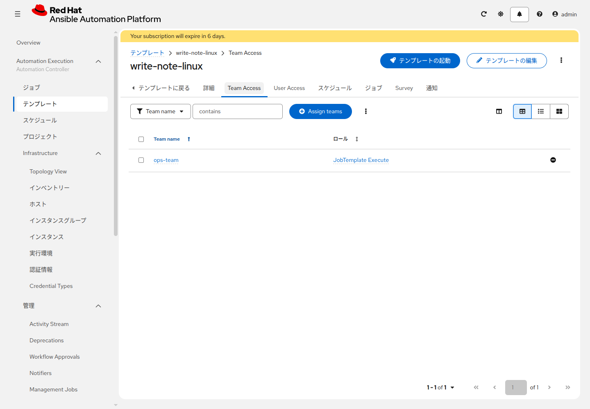
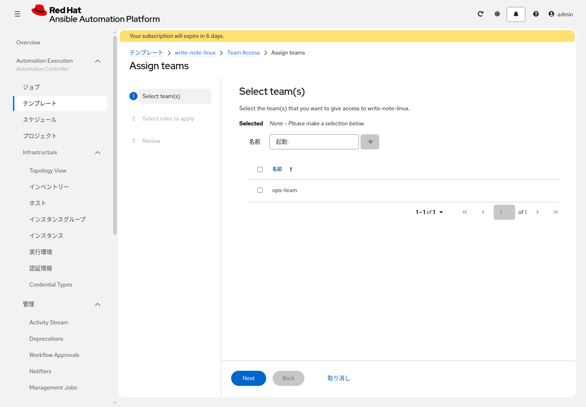
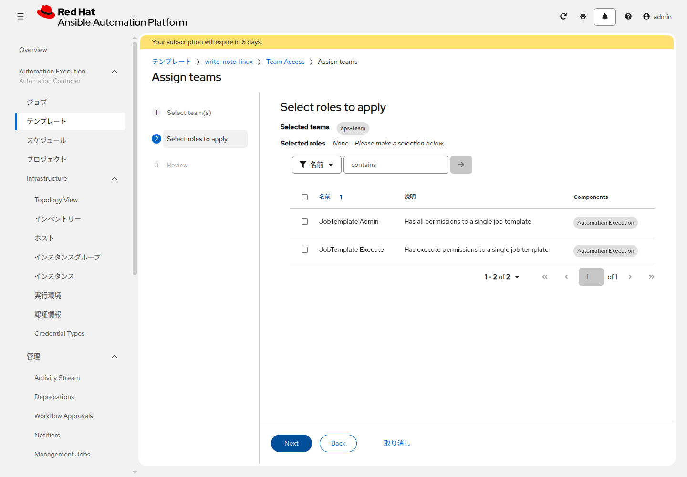
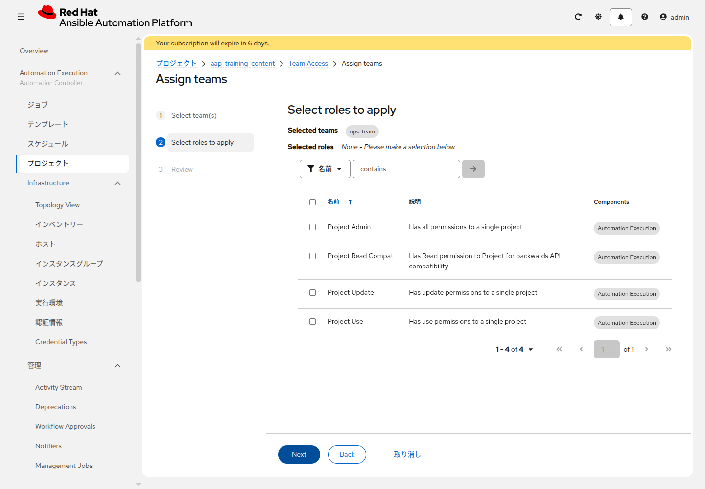
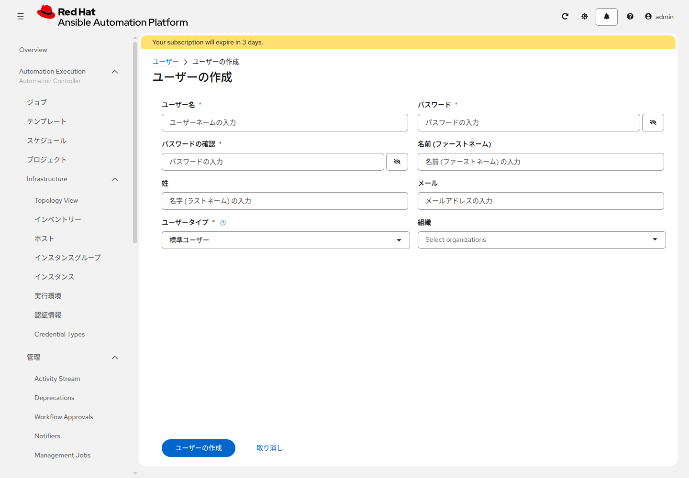

# 応用演習 1 - チームとロール（RBAC）

[演習11](../basic-controller/ex11.md) | [応用演習2へ](./ex2.md)

> **前提:** [演習11](../basic-controller/ex11.md) のワークフロー

この演習では、ジョブを起動できるだけの人と、設定も変更できる人を、チームとロールを使って分けます。

## Section 1: 画面上のロール名

ロールの一覧には、Read や Execute のような短い名前では表示されません。ロール名の前に、付ける対象のオブジェクトの種類の名前が付きます。

| 画面上の名前 | 付ける場所 | できること |
|---|---|---|
| JobTemplate Execute | `<name_prefix>-write-note-linux`、`<name_prefix>-write-note-windows` | 起動できる。編集はできない |
| WorkflowJobTemplate Execute | `<name_prefix>-note-workflow` | ワークフローを起動できる。中のテンプレートは、その人の権限に関係なく動く。承認はできない |
| Project Read Compat、または Project Use | `<name_prefix>-aap-training-content` | プロジェクトを見られる。同期と編集はできない |
| Inventory Read Compat、または Inventory Use | `<name_prefix>-training-inventory` | インベントリーを見られる。ホストの追加や編集はできない |

## Section 2: チームを作る

**Access Management > チーム** でチームを作ります。

| 項目 | 入力値 |
|---|---|
| 名前 | `<name_prefix>-ops-team` |
| 組織 | 演習1の組織 |

## Section 3: 実行権限だけを付ける

`<name_prefix>-write-note-linux` の **Team Access** を開きます。

**Assign teams** をクリックし、`<name_prefix>-ops-team` にチェックを入れて **Next** を押します。

**JobTemplate Execute** にチェックを入れ、**Next**、確認画面で **Finish** を押します。Admin にはチェックを入れません。

`<name_prefix>-write-note-windows` にも **JobTemplate Execute** を付けます。`<name_prefix>-note-workflow` の Team Access でも同じように付けますが、ロール名は **WorkflowJobTemplate Execute** です。

プロジェクト `<name_prefix>-aap-training-content` とインベントリー `<name_prefix>-training-inventory` の Team Access でも、同じ手順でロールを付けます。付けるロールは、ロールを選ぶ画面の一覧に何が表示されるかで、次のように選びます。

| オブジェクト | 一覧に `Read Compat` のロールがある場合 | 一覧に `Read Compat` のロールが無い場合 |
|---|---|---|
| プロジェクト | **Project Read Compat** | **Project Use** |
| インベントリー | **Inventory Read Compat** | **Inventory Use** |

`Read Compat` のロールは、以前の版の形式の権限が使われたときに作られるロールで、AAP の版が同じでも、環境によって一覧に無いことがあります。**Project Use** と **Inventory Use** は、AAP 2.5 以降のどの環境にも最初からあるロールです。**Use** は、ジョブテンプレートでそのプロジェクトやインベントリーを選べる権限で、閲覧の権限も含みます。同期、編集、ホストの追加の権限は含まないので、どちらを付けても Section 5 の確認の結果は同じです。**Admin**、**Update**、**Adhoc** のロールにはチェックを入れません。

JobTemplate Execute だけでは、Playbook や認証情報の変更はできません。

## Section 4: 標準ユーザーを作る

管理者はチームの権限に関係なく編集も同期もできるため、権限の確認は管理者ではないユーザーで行います。

**Access Management > ユーザー** で **ユーザーの作成** をクリックします。

| 項目 | 入力値 |
|---|---|
| ユーザー名 | `<name_prefix>-ops` |
| パスワード | 8文字以上。英大文字、英小文字、数字を含める |
| パスワードの確認 | 上と同じ文字 |
| ユーザータイプ | `標準ユーザー` |
| 組織 | 演習1の組織 |

組織は **Select organizations** を押して選びます。選ぶと、その欄に組織名が出ます。ユーザータイプは `標準ユーザー` のままにします。名前、姓、メールは空欄のまま **ユーザーの作成** を押します。

パスワードが条件に合わないときは、画面に表示される条件に合わせてパスワードを変え、もう一度 **ユーザーの作成** を押します。

`<name_prefix>-ops-team` を開き、**ユーザー** タブの **Assign users** をクリックします。`<name_prefix>-ops` にチェックを入れ、**Assign users** を押します。一覧のユーザータイプは `標準ユーザー` です。候補が無いときは、そのユーザーの組織が演習1の組織になっているかを確認します。

## Section 5: 確認する

右上の自分のユーザー名をクリックし、**ログアウト** を押します。`<name_prefix>-ops` でログインします。Section 3 で付けた権限ごとに、できることとできないことを確認します。

* `<name_prefix>-write-note-linux` の **テンプレートの起動** を押します。演習8と同じ **Prompt on Launch** が開きます。**制限** は空欄、**Survey** は `managed by AAP` のまま **Finish** を押します。ジョブが成功すれば、JobTemplate Execute の権限で起動できています。一方、Execute には編集の権限が含まれないため、**テンプレートの編集** は開けません。
* `<name_prefix>-verify-note-linux` には Execute を付けていないため、テンプレート一覧に表示されません。アドレスを直接開いても「このアクションを実行する権限がありません」と出て、ジョブは始まりません。
* `<name_prefix>-note-workflow` の詳細画面では、起動はできますが、編集はできません。WorkflowJobTemplate Execute に含まれるのは起動の権限だけです。**テンプレートの起動** を押します。`note.txt` を書く2つのジョブが成功したあと、承認ノード `<name_prefix>-note-review` で止まります。WorkflowJobTemplate Execute には承認が含まれないので、`<name_prefix>-ops` では承認できません。承認には **WorkflowJobTemplate Approve** が必要です。承認は、このあと管理者に戻ってから行います。
* プロジェクト `<name_prefix>-aap-training-content` は開けますが、Project Read Compat にも Project Use にも同期の権限は含まれないので、同期ボタンは押せません。
* インベントリー `<name_prefix>-training-inventory` も開けますが、Inventory Read Compat にも Inventory Use にも編集の権限は含まれないので、ホストの追加や変数の保存はできません。

右上の `<name_prefix>-ops` をクリックし、**ログアウト** を押します。管理者でログインし直し、`<name_prefix>-write-note-linux` の **テンプレートの編集** が開くことを確認します。

続けて、**Automation Execution > 管理 > Workflow Approvals** で、`<name_prefix>-ops` が起動したワークフローの `<name_prefix>-note-review` を、演習11と同じ手順で承認します。承認すると確認用テンプレート2つが成功し、ワークフローが成功で終わります。`<name_prefix>-ops` には確認用テンプレートの Execute を付けていませんが、ワークフローの中のテンプレートは、起動した人の権限に関係なく動きます。ワークフローの Execute を付けるときは、中のテンプレートを実行させてよい人かを考えて付けます。

## 次

[応用演習2](./ex2.md) で、失敗を通知します。
