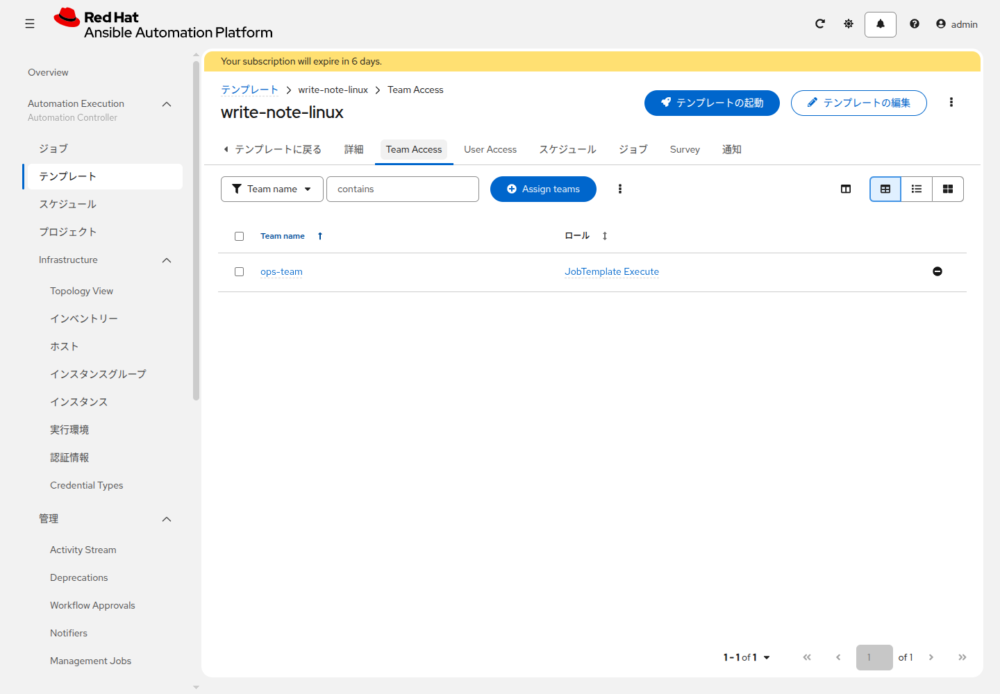
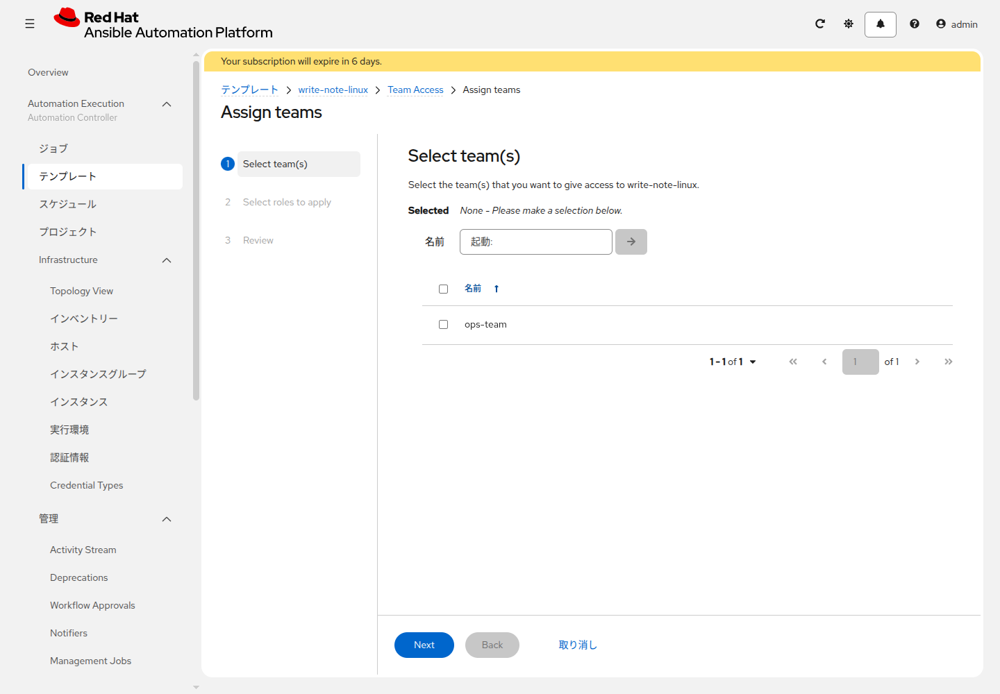
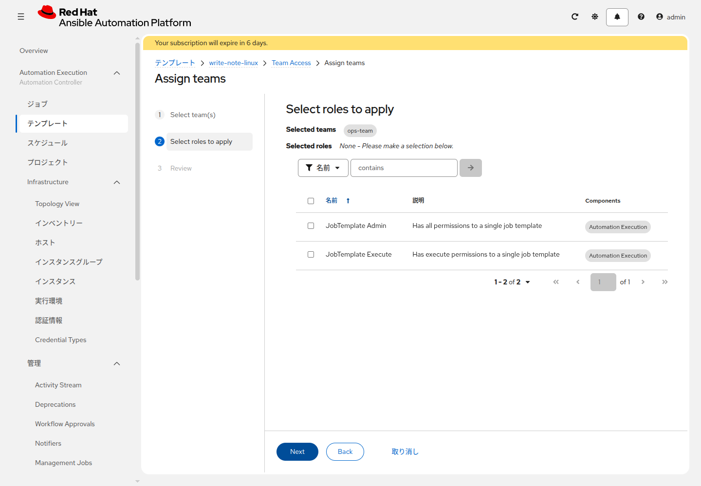
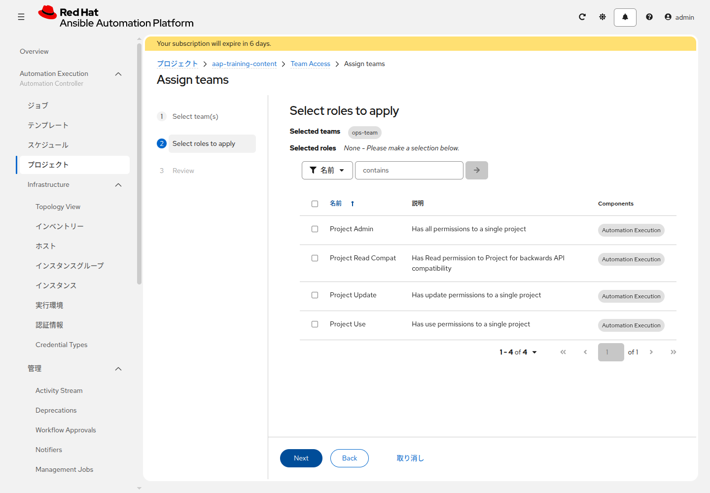

# 応用演習 1 - RBAC

[演習11](../basic-controller/ex11.md) | [応用演習2へ](./ex2.md)

実行だけできるチームと、設定を変えられる人を分けます。

## Section 1: 画面上のロール名

一覧に Read や Execute という短い名前はありません。付けるオブジェクトの名前が前に付きます。

| 画面上の名前 | 付ける場所 | できること |
|---|---|---|
| JobTemplate Execute | `<name_prefix>-write-note-linux`、`<name_prefix>-write-note-windows` | 起動できる。編集はできない |
| WorkflowJobTemplate Execute | `<name_prefix>-note-workflow` | ワークフローを起動できる |
| Project Read Compat | `<name_prefix>-aap-training-content` | プロジェクトを見られる |
| Inventory Read Compat | `<name_prefix>-training-inventory` | インベントリーを見られる |

## Section 2: チームを作る

**Access Management > チーム** でチームを作ります。

| 項目 | 入力値 |
|---|---|
| 名前 | `<name_prefix>-ops-team` |
| 組織 | 演習1の組織 |

## Section 3: 実行権限だけを付ける

`<name_prefix>-write-note-linux` の **Team Access** を開きます。

**Assign teams** をクリックし、`<name_prefix>-ops-team` にチェックを入れて **Next** を押します。

**JobTemplate Execute** にチェックを入れ、**Next**、確認画面で **Finish** を押します。Admin にはチェックを入れません。

`<name_prefix>-write-note-windows` にも **JobTemplate Execute** を付けます。`<name_prefix>-note-workflow` の Team Access では、名前が **WorkflowJobTemplate Execute** です。

プロジェクト `<name_prefix>-aap-training-content` の Team Access では **Project Read Compat** を付けます。インベントリー `<name_prefix>-training-inventory` では **Inventory Read Compat** です。

JobTemplate Execute だけでは、Playbook や認証情報の変更はできません。

## Section 4: 標準ユーザーを作る

確認は、管理者ではないユーザーで行います。管理者は、チームの権限に関係なく編集も同期もできます。

**Access Management > ユーザー** で **ユーザーの作成** をクリックします。

| 項目 | 入力値 |
|---|---|
| ユーザー名 | `<name_prefix>-ops` |
| パスワード | 8文字以上。英大文字、英小文字、数字を含める |
| パスワードの確認 | 上と同じ文字 |
| ユーザータイプ | `標準ユーザー` |
| 組織 | 演習1の組織 |

組織は **Select organizations** を押して選びます。選ぶと、その欄に組織名が出ます。ユーザータイプは `標準ユーザー` のままにします。名前、姓、メールは空欄のまま **ユーザーの作成** を押します。

パスワードが条件に合わないときは、画面の文に合わせて変えて、もう一度 **ユーザーの作成** を押します。

`<name_prefix>-ops-team` を開き、**ユーザー** タブの **Assign users** をクリックします。`<name_prefix>-ops` にチェックを入れ、**Assign users** を押します。一覧のユーザータイプは `標準ユーザー` です。候補が無いときは、そのユーザーの組織が演習1の組織になっているかを確認します。

## Section 5: 確認する

右上の自分のユーザー名をクリックし、**ログアウト** を押します。`<name_prefix>-ops` でログインします。見るのは、Section 3 で付けた権限ごとに、できることとできないことです。

* `<name_prefix>-write-note-linux` の **テンプレートの起動** を押します。演習8と同じ **Prompt on Launch** が開きます。**制限** は空欄、**Survey** は `managed by AAP` のまま **Finish** を押します。ジョブが成功すれば、JobTemplate Execute で起動できています。**テンプレートの編集** は開けません。Execute に編集は含まれません。
* テンプレート一覧に `<name_prefix>-verify-note-linux` は出ません。Execute を付けていないためです。アドレスを直接開いても「このアクションを実行する権限がありません」と出て、ジョブは始まりません。
* `<name_prefix>-note-workflow` の詳細では、起動ができて、編集はできません。WorkflowJobTemplate Execute は起動だけで、編集は含みません。起動は押さないでください。押すと、書くジョブのあと、Execute を付けていない確認用テンプレートで失敗します。
* プロジェクト `<name_prefix>-aap-training-content` を開きます。同期ボタンは押せません。Project Read Compat は閲覧です。
* インベントリー `<name_prefix>-training-inventory` は開けます。ホストの追加や、変数の保存はできません。Inventory Read Compat は閲覧です。

右上の `<name_prefix>-ops` をクリックし、**ログアウト** を押します。管理者でログインし直し、`<name_prefix>-write-note-linux` の **テンプレートの編集** が開くことを確認します。

## 次

[応用演習2](./ex2.md) で、失敗を通知します。
