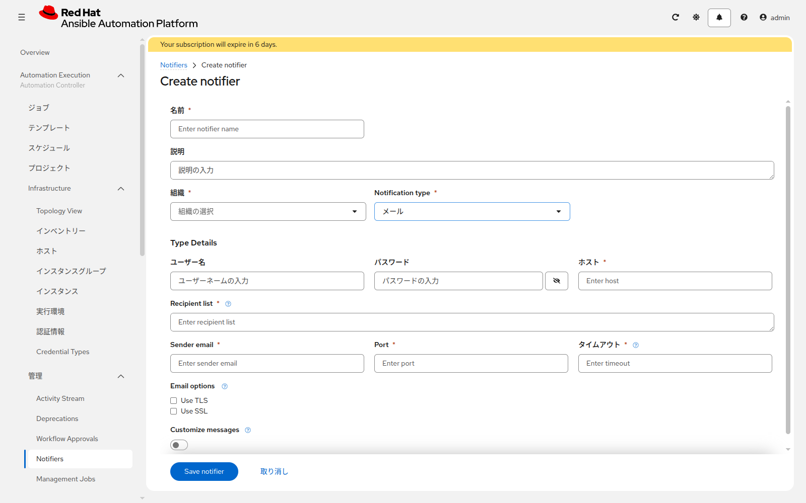

# 応用演習 2 - 通知

[応用演習1](./ex1.md) | [応用演習3へ](./ex3.md)

> **前提:** [演習8](../basic-controller/ex8.md) の制限の起動プロンプトと Survey。AWS で作った場合は [演習4](../basic-intro/ex4.md)

ジョブが失敗したときに、メールで知らせる Notifier を作ります。通知の送信に使う SMTP サーバは、対象サーバの用意の仕方で違います。

| 自分の状況 | メールを送るサーバ | 確認方法 |
|---|---|---|
| 既存サーバを使用 | 環境内の SMTP サーバ | 受信箱に届いたメール |
| AWS でサーバを作った | `lin1` に入れる検証用のメールサーバ Mailpit | Mailpit が受け取ったメールの件名を、ジョブの出力で見る |

既存サーバを使用する場合は、[事前準備](../prepare_training_environment.md) で控えたホスト名、ポート、差出人アドレスを使います。Section 1 は飛ばして Section 2 へ進みます。環境内に SMTP サーバが無く、事前準備で控えられなかった場合は、この演習を飛ばして [応用演習3](./ex3.md) へ進みます。

## Section 1: 検証用のメールサーバを入れる（AWS でサーバを作った場合）

Mailpit は、受け取ったメールを保存して見せるだけの SMTP サーバです。外へはメールを送りません。宛先は実在しないアドレスで構いません。メールは `lin1` の中にだけ置かれ、[演習4](../basic-intro/ex4.md) の Section 5 でサーバを消すと一緒に消えます。演習4で作ったセキュリティグループは、Mailpit が受ける TCP 1025 を許可しています。

Web IDE で、[sample-content/setup_mailpit.yml](../sample-content/setup_mailpit.yml) と [sample-content/show_mailpit_messages.yml](../sample-content/show_mailpit_messages.yml) をプロジェクトの直下に置きます。**Commit to main** のあと、AAP のプロジェクトを同期します。

**ジョブテンプレートの作成** で、次の2つを作ります。表に無い欄は空欄です。

| 項目 | Mailpit を入れる | 届いたメールを見る |
|---|---|---|
| 名前 | `<name_prefix>-setup-mailpit` | `<name_prefix>-show-mailpit` |
| インベントリー | `<name_prefix>-training-inventory` | `<name_prefix>-training-inventory` |
| プロジェクト | `<name_prefix>-aap-training-content` | `<name_prefix>-aap-training-content` |
| Playbook | `setup_mailpit.yml` | `show_mailpit_messages.yml` |
| 実行環境 | 空欄 | 空欄 |
| 認証情報 | `<name_prefix>-linux-ssh` | `<name_prefix>-linux-ssh` |

`<name_prefix>-setup-mailpit` を起動します。Mailpit は GitHub から取得し、sudo で入れます。成功すると、出力の最後の `Show the values for the notifier` に、Section 2 で入れるホストとポートが出ます。

```
ホスト: 203.0.113.10
Port: 1025
```

`203.0.113.10` は例です。自分の `lin1` のアドレスが出ます。`Download Mailpit` で失敗したときは、`lin1` からインターネットへ出られるかを確認します。

## Section 2: Notifierを作る

**Automation Execution > 管理 > Notifiers** を開き、**Create notifier** をクリックします。



| 項目 | 既存サーバを使用 | AWS でサーバを作った |
|---|---|---|
| 名前 | `<name_prefix>-note-mail` | `<name_prefix>-note-mail` |
| 組織 | 演習1の組織 | 演習1の組織 |
| Notification type | `メール` | `メール` |
| ホスト | 環境内の SMTP サーバ | Section 1 の出力の「ホスト」（`lin1` のアドレス） |
| Recipient list | 自分が見られるアドレスを1つ | `<name_prefix>@verify.test`（実在しないアドレスでよい） |
| Sender email | 配布された差出人アドレス | `aap@verify.test` |
| Port | 配布されたポート（指定が無ければ `25`） | `1025` |
| タイムアウト | `30` | `30` |
| ユーザー名 / パスワード | SMTP 認証が必要なときだけ | 空欄 |
| Use TLS | 配布された指定に合わせる | チェックを入れない |

`verify.test` の `.test` は、テスト用に予約されていて、実在しないドメインです。**Save notifier** で保存します。

## Section 3: 失敗させて、メールを受け取る

`<name_prefix>-write-note-linux` の **通知** タブで、`<name_prefix>-note-mail` を **失敗時** に付けます。

失敗を確認するため、Machine 認証情報をもう1つ作ります。名前は `<name_prefix>-linux-ssh-wrong`、認証情報タイプは `Machine`、ユーザ名は `<name_prefix>-linux-ssh` と同じ、パスワードはそれと違う英数字（例: `WrongPassword1`）です。**Privilege Escalation Method** は空欄です。

`<name_prefix>-write-note-linux` の編集で、認証情報の `<name_prefix>-linux-ssh` を外し、`<name_prefix>-linux-ssh-wrong` を付けます。`<name_prefix>-vault-training` を付けている場合は、付けたままにします。保存して起動します。**Prompts** の **制限** は空欄、**Survey** は `managed by AAP` のまま **Finish** を押します。ジョブは失敗します。

メールが届いたかを確かめます。

* 既存サーバを使用: 受信箱に、件名が `Job #<番号> '<name_prefix>-write-note-linux' failed` で始まるメールが届きます。数分遅れることがあります。届かないときは、迷惑メールのフォルダも確認します。
* AWS でサーバを作った: `<name_prefix>-show-mailpit` を起動します。出力の `Show the received messages` に、次のような行が出ます。

```
件名: Job #545 'sample01-write-note-linux' failed: https://... / 宛先: sample01@verify.test
```

`545` と `sample01` は例です。失敗したジョブの番号と、自分の接頭辞が出ます。`At least one message has arrived` で失敗したときは、まだメールが届いていません。

メールが届かないときは、**Notifiers** の一覧で `<name_prefix>-note-mail` を開き、ホスト、ポート、差出人アドレスを見直します。`<name_prefix>-write-note-linux` の **通知** タブで、**失敗時** が付いているかも確認します。

確認が終わったら、編集で `<name_prefix>-linux-ssh-wrong` を外し、`<name_prefix>-linux-ssh` を付け直して保存します。もう一度起動し、**制限** は空欄、**Survey** は `managed by AAP` のまま **Finish** を押します。ジョブが成功すれば、認証情報は戻っています。成功したジョブでは、失敗時の Notifier からメールは届きません。

## 次

実行環境を1つ作る場合は [応用演習3](./ex3.md) へ進みます。既定のままでよければ [応用演習4](./ex4.md) へ進みます。
