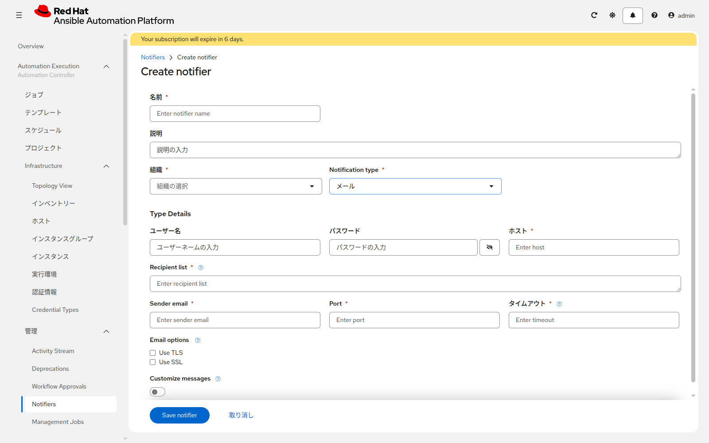

# 応用演習 2 - 通知

[応用演習1](./ex1.md) | [応用演習3へ](./ex3.md)

ジョブの結果を、自分の環境にある受け口へ送ります。やる節はどちらか一方です。

| 自分の状況 | 実施する節 | 確認方法 |
|---|---|---|
| サーバがすでにある | Section 1。環境内のメールサーバ | 受信したメール |
| AWS でサーバを作った | Section 2。S3 | 同じジョブのログに出る本文 |

## Section 1: メール（サーバがすでにある場合）

**Automation Execution > 管理 > Notifiers** を開きます。一覧が空のときは **Create notifier** をクリックします。



| 項目 | 入力値 |
|---|---|
| 名前 | `note-mail` |
| 組織 | 演習1の組織 |
| Notification type | `メール` |
| ホスト | 環境内の SMTP サーバ |
| Recipient list | 自分が見られるアドレスを1つ |
| Sender email | 配布された差出人アドレス |
| Port | 配布されたポート。無指定なら `25` |
| ユーザー名 / パスワード | SMTP 認証が必要なときだけ |

**Save notifier** で保存します。

`write-note-linux` の **通知** タブで、`note-mail` を **失敗時** に付けます。起動時の認証情報を、一時的にパスワード違いの Machine 認証情報へ変えるか、制限に存在しないホスト名 `lin-missing` を入れて起動し、ジョブを失敗させます。受信箱に失敗のメールが届くことを確認します。

確認が終わったら、認証情報と制限を元に戻し、成功することも確認します。

AWS で作った場合は、この Section は飛ばします。

## Section 2: S3（AWSで作った場合）

Playbook が S3 に1行書き、同じジョブがそれを読み、ログに表示します。

Web IDE で `notify_aws.yml` がプロジェクトにあることを確認し、同期します。ジョブテンプレートを作ります。

| 項目 | 入力値 |
|---|---|
| 名前 | `notify-aws` |
| インベントリー | `aws-runner` |
| プロジェクト | `aap-training-content` |
| Playbook | `notify_aws.yml` |
| 実行環境 | 空欄 |
| 認証情報 | `aws-training` |
| Extra variables | `resource_prefix: <演習4で使った値>` |

起動します。成功すると、ログの最後に次の3行が出ます。`contents` は `notification from AAP` です。

```
bucket: <resource_prefix>-aap-notify-<アカウントID>
object: notification.txt
contents: notification from AAP
```

この3行が見えれば、通知先へ書いた内容を、別の画面を開かずに確認できています。

編集画面の **Extra variables** に、`resource_prefix` の行を残したまま `notify_message: note failed` を足して保存し、もう一度起動します。起動画面にはこの欄は出ません。`contents` が `note failed` になることを確認したら、足した行だけを消すか、`notification from AAP` に戻して保存します。

## 次

[応用演習3](./ex3.md) で、ジョブが動いている実行環境を確認します。
