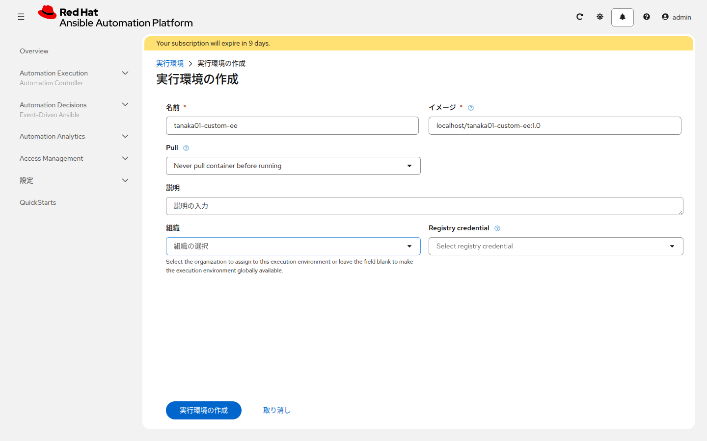

# 応用演習 3 - カスタム実行環境

[応用演習2](./ex2.md) | [応用演習4へ](./ex4.md)

> **前提:** [演習3](../basic-intro/ex3.md) のインベントリー、[演習5](../basic-controller/ex5.md) のプロジェクト。[事前準備](../prepare_training_environment.md) で控えた、AAP のコンテナを動かしているユーザーで AAP サーバへ SSH できること

実行環境については [AAPのしくみ](../aap_overview.md) で説明しています。ジョブテンプレートの実行環境の欄が空欄のときは、システムの既定の実行環境でジョブが動き、使われた実行環境の名前がジョブの詳細画面に表示されます。この演習では、既定の実行環境にコレクションを足したイメージを1つ作ってジョブテンプレートに付け、ジョブの詳細画面に表示される名前が変わることを確認します。確認が終わったら、実行環境の欄は空欄に戻します。

AAP は、ジョブを起動するたびに、ジョブを動かすサーバの `podman` を使って、実行環境のイメージからコンテナを起動します。この演習では、AAP のコンテナを動かしているユーザーで AAP サーバに SSH し、そのサーバ上でイメージをビルドします。ビルドしたイメージはそのサーバの `podman` に保存されるため、AAP からそのまま使えます。定義ファイルは、そのサーバの `/tmp/<name_prefix>-custom-ee` に置きます。なお、実際の運用では、ビルドしたイメージをコンテナレジストリに置き、AAP はそこからイメージを取得します。

> [!IMPORTANT]
> **次のどれかに当てはまる場合は、この演習を飛ばして [応用演習4](./ex4.md) へ進みます。** 実行環境は既定のままで、以降の演習を進められます。
>
> * [事前準備](../prepare_training_environment.md) で、AAP サーバへ SSH するユーザーを控えていない
> * AAP サーバから `registry.redhat.io` と Ansible Galaxy へ接続できない
> * AAP サーバで `podman` が無い、または `ansible-builder` を入れられない
> * ジョブを動かすサーバ（実行ノード）が、AAP サーバのほかにもある。そのサーバにはイメージが無いので、ジョブが `image not known` で失敗することがある

## Section 1: サーバでツールを確認する

事前準備で控えたユーザーで、AAP サーバへ SSH します。

```bash
ssh <ユーザー>@<AAPサーバ>
cd /tmp
podman ps --format '{{.Names}}'
podman --version
ansible-builder --version
```

`podman ps` の一覧に、名前に `controller` を含むコンテナが出ることを確認します。出ないときは、AAP のコンテナを動かしているユーザーでログインしていないので、事前準備で控えたユーザーで入り直します。そのユーザーでも出ないときは、この演習を飛ばして [応用演習4](./ex4.md) へ進みます。

`podman --version` が失敗したときは、この演習を飛ばして [応用演習4](./ex4.md) へ進みます。

`ansible-builder --version` が失敗したときは、次のコマンドで AAP サーバ（ホスト）に `ansible-builder` を入れます。ビルドはこのホスト上で行うため、controller のコンテナの中に `ansible-builder` があっても使えません。

```bash
python3 -m pip install --user 'ansible-builder>=3,<4'
export PATH="$HOME/.local/bin:$PATH"
ansible-builder --version
```

このインストールが失敗したときも、この演習を飛ばして [応用演習4](./ex4.md) へ進みます。

## Section 2: 定義ファイルを作る

`/tmp/<name_prefix>-custom-ee` を作り、その中に定義ファイルを置きます。

```bash
mkdir -p '/tmp/<name_prefix>-custom-ee' && cd '/tmp/<name_prefix>-custom-ee'
```

次の3つのファイルを、この作業ディレクトリに作ります。サーバ上のエディター（`vi` など）で作るか、`cat > requirements.yml <<'EOF'` と入力してから内容を貼り付け、最後の行に `EOF` と入力して作ります。

`requirements.yml`:

```yaml
---
collections:
  - name: community.general
    version: "8.6.1"
```

`pkgmgr`:

```bash
#!/bin/bash
cmd=()
for arg in "$@"; do
  case "$arg" in
    python|python-*|python3|python3-*|dnf|dnf-*) ;;
    *) cmd+=("$arg") ;;
  esac
done
if printf '%s\n' "${cmd[@]}" | grep -qx install; then
  has_pkg=0
  for arg in "${cmd[@]}"; do
    case "$arg" in
      -*|install|clean|makecache|update|remove) ;;
      *) has_pkg=1 ;;
    esac
  done
  if [ "$has_pkg" -eq 0 ]; then
    exit 0
  fi
fi
exec /usr/bin/microdnf "${cmd[@]}"
```

```bash
chmod 755 pkgmgr
```

`execution-environment.yml`:

```yaml
---
version: 3

images:
  base_image:
    name: registry.redhat.io/ansible-automation-platform-27/ee-supported-rhel9:latest

dependencies:
  galaxy: requirements.yml

additional_build_files:
  - src: pkgmgr
    dest: scripts

additional_build_steps:
  prepend_base:
    - COPY _build/scripts/pkgmgr /usr/local/bin/pkgmgr
    - RUN chmod 755 /usr/local/bin/pkgmgr
    - ENV PKGMGR=/usr/local/bin/pkgmgr
  prepend_builder:
    - ENV PKGMGR=/usr/local/bin/pkgmgr
  prepend_final:
    - ENV PKGMGR=/usr/local/bin/pkgmgr

options:
  package_manager_path: /usr/local/bin/pkgmgr
  skip_pip_install: true
```

`base_image` には、AAP 2.7 の既定の実行環境と同じイメージを指定しています。**Automation Execution > Infrastructure > 実行環境** で `Default execution environment` を開き、**イメージ** の値がこれと違うときは、その値に置き換えます。既定と同じイメージをベースにすると、Ansible と、既定の実行環境に入っているコレクションの版が、既定とそろいます。

<details>
<summary>pkgmgr が要る理由</summary>

ベースイメージには `ee-supported` を使います。このイメージは、パッケージ管理に `microdnf` を使い、Python は 3.12 です。一方、`ansible-builder` は既定で `/usr/bin/dnf` を呼び出します。`dnf` のパッケージを入れるとこの Python が置き換わり、ビルドが `pip` の段階で止まってしまいます。そこで `pkgmgr` は、`microdnf` を呼び出し、`python` と `dnf` のパッケージ名は渡さないようにしています。`pip` はベースイメージに入っているので、入れ直しません。なお、`ee-minimal` をベースにすると、既定のイメージに入っている `ansible.windows` や `amazon.aws` が欠けることがあります。`amazon.aws` をこのファイルに足す場合も、版は `10.3.0` にします。

</details>

`latest` のタグのままだと、ビルドのたびにイメージの中身が変わることがあります。そのため、実際の運用では、`base_image` のタグを版を表すタグに固定します。

## Section 3: ビルドする

ベースイメージを取得するため、`registry.redhat.io` にログインします。ユーザー名とパスワードは、事前準備で控えたものを使います。パスワードはコマンドの引数には書かず、入力しても画面に表示されない入力欄に入れます。

```bash
podman login registry.redhat.io
```

`Login Succeeded!` と出たら、ログインできています。AAP のインストール時にログインしてあるサーバでは、ユーザー名を聞かれずに `Existing credentials are valid. Already logged in to registry.redhat.io` と出ます。どちらの場合も、続けて AAP が使っているイメージの保存先を確認します。

```bash
cd '/tmp/<name_prefix>-custom-ee'
export PATH="$HOME/.local/bin:$PATH"
systemctl --user show podman.service -p Environment
```

`CONTAINERS_STORAGE_CONF=` のあとにパスが表示されたときは、そのパスを `<storage.conf>` に入れて、次のコマンドをビルドの前に実行します。パスが表示されないときは、このコマンドは実行しません。AAP とイメージの保存先が違うと、イメージはできてもジョブが `image not known` で失敗します。

```bash
export CONTAINERS_STORAGE_CONF=<storage.conf>
```

```bash
cd '/tmp/<name_prefix>-custom-ee'
export PATH="$HOME/.local/bin:$PATH"
ansible-builder build \
    -f execution-environment.yml \
    -t '<name_prefix>-custom-ee:1.0' \
    --container-runtime podman
podman images | grep '<name_prefix>-custom-ee'
```

ビルドが終わるまで数分かかります。

## Section 4: AAPへ登録する

**Automation Execution > Infrastructure > 実行環境** の作成画面で、次を入れて保存します。

| 項目 | 入力値 |
|---|---|
| 名前 | `<name_prefix>-custom-ee` |
| イメージ | `localhost/<name_prefix>-custom-ee:1.0` |
| Pull | `Never pull container before running` |



写真の `sample01` は例です。組織と Registry credential は空欄のまま **実行環境の作成** を押します。

`localhost/` で始まるイメージ名は、レジストリではなく、そのサーバの `podman` にあるイメージを指します。Pull を `Never pull container before running` にすると、AAP はレジストリへ取りに行かず、手元のイメージをそのまま使います。

イメージをレジストリに置く場合は、`podman push` でイメージをレジストリに送り、認証情報タイプ `Container Registry` の認証情報を作ります。実行環境の **イメージ** はレジストリのイメージ名、Pull は `Always pull container before running`、**Registry credential** はその認証情報にします。

## Section 5: 既定の実行環境で失敗し、カスタム実行環境で成功する

既定の実行環境には `community.general` が入っていません。まず既定の実行環境のままジョブが失敗することを確認し、そのあと Section 4 で登録した実行環境に切り替えます。

Web IDE で `use_ini_file.yml` をプロジェクトの直下に作り、[sample-content/use_ini_file.yml](../sample-content/use_ini_file.yml) の内容を貼ります。**Commit to main** のあと、AAP のプロジェクトを同期します。

**ジョブテンプレートの作成** で、次を作ります。表に無い欄は空欄のままにします。実行環境も空欄にします。

| 項目 | 入力値 |
|---|---|
| 名前 | `<name_prefix>-use-ini` |
| インベントリー | `<name_prefix>-training-inventory` |
| プロジェクト | `<name_prefix>-aap-training-content` |
| Playbook | `use_ini_file.yml` |
| 実行環境 | 空欄 |
| 認証情報 | 空欄 |
| Extra variables | 下の1行 |

```yaml
name_prefix: sample01
```

`sample01` は自分の接頭辞に置き換えます。この Playbook は `hosts: localhost` を対象にしていて、実行環境の中だけで動きます。サーバにはログインしないため、認証情報は付けません。**テンプレートの起動** を押します。Survey や制限の入力画面は出ません。

1回目は失敗します。出力に `community.general.ini_file` があり、`couldn't resolve module` または `was not found` と出ていれば、既定の実行環境にこのコレクションが無いことを確認できています。

失敗を確認したら、このテンプレートの **テンプレートの編集** で、実行環境に `<name_prefix>-custom-ee` を選んで保存します。もう一度起動します。成功すると、`Show the value written with community.general` に次の行が出ます。`sample01` の位置には、自分の接頭辞が出ます。

```
sample01-use-ini.ini の source は custom ee です
```

ジョブ詳細の実行環境が `<name_prefix>-custom-ee` になっていることも確認します。ジョブが `image not known` で失敗したときは、Section 3 の `CONTAINERS_STORAGE_CONF` を設定して、ビルドからやり直します。

確認が終わったら、`<name_prefix>-use-ini` の実行環境を空欄に戻します。

## 次

[応用演習4](./ex4.md)
