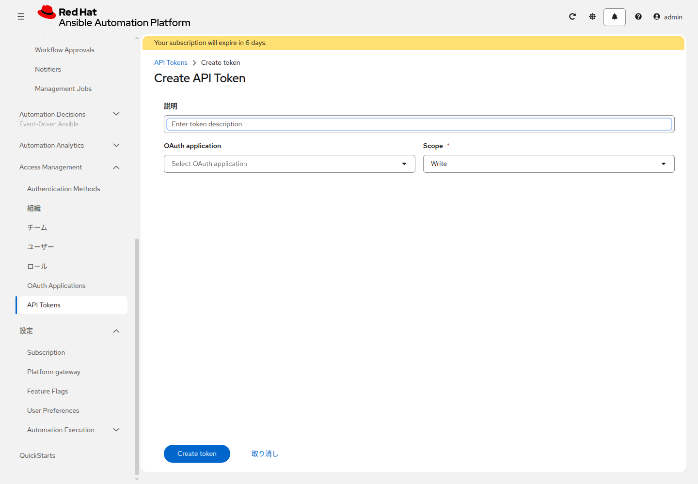

# 応用演習 4 - REST API

[応用演習3](./ex3.md) | [応用演習5へ](./ex5.md)

画面の起動を、API からも行います。ここで発行するのは AAP の API トークンです。GitLab のパスワードとは別です。

## Section 1: APIの場所

```bash
curl -sk https://<AAPのURL>/api/ | python3 -m json.tool
```

この資料の例は `https://<AAPのURL>/api/controller/v2` です。`/api/v2/` は、ゲートウェイ構成では 404 になります。以降、このベースを `AAP_API_ROOT` と書きます。

## Section 2: トークン

**Access Management > API Tokens** を開き、**Create API token** をクリックします。



| 項目 | 入力値 |
|---|---|
| 説明 | 空欄で構いません |
| OAuth application | 空欄 |
| Scope | `Write` |

**Create token** を押すと、文字列が1度だけ表示されます。再表示できないので、その場で控えます。この資料の写真には、その文字列は写していません。控えたあと、画面を閉じます。

```bash
export AAP_TOKEN="<控えたトークン>"
export AAP_API_ROOT="https://<AAPのURL>/api/controller/v2"
```

## Section 3: テンプレートのIDを見る

```bash
curl -sk -H "Authorization: Bearer ${AAP_TOKEN}" \
    "${AAP_API_ROOT}/job_templates/?name=<name_prefix>-write-note-linux" | python3 -m json.tool
```

`results` の `id` を控えます。以降の `7` は、その数字に置き換えます。

## Section 4: 起動する

```bash
curl -sk -X POST \
    -H "Authorization: Bearer ${AAP_TOKEN}" \
    -H "Content-Type: application/json" \
    -d '{"extra_vars": {"training_note": "from api"}, "limit": "lin1"}' \
    "${AAP_API_ROOT}/job_templates/7/launch/" | python3 -m json.tool
```

応答の `job` がジョブ ID です。

```bash
curl -sk -H "Authorization: Bearer ${AAP_TOKEN}" \
    "${AAP_API_ROOT}/jobs/<ジョブID>/" | python3 -m json.tool
```

`status` が `successful` になるまで、同じコマンドを繰り返します。ジョブ出力の `Show the note written to note.txt` に `note.txt の note は from api です` と出れば、API からの Extra variables が届いています。

確認後、Survey から `managed by AAP` を入れて `<name_prefix>-write-note-linux` を一度起動し、メモを戻します。

## 次

[応用演習5](./ex5.md)
