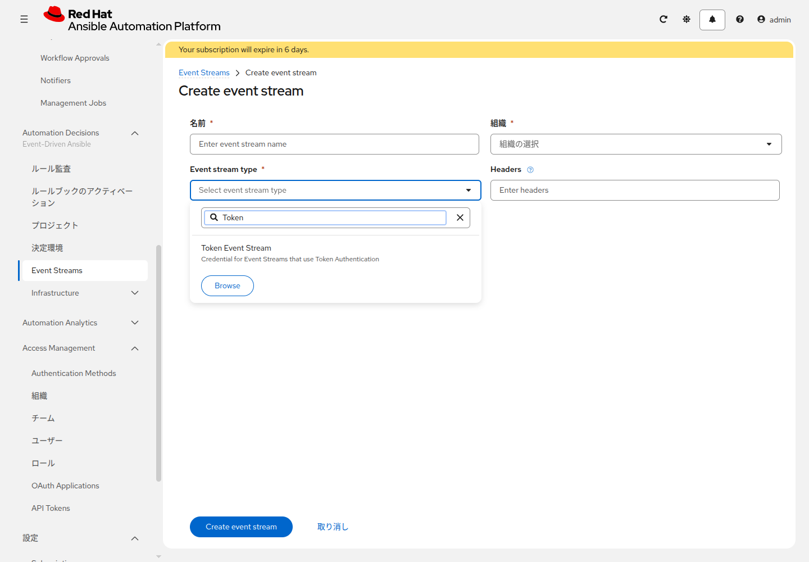

# 応用演習 7 - EDA入門

[応用演習6](./ex6.md) | [応用演習8へ](./ex8.md)

これまでのジョブは、人が起動するか、スケジュールで起動するか、ジョブテンプレートの Webhook で起動するものでした。EDA は、受け取ったイベントの内容に応じて処理を始めます。AAP 2.5 以降の受け口は Event Stream です。Rulebook の `sources` には、Event Stream と同じ名前だけを書きます。

| 用語 | 役割 |
|---|---|
| Rulebook | イベントの条件と、条件に対する処理を書いた YAML |
| Decision Environment | Rulebook を動かすコンテナイメージ |
| Event Stream | Webhook を受ける URL |
| Rulebook Activation | Rulebook を動かし続ける設定 |

## Section 1: RulebookをWeb IDEで置く

`<name_prefix>-aap-training-content` の Web IDE で `rulebooks/notify_on_webhook.yml` を作り、次を貼ります。貼る前に `<name_prefix>` を演習1の接頭辞に置き換えます。`sources` の `name` は、このあと作る Event Stream の名前と同じにします。

```yaml
---
- name: Record a webhook
  hosts: all

  sources:
    - name: <name_prefix>-check-webhook-stream

  rules:
    - name: Log every event
      condition: true
      action:
        debug:
          msg: "イベントを受信しました: {{ event.payload }}"
```

**Commit to main** でコミットし、AAP のプロジェクトを同期します。

<details>
<summary>git CLIで行う場合</summary>

```bash
mkdir -p rulebooks
git add rulebooks/notify_on_webhook.yml
git commit -m "Add sample rulebook"
git push
```

</details>

## Section 2: 決定環境

**Automation Decisions > 決定環境** を開き、一覧にある既定の Decision Environment の名前を控えます。この演習では新しくは作りません。

## Section 3: Event Stream

**Automation Decisions > Infrastructure > 認証情報** で、受け口用の認証情報を作ります。タイプは `Token Event Stream` です。一覧の先頭に無いときは、検索欄に `Token Event` と入れます。

| 項目 | 入力値 |
|---|---|
| 名前 | `<name_prefix>-check-webhook-token` |
| Token | 自分で決めた文字列 |
| HTTP Header Key | `Authorization`（最初から入っています） |

Token は再表示されないので、入力した文字列を控えます。

**Automation Decisions > Event Streams** の **Create event stream** で追加します。**Event stream type** を開き、検索欄に `Token` と入れます。先頭の一覧には Token Event Stream がありません。タイプを選ぶと、**認証情報** の欄が出ます。



| 項目 | 入力値 |
|---|---|
| 名前 | `<name_prefix>-check-webhook-stream` |
| 組織 | 演習1で控えた組織 |
| Event stream type | `Token Event Stream` |
| 認証情報 | `<name_prefix>-check-webhook-token` |

保存後の詳細に URL が出ます。控えます。詳細を開けば、URL はあとからでも見られます。

## Section 4: Decisionsのプロジェクト

Decisions 側に `<name_prefix>-aap-training-content` が無い場合は、先にプロジェクトを作ります。URL とブランチは Controller のプロジェクトと同じです。ソースコントロール認証情報は、一覧に `<name_prefix>-gitlab-scm` がすでにある場合はそれを使います。無い場合は **Automation Decisions > Infrastructure > 認証情報** でタイプ `Source Control`、名前 `<name_prefix>-gitlab-scm` を作り、ユーザー名とパスワードは Controller の同じ認証情報と同じにします。その認証情報を、Decisions のプロジェクトに付けます。作ったあとは、そのプロジェクトを同期します。

## Section 5: Controllerへ接続する認証情報

**Automation Decisions > Infrastructure > 認証情報** で、タイプ `Red Hat Ansible Automation Platform` を作ります。

| 項目 | 入力値 |
|---|---|
| 名前 | `<name_prefix>-eda-controller` |
| Red Hat Ansible Automation Platform | `https://<AAPのURL>/api/controller/` |
| OAuth Token | [応用演習4](./ex4.md) で発行した API トークン |

URL の末尾は `/api/controller/` です。このパスが無い URL だと、Activation は `/api/v2/config/` を呼び、ゲートウェイ構成では 404 になって起動直後に止まります。Username と Password は空欄で構いません。

応用演習5の `<name_prefix>-aap-api` は、ホストを `https://<AAPのURL>` だけにしています。Playbook 側で `/api/controller/` を足すためです。こちらの Activation は、入力した URL のうしろに `api/v2/` を足します。

## Section 6: Activation

**Automation Decisions > ルールブックのアクティベーション** で追加します。

| 項目 | 入力値 |
|---|---|
| 名前 | `<name_prefix>-note-webhook-activation` |
| 決定環境 | Section 2 で控えたもの |
| プロジェクト | Decisions の `<name_prefix>-aap-training-content` |
| ルールブック | `rulebooks/notify_on_webhook.yml` |
| 認証情報 | `<name_prefix>-eda-controller` |
| Event streams | `<name_prefix>-check-webhook-stream` |

Event streams を選んだあと、Rulebook のソースを置き換える画面が出たら、`<name_prefix>-check-webhook-stream` を同じ名前の Event Stream に割り当てて保存します。

状態が Running になることを確認します。すぐに失敗して `/api/v2/config/` と出ている場合は、Section 5 の URL を見直してから再起動します。

## Section 7: イベントを送る

```bash
curl -X POST "<Event StreamのURL>" \
    -H "Content-Type: application/json" \
    -H "Authorization: Bearer <Section 3のToken>" \
    -d '{"status":"success","host":"lin1"}'
```

`<name_prefix>-note-webhook-activation` のログに `lin1` が出れば、Event Stream から Rulebook へ届いています。確認するのは、このログです。

ここで終わる場合は、`<name_prefix>-note-webhook-activation` を無効にします。[応用演習8](./ex8.md) へ進む場合は、有効なまま次へ進みます。

## 次

[応用演習8](./ex8.md) で、同じイベントから `<name_prefix>-verify-note-linux` を起動します。
