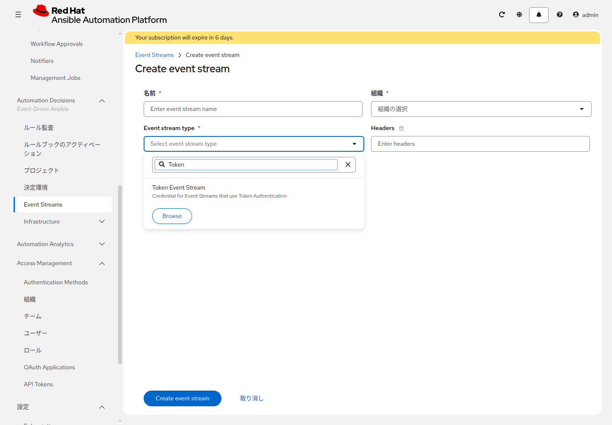

# 応用演習 7 - EDA入門

[応用演習6](./ex6.md) | [応用演習8へ](./ex8.md)

> **前提:** [演習5](../basic-controller/ex5.md) の GitLab のプロジェクト、[応用演習4](./ex4.md) の API トークン

これまでのジョブは、人が起動するか、スケジュールで起動するか、ジョブテンプレートの Webhook で起動するものでした。EDA を使うと、受け取ったイベントの内容に応じて処理を始められます。AAP 2.5 以降では、イベントの受け口として Event Stream を使います。Rulebook の `sources` には、Event Stream と同じ名前と、ソースの種類 `ansible.eda.webhook` を書き、値は `{}` のままにします。Activation で Event Stream を割り当てると、AAP はこのソースを Event Stream に置き換えて動かします。

| 用語 | 役割 |
|---|---|
| Rulebook | イベントの条件と、条件に対する処理を書いた YAML |
| Decision Environment | Rulebook を動かすコンテナイメージ |
| Event Stream | Webhook を受ける URL |
| Rulebook Activation | Rulebook を動かし続ける設定 |

## Section 1: RulebookをWeb IDEで置く

`<name_prefix>-aap-training-content` の Web IDE で `rulebooks/notify_on_webhook.yml` を作り、次の内容を貼り付けます。貼り付ける前に、`<name_prefix>` を演習1の接頭辞に置き換えます。`sources` の `name` は、このあと作る Event Stream の名前と同じにします。`ansible.eda.webhook` の値 `{}` は空のままにします。この行が無いと、AAP はソースを読み取れず、Activation は起動しません。

```yaml
---
- name: Record a webhook
  hosts: all

  sources:
    - name: <name_prefix>-check-webhook-stream
      ansible.eda.webhook: {}

  rules:
    - name: Log every event
      condition: true
      action:
        debug:
          msg: "イベントを受信しました: {{ event.payload }}"
```

**Commit to main** でコミットし、AAP のプロジェクトを同期します。

<details>
<summary>git CLIで行う場合</summary>

```bash
mkdir -p rulebooks
git add rulebooks/notify_on_webhook.yml
git commit -m "Add sample rulebook"
git push
```

</details>

## Section 2: 決定環境の名前を控える

**Automation Decisions > 決定環境** を開き、一覧にある既定の Decision Environment の名前を控えます。この名前は、Section 6 で Activation を作るときに選びます。

## Section 3: Event Streamを作る

**Automation Decisions > Infrastructure > 認証情報** で、Event Stream で使う認証情報を、認証情報タイプ `Token Event Stream` で作ります。タイプの一覧の先頭に無いときは、検索欄に `Token Event` と入れます。

| 項目 | 入力値 |
|---|---|
| 名前 | `<name_prefix>-check-webhook-token` |
| Token | 自分で決めた文字列 |
| HTTP Header Key | `Authorization`（最初から入っています） |

Token は再表示されないので、入力した文字列を控えます。

**Automation Decisions > Event Streams** の **Create event stream** で Event Stream を追加します。Token Event Stream は **Event stream type** の一覧の先頭には無いため、一覧を開いて検索欄に `Token` と入れます。タイプを選ぶと、**認証情報** の欄が表示されます。



| 項目 | 入力値 |
|---|---|
| 名前 | `<name_prefix>-check-webhook-stream` |
| 組織 | 演習1で控えた組織 |
| Event stream type | `Token Event Stream` |
| 認証情報 | `<name_prefix>-check-webhook-token` |

保存すると詳細画面に URL が表示されるので、控えます。URL は、あとから詳細画面を開いても確認できます。

## Section 4: Decisionsのプロジェクトを用意する

Automation Decisions 側にプロジェクト `<name_prefix>-aap-training-content` が無い場合は、先に作ります。URL とブランチは、Automation Execution のプロジェクトと同じにします。ソースコントロール認証情報は、一覧に `<name_prefix>-gitlab-scm` がすでにあればそれを使います。無い場合は、**Automation Decisions > Infrastructure > 認証情報** で認証情報タイプ `Source Control`、名前 `<name_prefix>-gitlab-scm` の認証情報を作り、ユーザー名とパスワードは Automation Execution の同名の認証情報と同じにします。その認証情報を Decisions のプロジェクトに付け、プロジェクトを作ったら同期します。

## Section 5: Automation Execution へ接続する認証情報

**Automation Decisions > Infrastructure > 認証情報** で、認証情報タイプ `Red Hat Ansible Automation Platform` の認証情報を作ります。

| 項目 | 入力値 |
|---|---|
| 名前 | `<name_prefix>-eda-controller` |
| Red Hat Ansible Automation Platform | `https://<AAPのURL>/api/controller/` |
| OAuth Token | [応用演習4](./ex4.md) で発行した API トークン |

URL の末尾には `/api/controller/` を付けます。このパスが無いと、Activation は `/api/v2/config/` を呼び出し、ゲートウェイ構成では 404 になって起動直後に止まります。Username と Password は空欄で構いません。

同じタイプ `Red Hat Ansible Automation Platform` の認証情報でも、使う側によって URL の書き方が違います。

| 認証情報 | 使う側 | URL | `/api/controller/` を足すところ |
|---|---|---|---|
| `<name_prefix>-aap-api`（応用演習5） | Playbook の `ansible.controller` | `https://<AAPのURL>` | Playbook の `CONTROLLER_OPTIONAL_API_URLPATTERN_PREFIX` |
| `<name_prefix>-eda-controller`（この演習） | Rulebook Activation | `https://<AAPのURL>/api/controller/` | 認証情報の URL。Activation はこのうしろに `api/v2/` を足す |

## Section 6: Activationを作る

**Automation Decisions > ルールブックのアクティベーション** で追加します。

| 項目 | 入力値 |
|---|---|
| 名前 | `<name_prefix>-note-webhook-activation` |
| 組織 | 演習1で控えた組織 |
| 決定環境 | Section 2 で控えたもの |
| プロジェクト | Decisions の `<name_prefix>-aap-training-content` |
| ルールブック | `notify_on_webhook.yml`（`rulebooks/` は付かずに表示されます） |
| 認証情報 | `<name_prefix>-eda-controller` |
| Event streams | `<name_prefix>-check-webhook-stream` |

**Event streams** の欄の右にあるボタンを押すと、**Event streams** の画面が開きます。**Mapping 1** の **Rulebook source** には、ルールブックのソース名 `<name_prefix>-check-webhook-stream` が入っています。**Event stream** で同じ名前の `<name_prefix>-check-webhook-stream` を選び、**Save** を押します。他の人の Event Stream も一覧に出るので、自分の接頭辞のものを選びます。

状態が Running になることを確認します。すぐに失敗して `/api/v2/config/` と出ている場合は、Section 5 の URL を見直してから再起動します。既存サーバを使用する環境で、Running にならずにイメージの取得で失敗している場合は、[事前準備](../prepare_training_environment.md) の「5. インターネットに出られない環境で確認すること」の決定環境を確認します。

## Section 7: イベントを送る

次のコマンドは、[事前準備](../prepare_training_environment.md) で控えた作業用サーバで実行します。Token はコマンドの引数に書かずに入力します。1行目を実行すると入力待ちになるので、Section 3 で決めた Token を入れて Enter を押します。

```bash
read -rsp 'Event stream token: ' EVENT_TOKEN; echo
curl -sk -o /dev/null -w 'HTTP %{http_code}\n' -X POST "<Event StreamのURL>" \
    -H "Content-Type: application/json" \
    -H "Authorization: Bearer ${EVENT_TOKEN}" \
    -d '{"status":"success","host":"lin1"}'
```

`HTTP 200` と出れば、Event Stream が受け付けています。`HTTP 403` のときは Token が違います。`-k` は、AAP の証明書を作業用サーバが信頼していない環境（自己証明書など）でも送れるようにする指定です。実際の運用での扱いは、[応用演習4の注意](./ex4.md#caution-curl-k) にあります。

Rulebook のログは、**Automation Decisions > ルールブックのアクティベーション** で `<name_prefix>-note-webhook-activation` を開き、**履歴** タブの一番上の行（`<番号> - <name_prefix>-note-webhook-activation`）を開くと表示されます。次のような行があれば、Event Stream から Rulebook へ届いています。行が多いときは、画面の検索欄に `lin1` と入れます。

```
イベントを受信しました: {'status': 'success', 'host': 'lin1'}
```

ここで終わる場合は、`<name_prefix>-note-webhook-activation` を無効にします。[応用演習8](./ex8.md) へ進む場合は、有効なまま次へ進みます。

## 次

[応用演習8](./ex8.md) で、同じイベントから `<name_prefix>-verify-note-linux` を起動します。
