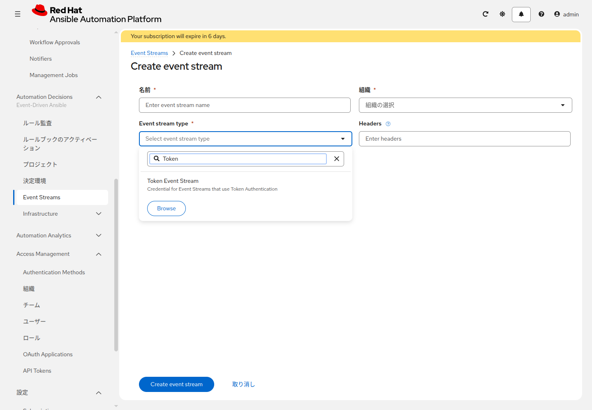

# 応用演習 8 - EDAからJobを起動する

[応用演習7](./ex7.md) | [応用演習9へ](./ex9.md)

`status` が `success` のイベントを受けたら、`verify-note-linux` を起動します。

## Section 1: Rulebookを書き換える

Web IDE で `rulebooks/notify_on_webhook.yml` を、次の内容に置き換えます。組織名は演習1で控えた名前にします。

```yaml
---
- name: Run verify when the event says success
  hosts: all

  sources:
    - ansible.eda.webhook:
        host: 0.0.0.0
        port: 5000

  rules:
    - name: Launch verify-note-linux
      condition: event.payload.status == "success"
      action:
        run_job_template:
          name: verify-note-linux
          organization: Default
          job_args:
            limit: "{{ event.payload.host | default(omit) }}"
```

コミットして、プロジェクトを同期します。

<details>
<summary>git CLIで行う場合</summary>

```bash
git add rulebooks/notify_on_webhook.yml
git commit -m "Launch verify-note-linux from the rulebook"
git push
```

</details>

## Section 2: 決定環境

**Automation Decisions > 決定環境** を開き、一覧にある既定の Decision Environment の名前を控えます。この演習では新しくは作りません。

## Section 3: Controllerへ接続する認証情報

**Automation Decisions > Infrastructure > 認証情報** で、タイプ `Red Hat Ansible Automation Platform` を作ります。

| 項目 | 入力値 |
|---|---|
| 名前 | `eda-controller` |
| Red Hat Ansible Automation Platform | `https://<AAPのURL>/api/controller/` |
| OAuth Token | [応用演習5](./ex5.md) で発行した API トークン |

URL の末尾は `/api/controller/` です。このパスが無い URL だと、Activation は `/api/v2/config/` を呼び、ゲートウェイ構成では 404 になって起動直後に止まります。Username と Password は空欄で構いません。

## Section 4: Event Stream

同じ認証情報の画面で、受け口用の認証情報を先に作ります。タイプは `Token Event Stream` です。一覧の先頭に無いときは、検索欄に `Token Event` と入れます。

| 項目 | 入力値 |
|---|---|
| 名前 | `check-webhook-token` |
| Token | 自分で決めた文字列 |
| HTTP Header Key | `Authorization`（最初から入っています） |

Token は再表示されないので、入力した文字列を控えます。

**Automation Decisions > Event Streams** の **Create event stream** で追加します。**Event stream type** を開き、検索欄に `Token` と入れます。先頭の一覧には Token Event Stream がありません。タイプを選ぶと、**認証情報** の欄が出ます。



| 項目 | 入力値 |
|---|---|
| 名前 | `check-webhook-stream` |
| 組織 | 演習1で控えた組織 |
| Event stream type | `Token Event Stream` |
| 認証情報 | `check-webhook-token` |

保存後の詳細に URL が出ます。控えます。詳細を開けば、URL はあとからでも見られます。

## Section 5: Activation

Decisions 側に `aap-training-content` が無い場合は、先にプロジェクトを作ります。URL とブランチは Controller のプロジェクトと同じです。ソースコントロール認証情報は Decisions 側で作ります。**Automation Decisions > Infrastructure > 認証情報** でタイプ `Source Control` を作り、ユーザー名とパスワードは Controller の `gitlab-scm` と同じものにします。その認証情報を、Decisions のプロジェクトに付けます。

**Automation Decisions > ルールブックのアクティベーション** で追加します。

| 項目 | 入力値 |
|---|---|
| 名前 | `note-webhook-activation` |
| 決定環境 | Section 2 で控えたもの |
| プロジェクト | Decisions の `aap-training-content` |
| ルールブック | `rulebooks/notify_on_webhook.yml` |
| 認証情報 | `eda-controller` |
| Event streams | `check-webhook-stream` |

Event streams を選んだあと、Rulebook のソースを置き換える画面が出たら、表示されたソースを `check-webhook-stream` に割り当てて保存します。名前の無いソースは `__SOURCE_1` と出ます。

状態が Running になることを確認します。すぐに失敗して `/api/v2/config/` と出ている場合は、Section 3 の URL を見直してから再起動します。

## Section 6: イベントを送る

`verify-note-linux` の編集画面を開き、**起動プロンプト** の制限にチェックを入れて保存します。このチェックが無いと、Rulebook が渡した制限は無視され、ジョブの制限は空のままです。

```bash
curl -X POST "<Event StreamのURL>" \
    -H "Content-Type: application/json" \
    -H "Authorization: Bearer <Section 4のToken>" \
    -d '{"status":"success","host":"lin1"}'
```

**ジョブ** の一覧に `verify-note-linux` が増え、制限が `lin1` になっていれば完了です。Activation のログに、ジョブを起動した記録が出ていることも確認します。

終わったら `note-webhook-activation` を無効にします。無効にしないと、同じ URL へ送るたびにジョブが起動します。

## 次

[応用演習9](./ex9.md)
