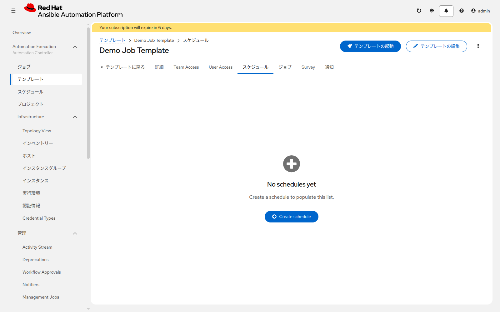

# 演習 10 - スケジュール

[演習9](./ex9.md) | [演習11へ](./ex11.md)

確認用のジョブはファイルを変えません。`verify-note-linux` を毎日 07:00 に実行する予定を作ります。

## Section 1: Linuxの確認を毎日実行する

`verify-note-linux` を開き、**スケジュール** タブで **Create schedule** をクリックします。日本語UIでは「スケジュールの作成」と出ることがあります。

| 項目 | 入力値 |
|---|---|
| 名前 | `daily-verify-linux` |
| 開始日 | 今日 |
| 開始時刻 | `07:00` |
| 繰り返し | 毎日 |
| 有効 | オン |

タイムゾーンは AAP に表示されているものを使います。保存します。

今すぐ動くことを見るには、開始時刻を数分後にして一度だけ実行される予定を追加し、**ジョブ** の一覧に `verify-note-linux` が増えることを確認します。確認できたら、その試し用の予定は削除し、`daily-verify-linux` だけを残します。

## Section 2: Windowsも同じように予定する

`verify-note-windows` の **スケジュール** タブで、同じ時刻の予定を作ります。名前は `daily-verify-windows` です。

## 次

[演習11](./ex11.md) で、書くジョブと確認ジョブを1つの流れにまとめます。
