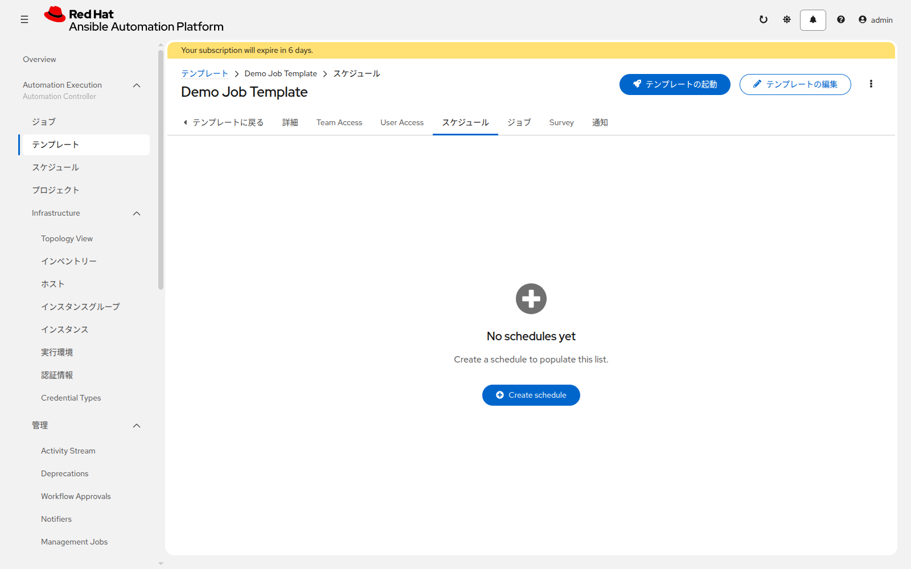
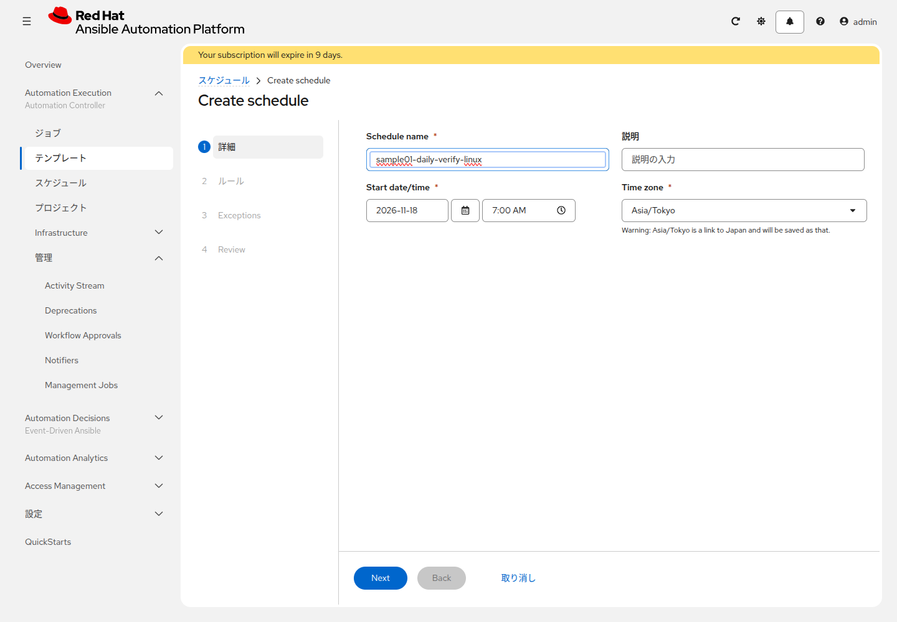
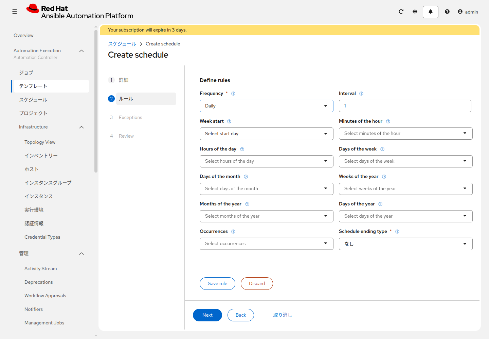

# 演習 10 - スケジュール

[演習9](./ex9.md) | [演習11へ](./ex11.md)

> **前提:** [演習7](./ex7.md) Section 3 の確認用テンプレート

この演習では、`<name_prefix>-verify-note-linux` と `<name_prefix>-verify-note-windows` を毎日 7:00 に実行するスケジュールを作ります。どちらも確認用のジョブで、ファイルは変えません。

## Section 1: Linuxの確認を毎日実行する

`<name_prefix>-verify-note-linux` を開き、**スケジュール** タブで **Create schedule** をクリックします。

左に出る段階は **詳細**、**ルール**、**Exceptions**、**Review** です。

**詳細** では、次を入れて **Next** を押します。

| 項目 | 入力値 |
|---|---|
| Schedule name | `<name_prefix>-daily-verify-linux` |
| Start date/time | 今日の日付と `7:00 AM` |
| Time zone | `Asia/Tokyo` |

時刻の欄が 24 時間表示のときは、`07:00` と入れます。Time zone には、ブラウザのタイムゾーンが最初から入っています。`Asia/Tokyo` が入っていれば、そのまま使います。`Warning: Asia/Tokyo is a link to Japan and will be saved as that.` と出ても、そのまま **Next** を押します。`UTC` など別の値が出ているときは、Time zone を開いて `Asia/Tokyo` を選びます。`UTC` のままだと、日本時間の 16:00 に動きます。名前欄の下に赤線が出ても、そのまま **Next** を押します。

**ルール** では、最初 **Yearly** になっている **Frequency** を **Daily** に変えます。**Interval** は `1` のまま、ほかの Select は空のままにし、**Schedule ending type** は **なし** にします。続けて **Save rule** を押します。押さずに **Next** を押すと、`Schedules must have at least one rule.` と出ます。**Save rule** を押すと、`RRULE:FREQ=DAILY` と、翌日 7:00 からの時刻が出ます。それから **Next** を押します。

**Exceptions** は作らず **Next** を押します。**Review** で、翌日 7:00 から毎日の時刻が出ていることを確認し、**Finish** を押します。

## Section 2: Windowsも同じように予定する

`<name_prefix>-verify-note-windows` の **スケジュール** タブで、同じウィザードを開きます。Schedule name は `<name_prefix>-daily-verify-windows`、Start date/time は今日の `7:00 AM`、Time zone は `Asia/Tokyo`、Frequency は **Daily** です。**Save rule** を押してから **Review** の **Finish** を押します。

翌日の 7:00 を過ぎてから **Automation Execution > ジョブ** を開き、`<name_prefix>-verify-note-linux` と `<name_prefix>-verify-note-windows` のジョブが増えていれば、スケジュールは動いています。次に動く時刻は、テンプレートの **スケジュール** タブで確かめられます。

2つのスケジュールは、[削除手順](../cleanup.md) で消すまで毎日動きます。研修を途中で終える場合も、削除手順を行います。

## 次

[演習11](./ex11.md) で、`note.txt` に書き込むジョブと、その中身を確かめるジョブを、1つの流れにまとめます。
