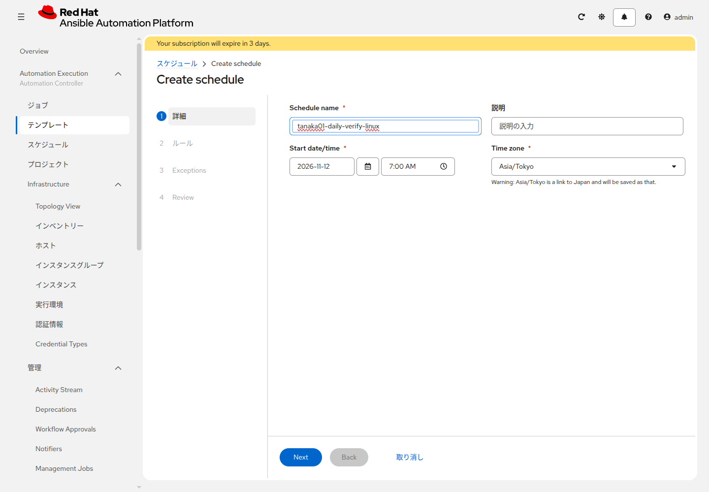
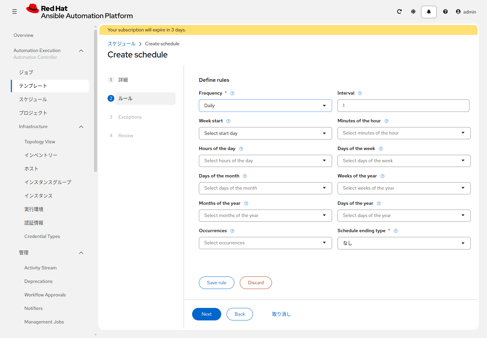

# 演習 10 - スケジュール

[演習9](./ex9.md) | [演習11へ](./ex11.md)

確認用のジョブはファイルを変えません。`<name_prefix>-verify-note-linux` を毎日 7:00 に実行する予定を作ります。

## Section 1: Linuxの確認を毎日実行する

`<name_prefix>-verify-note-linux` を開き、**スケジュール** タブで **Create schedule** をクリックします。

手順は **詳細**、**ルール**、**Exceptions**、**Review** です。

**詳細** では、次を入れて **Next** を押します。

| 項目 | 入力値 |
|---|---|
| Schedule name | `<name_prefix>-daily-verify-linux` |
| Start date/time | 今日の日付と `7:00 AM` |
| Time zone | 表示されているもの |

時刻の欄が 24 時間表示のときは、`07:00` と入れます。Time zone の注意が出ても、表示されているタイムゾーンのまま **Next** を押します。名前欄の下に赤線が出ても、そのまま **Next** を押します。

**ルール** では、**Frequency** が最初 **Yearly** です。**Daily** に変えます。**Interval** は `1` のまま、他の Select は空のままにします。**Schedule ending type** は **なし** です。**Save rule** を押します。押さないと、**Next** で `Schedules must have at least one rule.` と出ます。**Save rule** のあと、`RRULE:FREQ=DAILY` と、翌日 7:00 からの時刻が出ます。それから **Next** を押します。

**Exceptions** は作らず **Next** を押します。**Review** で、翌日 7:00 から毎日の時刻が出ていることを確認し、**Finish** を押します。

## Section 2: Windowsも同じように予定する

`<name_prefix>-verify-note-windows` の **スケジュール** タブで、同じウィザードを開きます。Schedule name は `<name_prefix>-daily-verify-windows`、Start date/time は今日の `7:00 AM`、Frequency は **Daily** です。**Save rule** を押してから **Review** の **Finish** を押します。

## 次

[演習11](./ex11.md) で、書くジョブと確認ジョブを1つの流れにまとめます。
