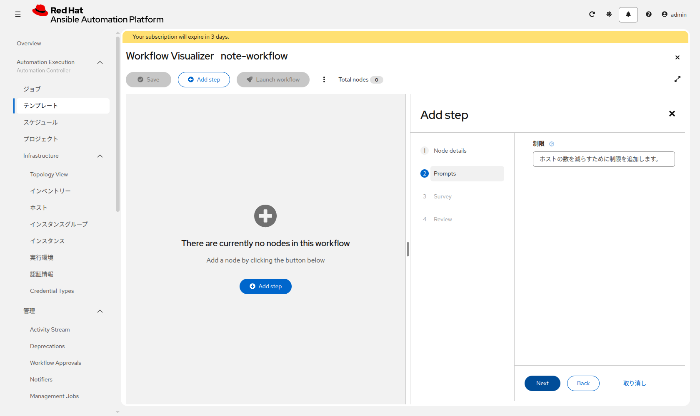
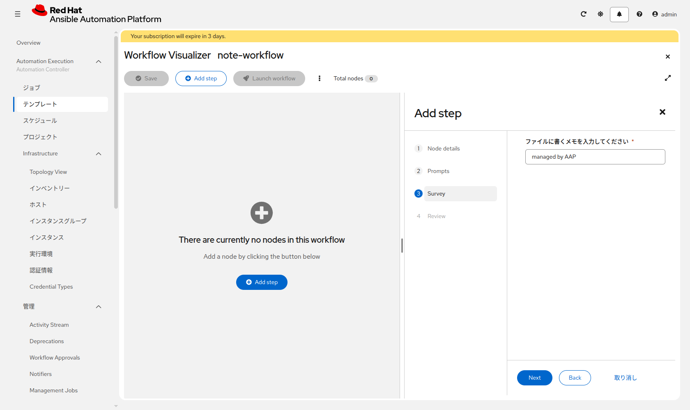
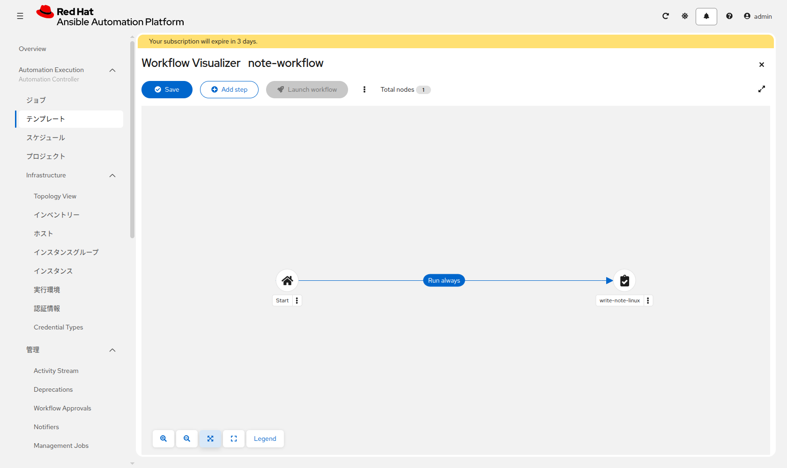
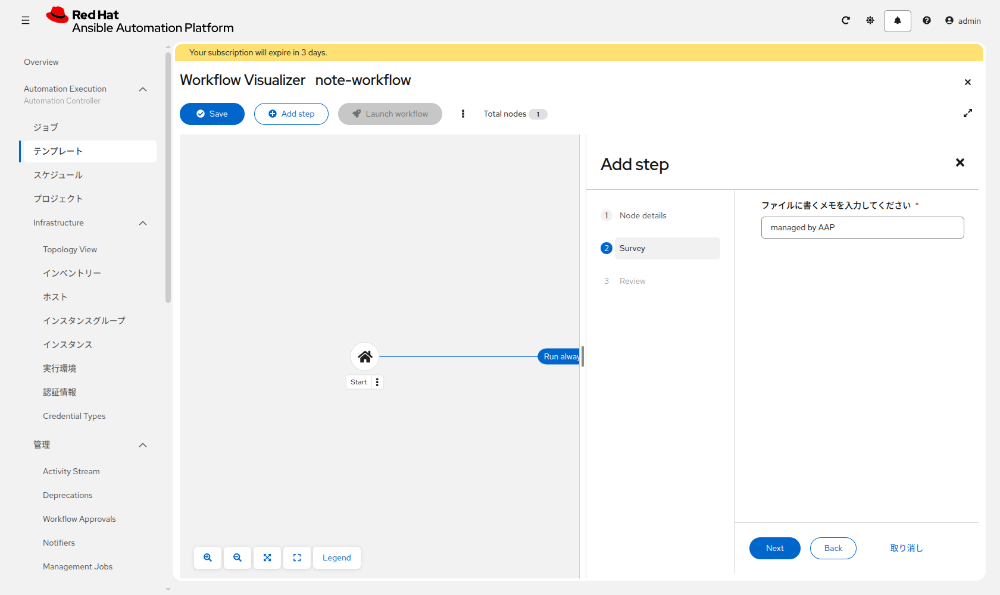
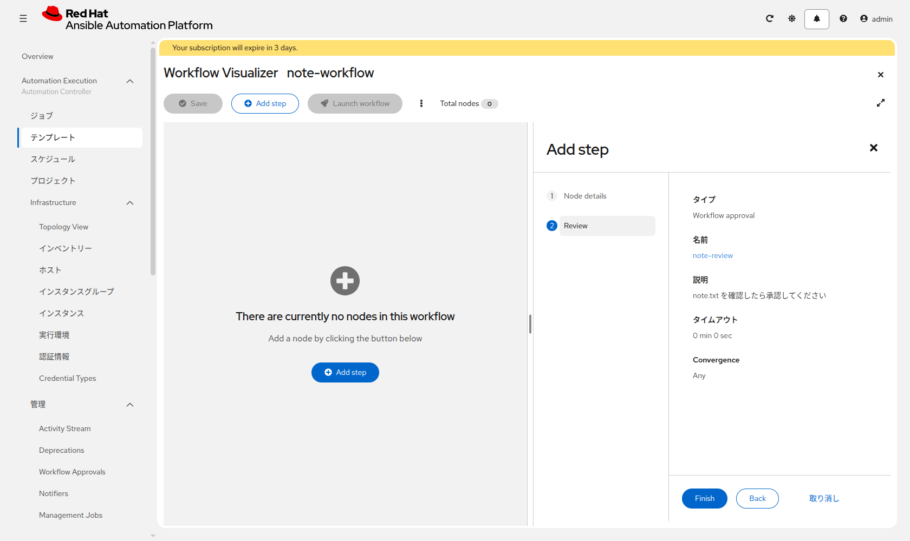
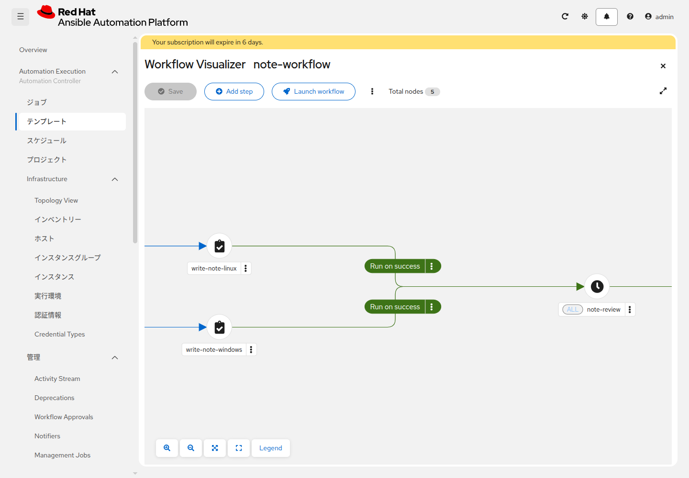
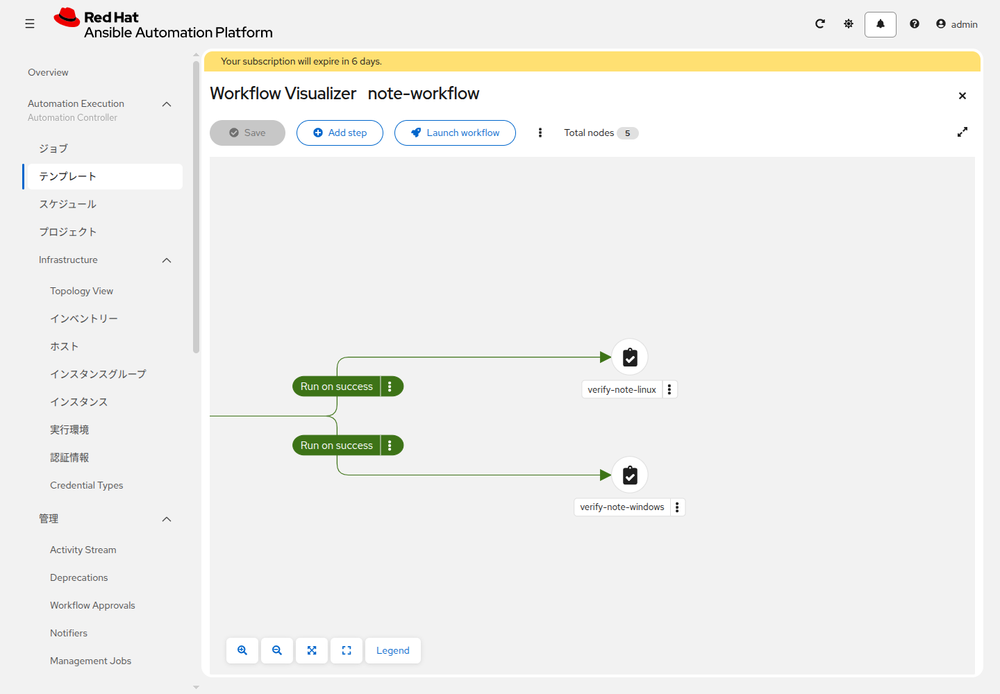

# 演習 11 - Workflow Job Template

[演習10](./ex10.md) | [応用演習1へ](../advanced/ex1.md)

次の順で実行されるワークフローを作ります。

```
開始
 ├─ <name_prefix>-write-note-linux
 └─ <name_prefix>-write-note-windows
        ↓ 両方成功
   承認 <name_prefix>-note-review
        ↓ 承認
 ├─ <name_prefix>-verify-note-linux
 └─ <name_prefix>-verify-note-windows
```

書くジョブが両方成功したあと、人が承認してから、確認ジョブが走ります。

## Section 1: テンプレートを作る

**テンプレートの作成** > **ワークフロージョブテンプレートの作成** をクリックします。

| 項目 | 入力値 |
|---|---|
| 名前 | `<name_prefix>-note-workflow` |
| インベントリー | `<name_prefix>-training-inventory` |

保存するとビジュアライザーが開きます。ノードが無い状態では、**Add step** から最初のノードを足します。線を引き終えたら、左上の **Save** を押すまで内容は残りません。名前が小さくて読めないときは、画面下の虫眼鏡で拡大します。


## Section 2: ノードを繋ぐ

1. **Add step** を押します。ノードタイプは **Job Template**、ジョブテンプレートは `<name_prefix>-write-note-linux` です。**Next** を押すと **Prompts** が出ます。**制限** は空欄のまま **Next** を押します。**Survey** は既定の `managed by AAP` のまま **Next** を押し、**Review** で **Finish** を押します。

   左側が空なのは、まだノードが無いからです。見る場所は右側の Add step です。

   

   

   **Finish** のあと、開始からこのノードへ青の線が出ます。表示は **Run always** です。開始からの線はこれで合っています。左上の **Save** を押すまで、この線は残りません。

   

2. 開始ノードにマウスを置くと **+** が出ます。その **+** から `<name_prefix>-write-note-windows` を追加します。このテンプレートには制限の起動プロンプトが無いので、**Prompts** は出ません。**Survey** は `managed by AAP` のまま **Next** を押し、**Review** で **Finish** を押します。開始から2本出ている状態にします。開始からの線は、どちらも **Run always** です。

   

3. `<name_prefix>-write-note-linux` の **+** からノードを追加します。**ノードタイプ** は **Approval** です。「承認」という選択肢はありません。名前は `<name_prefix>-note-review`、説明は `note.txt を確認したら承認してください`。タイムアウトは空欄にします。空欄のとき、Review のタイムアウトは `0 min 0 sec` と出ます。Convergence は **Any** のまま **Next** を押し、**Review** で **Finish** を押します。書くジョブから承認への線は緑で、**Run on success** と出ます。

   写真の左側が空なのは、ノードを足す前に開いた画面です。手順3のときは、左側に書くジョブがあります。見るのは右側の Review と、最後の **Finish** です。

   

4. `<name_prefix>-write-note-windows` の **+** からも、同じ `<name_prefix>-note-review` へ繋ぎます。2本目を繋ぐと、承認ノードに **ALL** と出ます
5. `<name_prefix>-note-review` の **+** から `<name_prefix>-verify-note-linux` と `<name_prefix>-verify-note-windows` を追加します。確認用テンプレートには Survey も制限の起動プロンプトも無いので、追加画面は **Node details** と **Review** です。**Node details** で **Next** を押し、**Review** で **Finish** を押します。ここも緑の **Run on success** になります
6. **Save** をクリックします

繋いだあとは、次の2画面のようになります。左が書くジョブから承認まで、右が承認から確認ジョブまでです。





ワークフローを起動するときには、ノードへ保存した Survey は出ません。メモの文面を変えるときは、ノードの **Edit step** から **Survey** を開きます。

## Section 3: 実行して承認する

`<name_prefix>-note-workflow` を起動します。2つの write ジョブが成功すると、**Automation Execution > 管理 > Workflow Approvals** に `<name_prefix>-note-review` が出ます。承認すると、2つの verify ジョブが走り、ワークフローが成功で終わります。

拒否した場合は、verify は走りません。

## Section 4: 前のジョブの変数を次のジョブで使う

`set_stats` は、そのジョブの結果として変数を残します。ワークフローでは、直後のジョブが同じ名前の変数として読めます。ホストごとの辞書にしないため、`per_host: false` にします。

Web IDE で `write_note_linux.yml` を開き、末尾に次のタスクが無ければ足します。`training_note` は、このジョブの Survey で入ったメモです。

```yaml
    - name: Hand the note to the next workflow job
      ansible.builtin.set_stats:
        data:
          note_from_linux: "{{ training_note }}"
        per_host: false
      run_once: true
```

同じ Web IDE で `show_handed_note.yml` を開き、次の内容にします。ファイルが無い場合は作ります。`<name_prefix>-show-handed-note` の Extra variables は空欄にします。このテンプレートは `name_prefix` を使いません。`<name_prefix>-write-note-linux` に保存してある `name_prefix` の行は残します。表示する変数は、前のジョブから来ます。変数が渡っていないときは、表示より先の確認タスクが失敗し、失敗メッセージに見る箇所が書いてあります。

```yaml
---
- name: Use the note from the previous workflow job
  hosts: linux
  gather_facts: false

  tasks:
    - name: The previous job must have set note_from_linux
      ansible.builtin.assert:
        that:
          - note_from_linux is defined
          - note_from_linux | default('') | length > 0
        fail_msg: 前のジョブから note_from_linux が渡っていません。write_note_linux.yml の set_stats と、write-note-linux からこのジョブへの線を確認してください。

    - name: Show the note handed off by write-note-linux
      ansible.builtin.debug:
        msg: "note_from_linux={{ note_from_linux }}"
```

**Commit to main** でコミットし、プロジェクト `<name_prefix>-aap-training-content` を同期します。

<details>
<summary>git CLIで行う場合</summary>

```bash
git add write_note_linux.yml show_handed_note.yml
git commit -m "Pass the note to the next workflow job"
git push
```

</details>

**ジョブテンプレートの作成** で、次を作ります。表に無い欄は空欄です。実行環境も空欄です。

| 項目 | 入力値 |
|---|---|
| 名前 | `<name_prefix>-show-handed-note` |
| インベントリー | `<name_prefix>-training-inventory` |
| プロジェクト | `<name_prefix>-aap-training-content` |
| Playbook | `show_handed_note.yml` |
| 実行環境 | 空欄 |
| 認証情報 | `<name_prefix>-linux-ssh` |

`<name_prefix>-note-workflow` のビジュアライザーを開きます。上の図は、承認までの線です。そこへ、`<name_prefix>-write-note-linux` の **+** から `<name_prefix>-show-handed-note` を追加します。このテンプレートには Survey も制限の起動プロンプトも無いので、追加画面は **Node details** と **Review** です。線は緑の **Run on success** です。承認ノードへの線はそのまま残します。**Save** を押すまで線は残りません。

引き継ぎを確認するため、`<name_prefix>-write-note-linux` ノードの **Edit step** から **Survey** を開き、答えを `handoff check` に変えて保存します。`<name_prefix>-show-handed-note` の Extra variables は空欄のままです。

`<name_prefix>-note-workflow` を起動し、`<name_prefix>-note-review` を承認します。`<name_prefix>-show-handed-note` の出力に、次の行があれば、前のジョブのメモが次のジョブへ渡っています。

```
note_from_linux=handoff check
```

この起動では、ワークフロー全体は失敗で終わります。`<name_prefix>-verify-note-linux` は、ファイルの中に既定のメモ `managed by AAP` があるかを見ます。ノードの Survey でメモを `handoff check` に変えているため、その確認は失敗します。引き継ぎできたかの確認は、`<name_prefix>-show-handed-note` の出力です。

確認が終わったら、同じ **Edit step** の Survey を `managed by AAP` に戻して **Save** します。`<name_prefix>-write-note-linux` を単体で起動し、`lin1` の `note:` を `managed by AAP` に戻します。起動画面の **制限** には `lin1` と入力し、**Survey** は `managed by AAP` のまま **Finish** を押します。

## 次

基礎演習はここまでです。[応用演習1](../advanced/ex1.md) では、このワークフローを実行できる人と、編集できる人を分けます。
