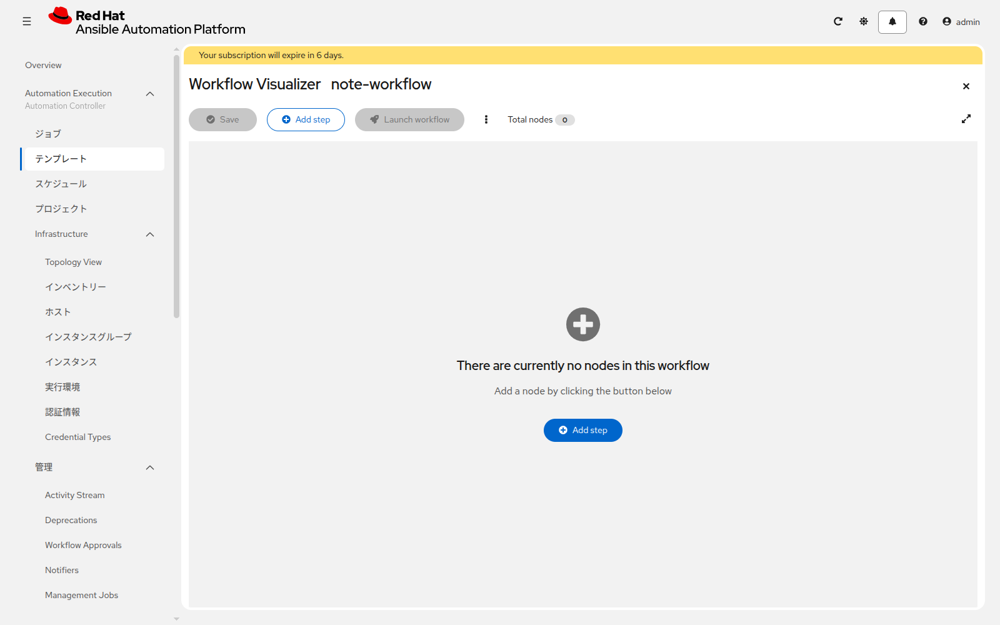

# 演習 11 - Workflow Job Template

[演習10](./ex10.md) | [応用演習1へ](../advanced/ex1.md)

次の順で実行されるワークフローを作ります。

```
開始
 ├─ write-note-linux
 └─ write-note-windows
        ↓ 両方成功
   承認 note-review
        ↓ 承認
 ├─ verify-note-linux
 └─ verify-note-windows
```

書くジョブが両方成功したあと、人が承認してから、確認ジョブが走ります。

## Section 1: テンプレートを作る

**テンプレートの作成** > **ワークフロージョブテンプレートの作成** をクリックします。

| 項目 | 入力値 |
|---|---|
| 名前 | `note-workflow` |
| インベントリー | `training-inventory` |

保存するとビジュアライザーが開きます。ノードが無い状態では、**Add step** から最初のノードを足します。線を引き終えたら、左上の **Save** を押すまで内容は残りません。



## Section 2: ノードを繋ぐ

1. **Add step** で Job Template `write-note-linux` を追加する
2. 左に出る開始の **+** から `write-note-windows` を追加し、開始から2本出ている状態にする
3. `write-note-linux` の成功側の **+** から、ノードタイプ **承認** を追加する。名前は `note-review`。説明は `note.txt を確認したら承認してください`
4. `write-note-windows` の成功側も、同じ `note-review` へ繋ぐ
5. `note-review` の成功側から `verify-note-linux` と `verify-note-windows` を追加する
6. **Save** をクリックする

Survey が付いたジョブテンプレートをノードにすると、追加するときにその答えをノードへ保存します。ワークフローを起動するときには、その Survey は出ません。メモの文面を変えるときは、ノードの **Edit step** から **Survey** を開きます。

## Section 3: 実行して承認する

`note-workflow` を起動します。2つの write ジョブが成功すると、**Automation Execution > 管理 > Workflow Approvals** に `note-review` が出ます。承認すると、2つの verify ジョブが走り、ワークフローが成功で終わります。

拒否した場合は、verify は走りません。

## 次

基礎演習はここまでです。[応用演習1](../advanced/ex1.md) では、このワークフローを実行できる人と、編集できる人を分けます。
