# 演習 11 - ワークフロージョブテンプレート

[演習10](./ex10.md) | [応用演習1へ](../advanced/ex1.md)

> **前提:** [演習7](./ex7.md) の4つのテンプレート、[演習8](./ex8.md) の制限の起動プロンプトと Survey

次の順で実行されるワークフローを作ります。

```
開始
 ├─ <name_prefix>-write-note-linux
 └─ <name_prefix>-write-note-windows
        ↓ 両方成功
   承認 <name_prefix>-note-review
        ↓ 承認
 ├─ <name_prefix>-verify-note-linux
 └─ <name_prefix>-verify-note-windows
```

書くジョブが両方成功したあと、人が承認してから、確認ジョブが走ります。

## Section 1: テンプレートを作る

**テンプレートの作成** > **ワークフロージョブテンプレートの作成** をクリックします。

| 項目 | 入力値 |
|---|---|
| 名前 | `<name_prefix>-note-workflow` |

インベントリーの欄は空欄のままにします。各ノードは、それぞれのジョブテンプレートに保存したインベントリーで動きます。

保存するとビジュアライザーが開きます。ノードが無い状態では、**Add step** から最初のノードを足します。線を引き終えたら、左上の **Save** を押します。押さないと、引いた線は残りません。名前が小さくて読めないときは、画面下の虫眼鏡で拡大します。

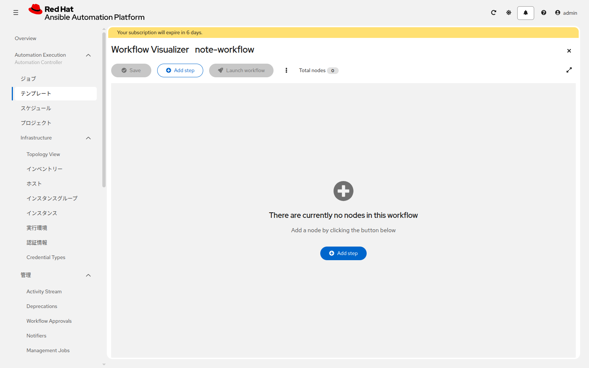

## Section 2: ノードを繋ぐ

1. **Add step** を押します。ノードタイプは **Job Template**、ジョブテンプレートは `<name_prefix>-write-note-linux` です。**Next** を押すと **Prompts** が出ます。**制限** は空欄のまま **Next** を押します。**Survey** は既定の `managed by AAP` のまま **Next** を押し、**Review** で **Finish** を押します。

   左側が空なのは、まだノードが無いからです。見る場所は右側の Add step です。

   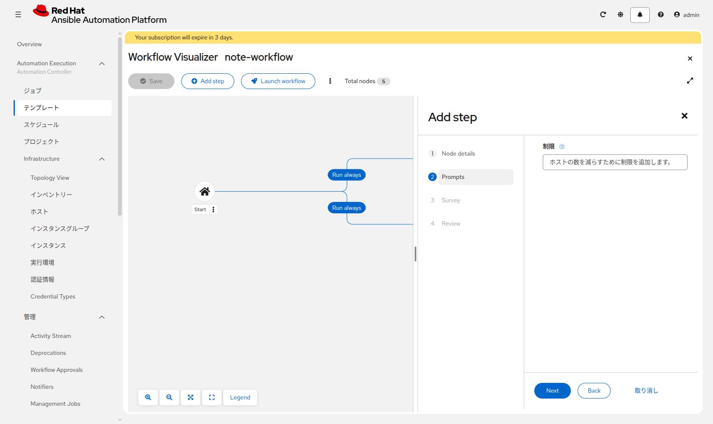

   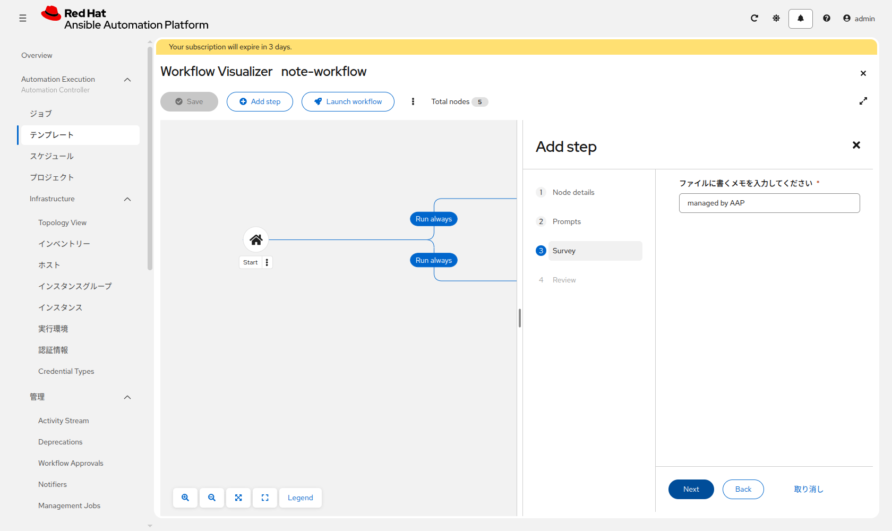

   **Finish** のあと、開始からこのノードへ青の線が出ます。表示は **Run always** です。開始からの線はこれで合っています。左上の **Save** を押すまで、この線は残りません。

   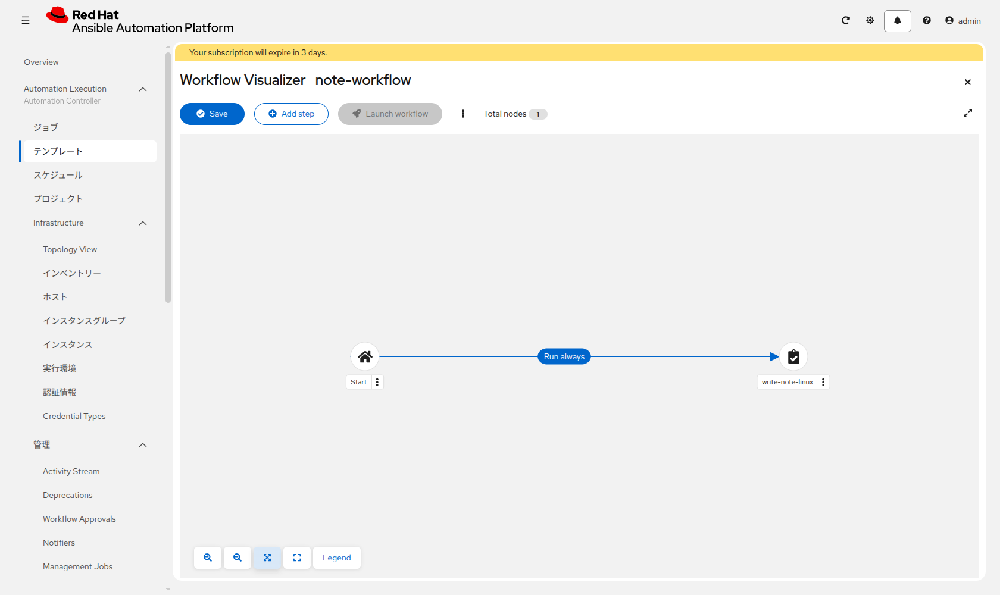

2. 開始ノードの下にある、点が3つ並んだボタンを押します。**Add step** が出ます。そこから `<name_prefix>-write-note-windows` を追加します。このテンプレートには制限の起動プロンプトが無いので、**Prompts** は出ません。**Survey** は `managed by AAP` のまま **Next** を押し、**Review** で **Finish** を押します。開始から2本出ている状態にします。開始からの線は、どちらも青の **Run always** です。

   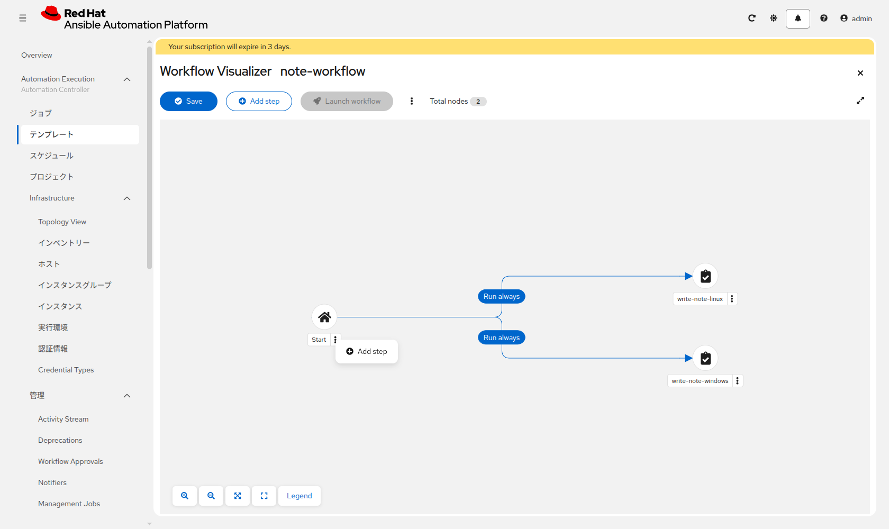

   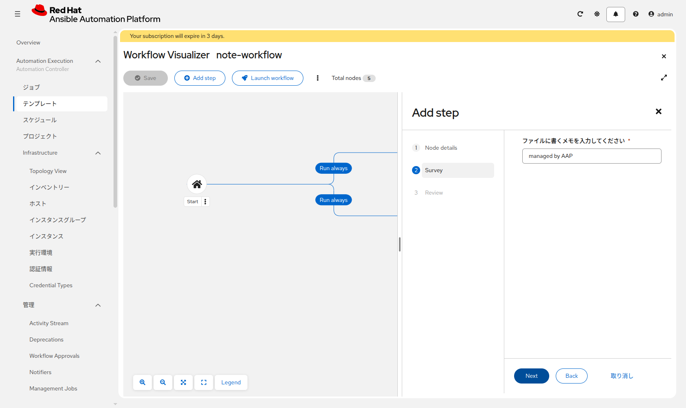

   

3. `<name_prefix>-write-note-linux` の下にある点が3つのボタンを押します。**Add step and link** を選びます。**ノードタイプ** は **Approval** です。名前は `<name_prefix>-note-review`、説明は `note.txt を確認したら承認してください`。タイムアウトは **0** と **0** のままにします。Review では `0 min 0 sec` と出ます。**ステータス** は最初 **Always run** です。**Run on success** に変えます。変えずに進むと、線は青の **Run always** になり、書くジョブが失敗しても承認へ進みます。Convergence は **Any** のまま **Next** を押し、**Review** で **Finish** を押します。書くジョブから承認への線は緑で、**Run on success** と出ます。

   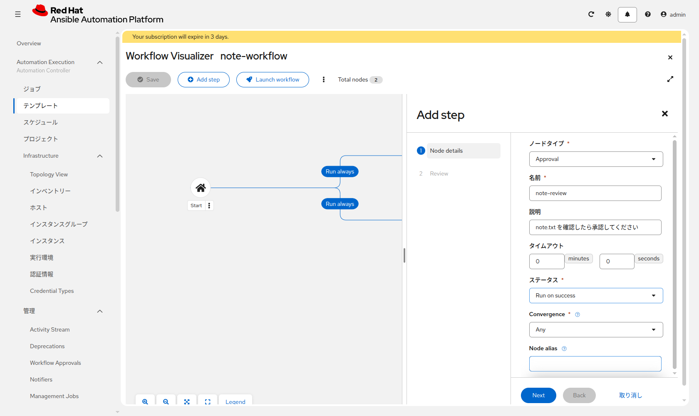

   左側は、開始から2本出ているところです。入力は右側です。写真と同じ説明、タイムアウト、ステータスにしてから **Next** を押します。

   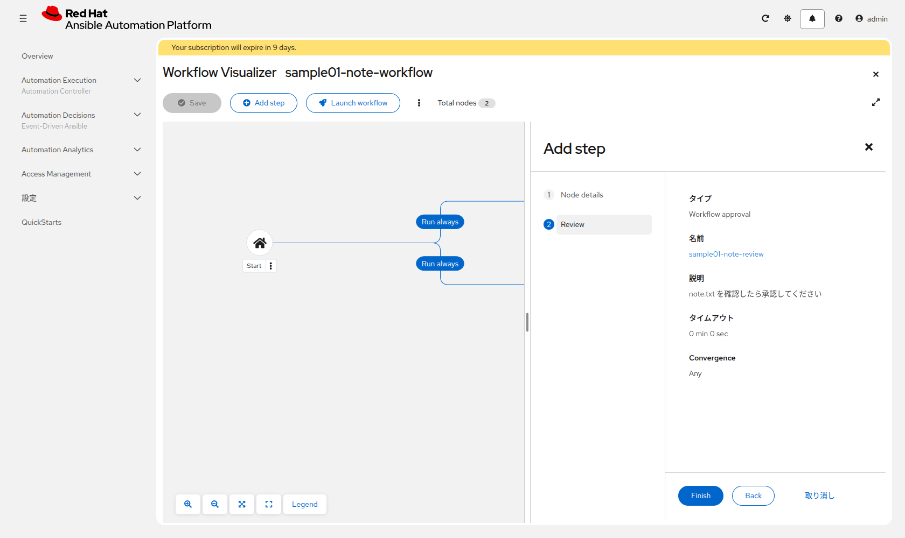

4. `<name_prefix>-write-note-windows` の丸の右に出る矢印を、すでにある `<name_prefix>-note-review` の丸までドラッグして離します。付いた線は青の **Run always** です。その青い文字の右にある点が3つのボタンを押し、**Run on success** を選びます。線が緑になります。

   続けて、`<name_prefix>-note-review` の点が3つのボタンから **Edit step** を開き、Convergence を **All** に変えて **Next**、**Review** の **Finish** を押します。承認ノードに **ALL** と出ます。**Any** のままだと、書くジョブのどちらか1つが成功しただけで承認へ進みます。

   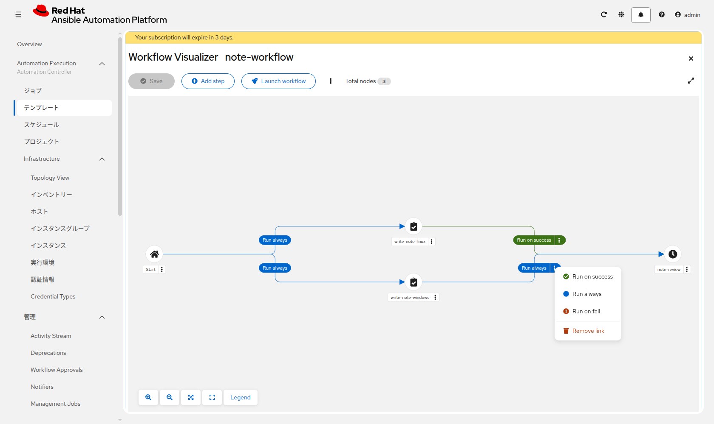

5. `<name_prefix>-note-review` の点が3つのボタンから **Add step and link** を選び、`<name_prefix>-verify-note-linux` と `<name_prefix>-verify-note-windows` を1つずつ追加します。確認用テンプレートには Survey も制限の起動プロンプトも無いので、追加画面は **Node details** と **Review** です。**ステータス** は **Run on success** に変えてから **Next** を押し、**Review** で **Finish** を押します。線は緑の **Run on success** です。
6. **Save** をクリックします

繋いだあとは、次の2画面のようになります。左が書くジョブから承認まで、右が承認から確認ジョブまでです。

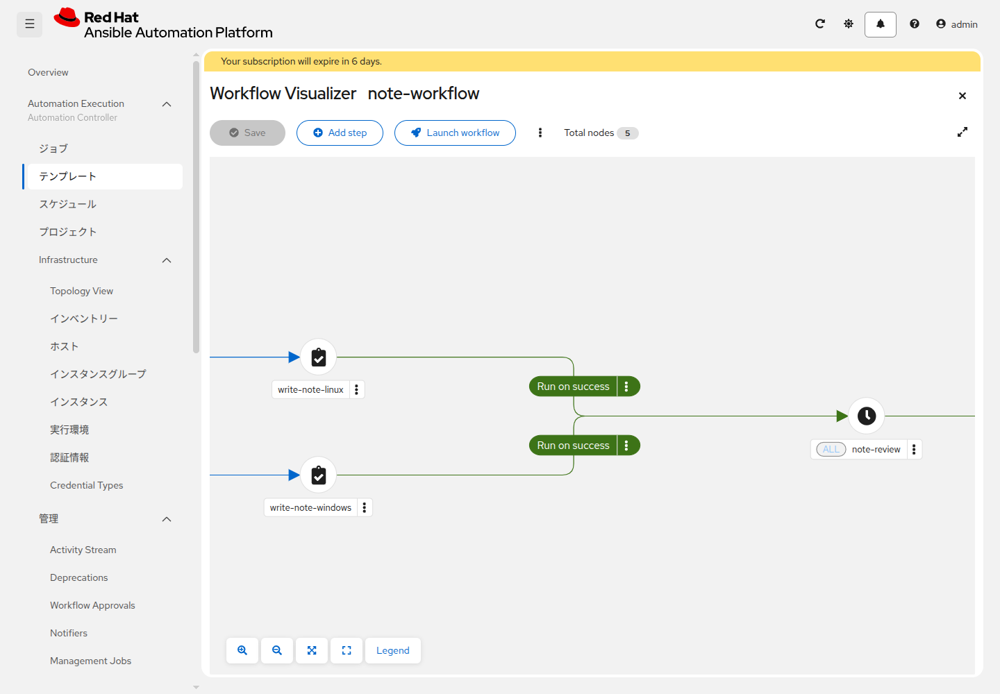

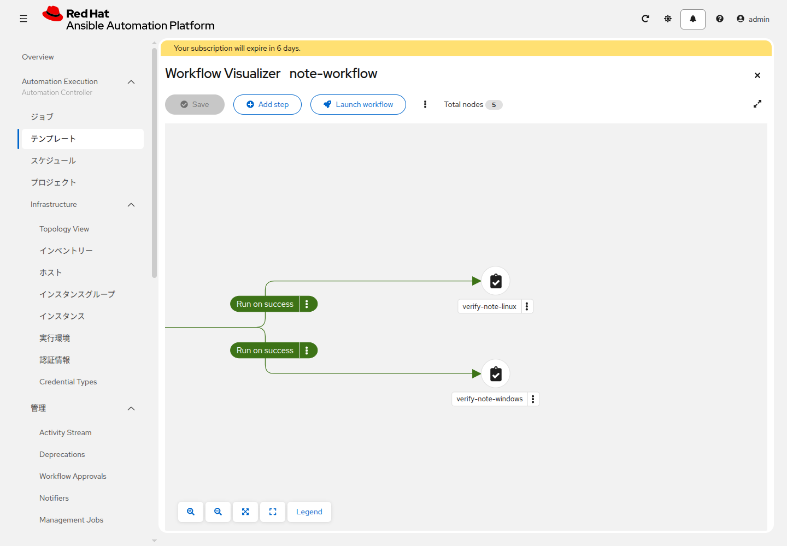

ワークフローを起動するときには、ノードへ保存した Survey は出ません。メモの文面を変えるときは、ノードの **Edit step** から **Survey** を開きます。

## Section 3: 実行して承認する

`<name_prefix>-note-workflow` を起動します。2つの書くジョブが成功すると、**Automation Execution > 管理 > Workflow Approvals** に `<name_prefix>-note-review` が出ます。名前を開きます。**承認** を押すと、確認の画面 **Approve workflow approvals** が開きます。**Yes, I confirm that I want to approve these 1 workflow approvals.** にチェックを入れ、**Approve workflow approvals** を押します。

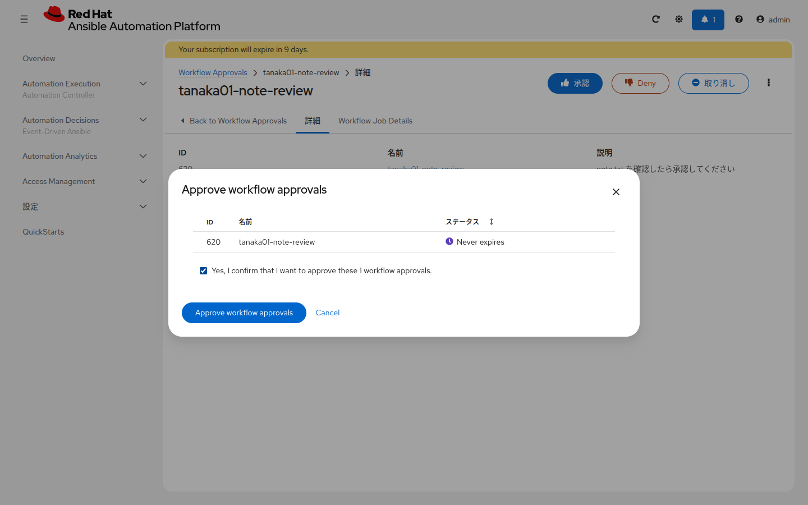

写真の `tanaka01` は例です。ステータスに `Success` と出て画面が閉じると、2つの確認ジョブが走り、ワークフローが成功で終わります。拒否するときは **Deny** を押し、同じように確認の画面でチェックを入れてから進めます。拒否すると、確認ジョブは走りません。ステータスの **Never expires** は、タイムアウトを **0** と **0** にしたので期限が無いという意味です。

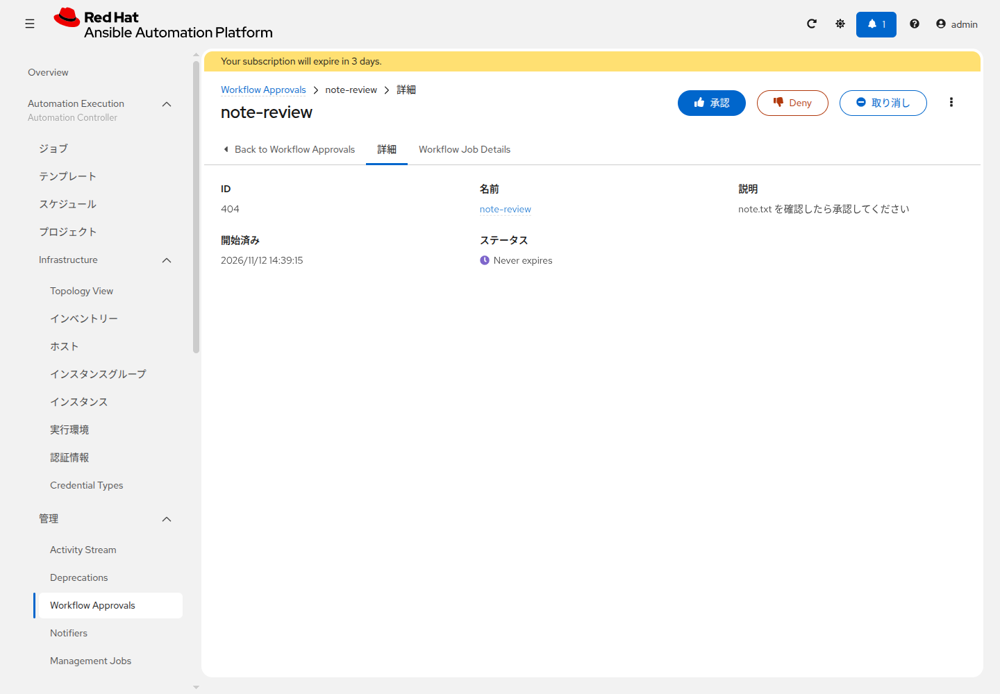

## Section 4: 前のジョブの変数を次のジョブで使う

`set_stats` は、そのジョブの結果として変数を残します。ワークフローでは、そのノードより後ろにあるノードのジョブで、同じ名前の変数として使えます。ホストごとの辞書にしないため、`per_host: false` にします。

Web IDE で `write_note_linux.yml` を開き、末尾に次のタスクが無ければ足します。`training_note` は、このジョブの Survey で入ったメモです。

```yaml
    - name: Hand the note to the next workflow job
      ansible.builtin.set_stats:
        data:
          note_from_linux: "{{ training_note }}"
        per_host: false
      run_once: true
```

同じ Web IDE で `show_handed_note.yml` を開き、次の内容にします。ファイルが無い場合は作ります。この Playbook は `name_prefix` を使いません。表示する変数は、前のジョブから来ます。変数が渡っていないときは、表示より先の確認タスクが失敗し、失敗メッセージに見る箇所が書いてあります。

```yaml
---
- name: Use the note from the previous workflow job
  hosts: linux
  gather_facts: false

  tasks:
    - name: The previous job must have set note_from_linux
      ansible.builtin.assert:
        that:
          - note_from_linux is defined
          - note_from_linux | default('') | length > 0
        fail_msg: 前のジョブから note_from_linux が渡っていません。write_note_linux.yml の set_stats と、write-note-linux からこのジョブへの線を確認してください。

    - name: Show the note handed off by write-note-linux
      ansible.builtin.debug:
        msg: "note_from_linux={{ note_from_linux }}"
```

**Commit to main** でコミットし、プロジェクト `<name_prefix>-aap-training-content` を同期します。

<details>
<summary>git CLIで行う場合</summary>

```bash
git add write_note_linux.yml show_handed_note.yml
git commit -m "Pass the note to the next workflow job"
git push
```

</details>

**ジョブテンプレートの作成** で、次を作ります。表に無い欄は空欄です。実行環境も空欄です。

| 項目 | 入力値 |
|---|---|
| 名前 | `<name_prefix>-show-handed-note` |
| インベントリー | `<name_prefix>-training-inventory` |
| プロジェクト | `<name_prefix>-aap-training-content` |
| Playbook | `show_handed_note.yml` |
| 実行環境 | 空欄 |
| 認証情報 | `<name_prefix>-linux-ssh` |

Extra variables は空欄のままにします。`<name_prefix>-write-note-linux` に保存してある `name_prefix` の行は、消さずに残します。

`<name_prefix>-note-workflow` のビジュアライザーを開きます。Section 2 で作った線（書くジョブから承認、承認から確認ジョブ）はそのままです。そこへ、`<name_prefix>-write-note-linux` の点が3つのボタンから **Add step and link** を選び、`<name_prefix>-show-handed-note` を追加します。このテンプレートには Survey も制限の起動プロンプトも無いので、追加画面は **Node details** と **Review** です。**ステータス** は **Run on success** に変えます。線は緑の **Run on success** です。承認ノードへの線はそのまま残します。**Save** を押すまで線は残りません。

`<name_prefix>-note-workflow` を起動し、`<name_prefix>-note-review` を承認します。`<name_prefix>-show-handed-note` は承認を待たず、`<name_prefix>-write-note-linux` が成功したあとすぐに動きます。`<name_prefix>-show-handed-note` の出力に次の行があれば、前のジョブのメモが次のジョブへ渡っています。`managed by AAP` は、`<name_prefix>-write-note-linux` ノードの Survey に保存した答えです。

```
note_from_linux=managed by AAP
```

`note_from_linux` は、`group_vars/all.yml` にも、`<name_prefix>-show-handed-note` の Extra variables にも無い変数です。この行が出るのは、`<name_prefix>-write-note-linux` の `set_stats` から値が渡ったときだけです。ワークフロー全体は成功で終わります。

## 次

基礎演習はここまでです。[応用演習1](../advanced/ex1.md) では、このワークフローを実行できる人と、編集できる人を分けます。
