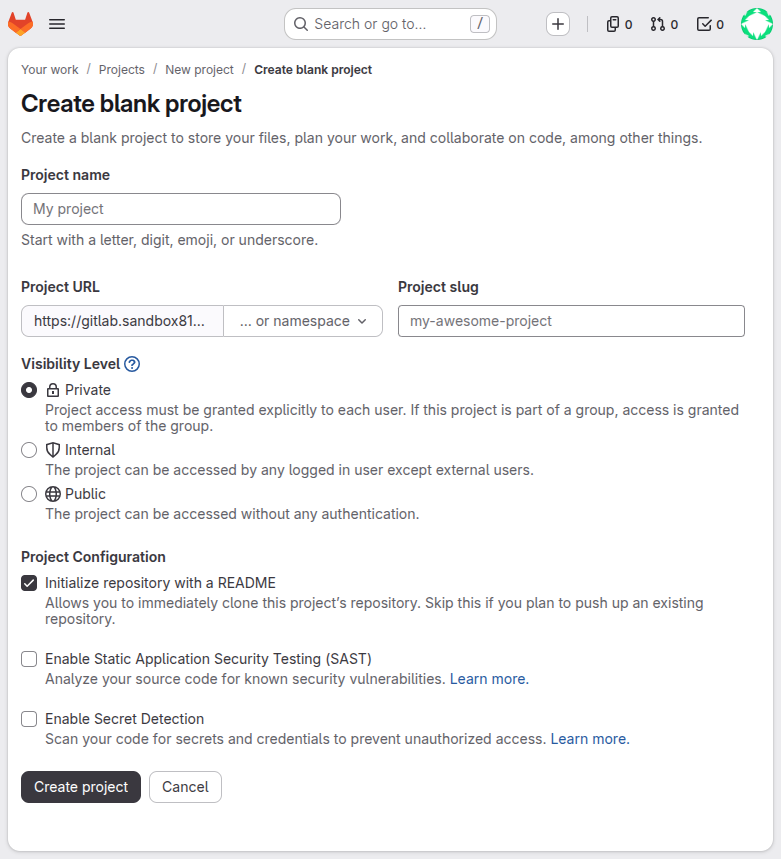
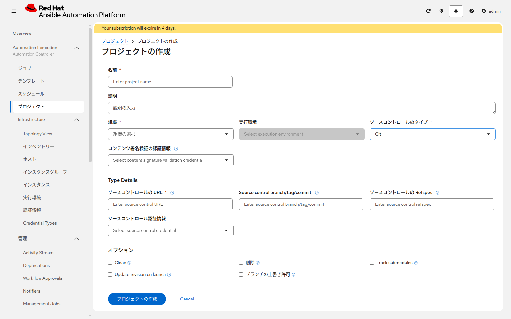

# 演習 4 - Projectの作成（GitLab連携）

[基礎演習1〜3へ戻る](../basic-intro/ex3.md)

---

**前提条件:** 基礎演習1〜3を完了していること。

この演習では、GitLab上にPlaybook/Role用のリポジトリを作成し、AAPの **Project** としてSCM連携を設定します。以降の演習（Job Templateの作成、Inventory Sourceなど）は、ここで作成するProjectを土台に進めます。

## Section 1: GitLab側の準備

### Step 1: GitLabにログイン

[事前準備](../prepare_training_environment.md)で確認したGitLabのURLにアクセスし、ログインします。

### Step 2: 新規Projectの作成

GitLabの右上 **Create new…** > **New project/repository** > **Create blank project** を開きます。表示言語が日本語の場合は「新規作成」から同じ画面に進んでください。



| 項目 | 入力値 |
|---|---|
| Project name | `aap-training-content` |
| Project URL | [事前準備](../prepare_training_environment.md)で確認した演習用Namespace |
| Visibility Level | `Private`（研修用。社内ポリシーに応じて調整） |
| Initialize repository with a README | **外す**。`sample-content` を git push するため。Web IDEだけでファイルを置く場合は付けたままでよい |
| Enable SAST / Enable Secret Detection | オフのままでよい |

**Create project** をクリックします。作成後、リポジトリのクローンURL（例: `https://gitlab.example.local/aap-training/aap-training-content.git`）を控えておきます。Clone ボタンの表示が HTTPS になっていることを確認してください。

### Step 3: サンプルコンテンツをpushする

この研修資料リポジトリに含まれる [sample-content/](../sample-content/) の内容を、作成したGitLab Projectにpushします。基本はgit CLIでの操作ですが、CLIが使えない場合はGitLab Web IDEでも代替できます（詳細手順は[sample-content/README.md](../sample-content/README.md)を参照）。

**方法A: git CLIで行う場合（基本）**

```bash
$ git clone <この研修資料リポジトリのURL>
$ cd aap_training/sample-content
$ git init
$ git remote add origin <GitLabプロジェクトのクローンURL>
$ git add .
$ git commit -m "Initial commit: sample content for AAP training"
$ git branch -M main
$ git push -u origin main
```

**方法B: GitLab Web IDEで行う場合（代替）**

ブラウザだけで完結させたい場合は、GitLab Project画面の「Web IDE」を開き、[sample-content/README.md](../sample-content/README.md)の「方法B」の手順に従ってファイルを作成・コミットしてください。

**Note:** push前（またはWeb IDEでのコミット前）に、`inventory.yml` 内のホスト名・IPアドレスを、実際の管理対象ノードの値に書き換えてください（[基礎演習3](../basic-intro/ex3.md)で登録したホストと揃えておくと、後続の演習がわかりやすくなります）。

### Step 4: Personal Access Tokenの発行

AAPがこのリポジトリを読み取るための認証情報として、GitLabのPersonal Access Token（PAT）を発行します。

1. 右上のユーザーメニューから User Settings を開き、左メニュー **Personal access tokens** を開く（URLの末尾は `/-/user_settings/personal_access_tokens`）
2. Token name: `aap-training-pat`
3. Scopes: `read_repository`（PushやAPI操作が不要であれば最小権限でよい）
4. **Create personal access token** をクリックし、表示されたトークン文字列を**その場でコピーして控える**（再表示はできません）

## Section 2: AAP側でSource Control Credentialを作成

### Step 1: Credential作成画面を開く

**Automation Execution > Infrastructure > 認証情報** を開き、**認証情報の作成** をクリックします。

### Step 2: 入力する

| 項目 | 入力値 |
|---|---|
| 名前 | `gitlab-scm-credential` |
| 組織 | 基礎演習1で確認した組織 |
| 認証情報タイプ | `Source Control` |
| ユーザ名 | GitLabのユーザー名 |
| パスワード | Section 1 Step 4で発行したPersonal Access Token |

**認証情報の作成** をクリックして保存します。

**Note:** Credential Typeは[基礎演習2](../basic-intro/ex2.md)で説明した通り、種類ごとに入力項目が異なります。`Source Control` Credentialの「Password」欄には、GitLabのログインパスワードではなくPersonal Access Tokenを入力する点に注意してください。

## Section 3: Projectの作成

### Step 1: Project作成画面を開く

**Automation Execution > プロジェクト** を開き、**プロジェクトの作成** をクリックします。

### Step 2: 入力する

| 項目 | 入力値 |
|---|---|


| 画面上の項目 | 入力値 |
|---|---|
| 名前 | `aap-training-content` |
| 組織 | 基礎演習1で確認した組織 |
| ソースコントロールのタイプ | `Git` |
| ソースコントロールの URL | GitLabプロジェクトのクローンURL（例: `https://gitlab.example.local/aap-training/aap-training-content.git`） |
| Source control branch/tag/commit | `main` |
| ソースコントロール認証情報 | `gitlab-scm-credential`（Section 2で作成） |
| オプション | `Update revision on launch` を有効化（Job Template実行の都度、最新リビジョンを取得する） |

**プロジェクトの作成** をクリックして保存します。

### Step 3: SCM Syncの実行

Project一覧画面で、作成した `aap-training-content` の行にある同期アイコン（Sync）をクリックします。

数秒〜数十秒でSyncが完了し、ステータスが `Successful` になることを確認してください。

### Step 4: Syncの結果を確認する

Projectの詳細画面を開き、以下を確認します。

* **Status**: `Successful`
* **Last Job**: Sync実行時刻
* 画面下部またはJobs一覧で、取得した**Revision**（GitLabのコミットハッシュ）が表示されていること

**Note:** これはOSS版Ansibleの用語集における「SCM Sync」「Revision」に対応します。PlaybookやRoleの内容を変更してGitLabにpushした後は、必ずこのSyncを実行（または `Update Revision on Launch` により自動取得）して最新化する必要があります。

### Step 5: Syncが失敗する場合のトラブルシューティング

* Source Control URLのスキーム・ホスト名・パスに誤りがないか
* Source Control Credential（Username / Personal Access Token）が正しいか
* トークンのスコープに `read_repository` が含まれているか
* AAPの実行環境からGitLabへのネットワーク到達性（プロキシ・ファイアウォール等）に問題がないか
* GitLabリポジトリのブランチ名（`main` か `master` か）が設定と一致しているか

---

ここまでで、GitLabと連携したProjectの作成が完了しました。次の演習では、このProjectに含まれるYAML形式のインベントリファイルを使って、Inventory Sourceを設定します。

[次へ進む](./ex5.md)
