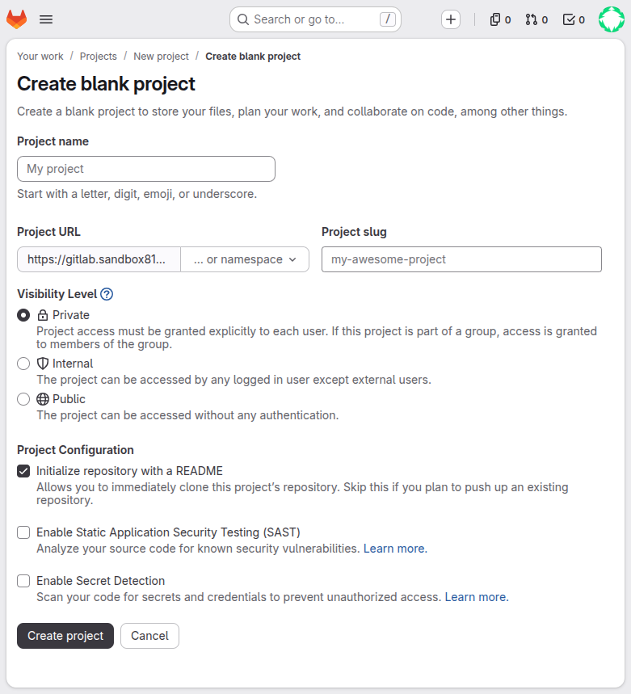
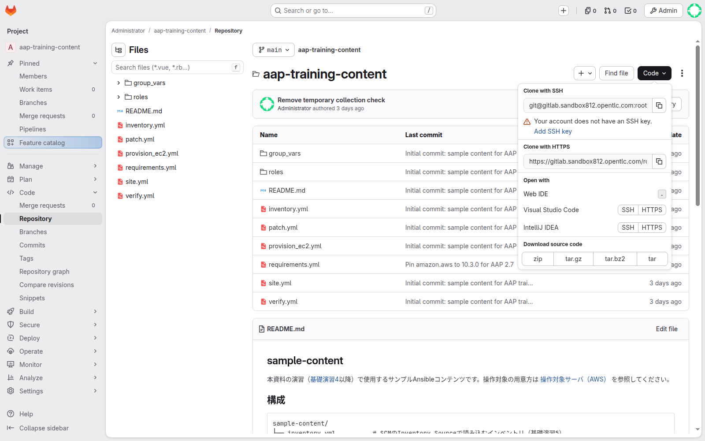
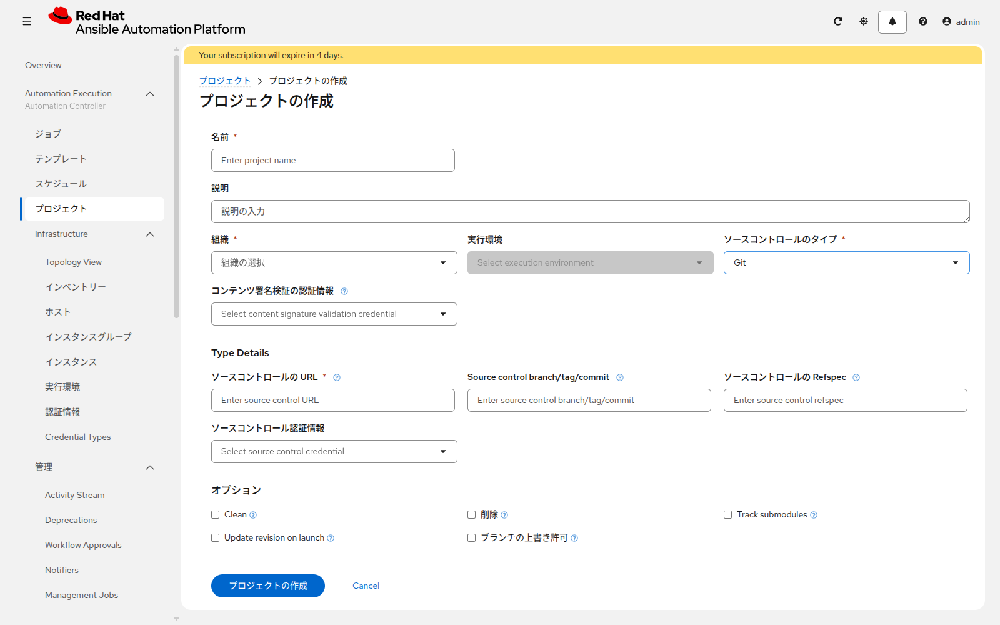

# 演習 5 - GitLabにPlaybookを置く

[演習3](../basic-intro/ex3.md) | [演習6へ](./ex6.md)

Playbook は GitLab に置き、AAP のプロジェクトから読みます。ファイルの作成と編集は Web IDE で行います。サーバが無い場合は、演習4と、演習3の Section 4 まで終わってから、この演習に入ります。

| 自分の状況 | この演習でやること |
|---|---|
| サーバがすでにある | プロジェクトを新規作成し、下のファイルを置く。`requirements.yml` は置かない |
| 演習4でプロジェクトを作った | 新規作成はしない。同じプロジェクトに、まだ無いファイルを Web IDE で追加する。`requirements.yml` は置いたままにする |

## Section 1: プロジェクトを作る

演習4で `<name_prefix>-aap-training-content` を作った場合は、Section 2 へ進んでください。

GitLab にログインし、**Create new…** > **New project/repository** > **Create blank project** を開きます。



| 項目 | 入力値 |
|---|---|
| Project name | `<name_prefix>-aap-training-content` |
| Visibility Level | `Private` |
| Initialize repository with a README | 付けたまま |
| SAST / Secret Detection | オフのまま |

**Create project** のあと、HTTPS のクローン URL を控えます。

## Section 2: Web IDEでファイルを置く

プロジェクト画面の右上 **Code** を開き、**Web IDE** をクリックします。メニューが **Edit** の環境では、その中の **Web IDE** を選びます。SSH キーの案内が出ても、この演習では使いません。最初に Welcome が出たら閉じて、左のファイルを開きます。



左のファイル一覧で新規ファイルを作り、[sample-content/](../sample-content/) から次を貼り付けます。

| ファイル | サーバがすでにある | AWSで作った |
|---|---|---|
| `inventory.yml` | 置く。`ansible_host` を自分のアドレスにする | 置く。演習4で控えたアドレスにする |
| `group_vars/all.yml` | 置く | 演習4で置いていればそのままでよい |
| `write_note_linux.yml` | 置く | 置く |
| `write_note_windows.yml` | 置く | 置く |
| `verify_note_linux.yml` | 置く | 置く |
| `verify_note_windows.yml` | 置く | 置く |
| `notify_aws.yml` | 置かない | 置く |
| `create_aws_servers.yml` / `remove_aws_servers.yml` | 置かない | 演習4で置いていればそのままでよい |
| `requirements.yml` | **置かない** | 演習4で置いたものを残す |

`inventory.yml` の `203.0.113.10` と `203.0.113.11` は、保存前に必ず自分のアドレスへ変えます。

Windows の接続は、サンプルが NTLM です。演習3で NTLM を選んだ人は、`ansible_psrp_auth`、`ansible_psrp_protocol`、`ansible_psrp_port` をサンプルのままにします。ドメインに参加している Windows は、この3つを下の Kerberos の列に置き換えます。どれか1つだけ変えると、演習6の同期で演習3の変数が上書きされ、`win_ping` が失敗します。

| 項目 | NTLM（サンプルのまま） | Kerberos（3つとも置き換える） |
|---|---|---|
| `ansible_psrp_auth` | `ntlm` | `kerberos` |
| `ansible_psrp_protocol` | `http` | `https` |
| `ansible_psrp_port` | `5985` | `5986` |

`ansible_connection: psrp` と `ansible_psrp_cert_validation: ignore` は、どちらもサンプルのままです。

**Source Control** を開き、メッセージ（例: `Add note playbooks`）を書いて **Commit to main** をクリックします。

<details>
<summary>git CLIで行う場合</summary>

```bash
git clone 'https://gitlab.example.local/<namespace>/<name_prefix>-aap-training-content.git'
cd '<name_prefix>-aap-training-content'
# sample-content から必要なファイルをコピーし、inventory.yml のアドレスを直してから
git add .
git commit -m "Add note playbooks"
git push
```

ユーザー名とパスワードを聞かれたら、GitLab のログインに使うものを入力します。

</details>

## Section 3: AAPのプロジェクト

演習4で同名のプロジェクトを作った場合は、新規作成せず、そのプロジェクトで同期を実行してください。

まだ無い場合は、**Automation Execution > プロジェクト** から **プロジェクトの作成** をクリックします。



| 項目 | 入力値 |
|---|---|
| 名前 | `<name_prefix>-aap-training-content` |
| ソースコントロールタイプ | Git |
| ソースコントロールURL | Section 1 の HTTPS URL |
| ソースコントロールブランチ | `main` |
| ソースコントロール認証情報 | `<name_prefix>-gitlab-scm` |
| 起動時のリビジョン更新 | 有効 |
| クリーン | 有効 |

同期が成功することを確認します。

失敗したときの確認箇所:

* URL が HTTPS で、プロジェクトのパスまで含んでいるか
* `<name_prefix>-gitlab-scm` のユーザー名とパスワードが、GitLab のログインと同じか
* ブランチ名が `main` か
* サーバがある環境なのに `requirements.yml` を置いていないか（置くと、外への取得に失敗します）

## 次

[演習6](./ex6.md) で、GitLab 上の `inventory.yml` をインベントリーへ読み込みます。
