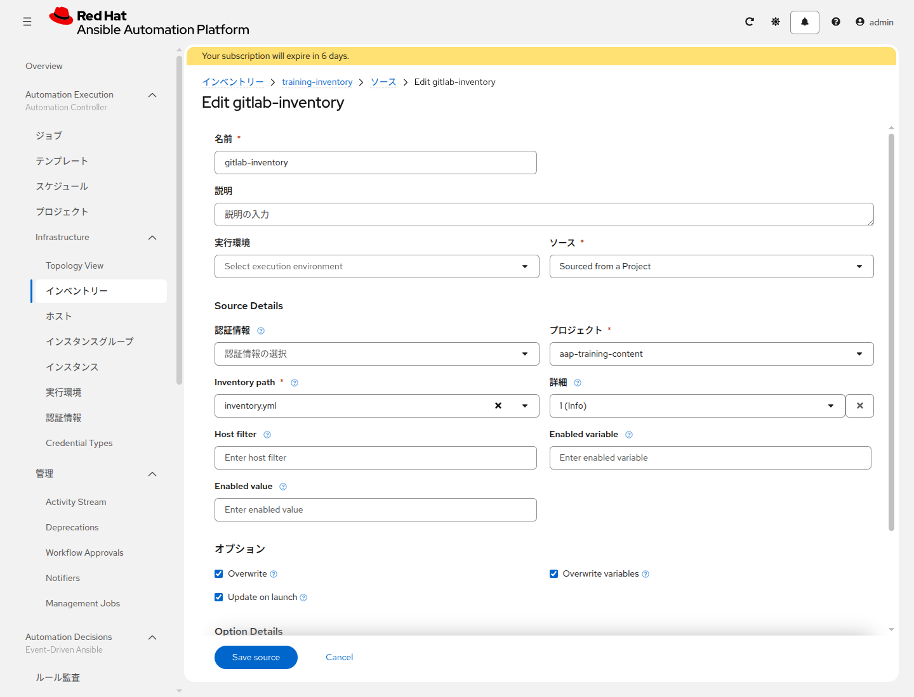

# 演習 6 - Inventory Source

[演習5](./ex5.md) | [演習7へ](./ex7.md)

演習3では画面からホストを登録しました。ここでは、GitLab の `inventory.yml` を正とし、同期するたびに AAP のホスト一覧をそのファイルへ合わせます。

## Section 1: ソースを作る

`<name_prefix>-training-inventory` を開き、**ソース** タブでソースを追加します。

| 項目 | 入力値 |
|---|---|
| 名前 | `<name_prefix>-gitlab-inventory` |
| ソース | `Sourced from a Project` |
| プロジェクト | `<name_prefix>-aap-training-content` |
| Inventory path | `inventory.yml` |
| Overwrite | 有効 |
| Overwrite variables | 有効 |
| Update on launch | 有効 |

日本語UIでも、ファイルの欄名は **Inventory path** です。「インベントリファイル」という欄はありません。保存します。

Overwrite を有効にすると、このソースが前回の同期で取り込んだホストやグループのうち、`inventory.yml` から消えたものが消えます。画面から追加しただけで、ファイルに一度も書いていないホストは残ります。演習3で画面から入れた `lin1` と `win1` は、ファイルに同じ名前で書いてあれば残り、変数はファイルの内容で上書きされます。

## Section 2: 同期する

ソースの同期を実行します。成功すると、グループ `linux` と `windows`、ホスト `lin1` と `win1` が表示されます。`lin1` と `win1` を開き、次がファイルに書いた値になっていることを確認します。

* `ansible_host` が、自分のアドレスである
* Windows の `ansible_psrp_auth`、`ansible_psrp_protocol`、`ansible_psrp_port` が、演習3で保存した3つと一致している。NTLM のままなら `ntlm`、`http`、`5985` です。Kerberos に置き換えた人は `kerberos`、`https`、`5986` です

まだ `203.0.113.10` のまま、または Windows の3つのどれかが演習3と違うときは、Web IDE で `inventory.yml` を直し、コミットしてから、もう一度同期します。

演習3の `<name_prefix>-aws-runner` には、このソースを付けません。`localhost` が消えるためです。サーバがすでにある場合、`<name_prefix>-aws-runner` は作っていないので、この注意は読み飛ばしてください。

## 次

[演習7](./ex7.md) で、ファイルを書くジョブを実行します。
