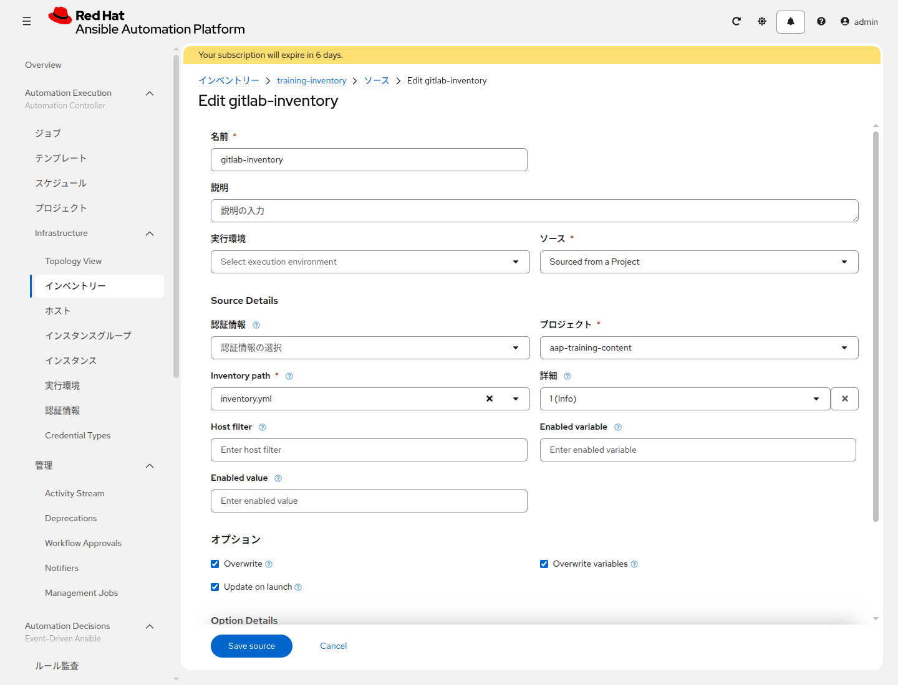

# 演習 6 - インベントリソース

[演習5](./ex5.md) | [演習7へ](./ex7.md)

> **前提:** [演習3](../basic-intro/ex3.md) のインベントリー、[演習5](./ex5.md) のプロジェクト

演習3では画面からホストを登録しました。ここでは、GitLab の `inventory.yml` を元にして、同期するたびに AAP のホスト一覧をそのファイルへ合わせます。

## Section 1: ソースを作る

`<name_prefix>-training-inventory` を開き、**ソース** タブでソースを追加します。

| 項目 | 入力値 |
|---|---|
| 名前 | `<name_prefix>-gitlab-inventory` |
| ソース | `Sourced from a Project` |
| プロジェクト | `<name_prefix>-aap-training-content` |
| Inventory path | `inventory.yml` |
| Overwrite | 有効 |
| Overwrite variables | 有効 |
| Update on launch | 有効 |

日本語UIでも、ファイルの欄名は **Inventory path** です。「インベントリファイル」という欄はありません。保存します。

写真のプロジェクト名に接頭辞は写っていません。選ぶのは `<name_prefix>-aap-training-content` です。認証情報の欄は空欄のままにします。保存ボタンは **Save source** です。

Overwrite を有効にすると、このソースが前回の同期で取り込んだホストやグループのうち、`inventory.yml` から削除したものが消えるようになります。画面から追加しただけで、ファイルに一度も書いていないホストは残ります。演習3で画面から入れた `lin1` と `win1` は、ファイルに同じ名前で書いてあれば残り、変数はファイルの内容で上書きされます。

## Section 2: 同期する

ソースの同期を実行します。成功すると、グループ `linux` と `windows`、ホスト `lin1` と `win1` が表示されます。`inventory.yml` で2つのグループをまとめている親グループ `targets` も表示されます。`lin1` と `win1` を開き、次がファイルに書いた値になっていることを確認します。

* `ansible_host` が、自分のアドレスになっていること。Kerberos の Windows は、演習3で保存した FQDN になっていること
* Windows の `ansible_psrp_auth`、`ansible_psrp_protocol`、`ansible_psrp_port` が、演習3で保存した3つと一致していること。NTLM のままなら `ntlm`、`http`、`5985`、Kerberos に置き換えた人は `kerberos`、`https`、`5986`

まだ `203.0.113.10` のまま、または Windows の3つのどれかが演習3と違うときは、Web IDE で `inventory.yml` を直し、コミットしてから、もう一度同期します。

AWS でサーバを作った場合は、演習3で作った `<name_prefix>-aws-runner` には、このソースを付けません。付けると、同期で `localhost` が消えます。

## 次

[演習7](./ex7.md) で、ファイルを書くジョブを実行します。
