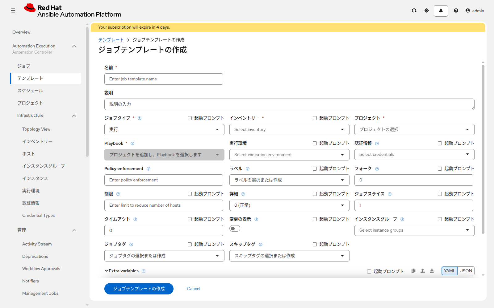
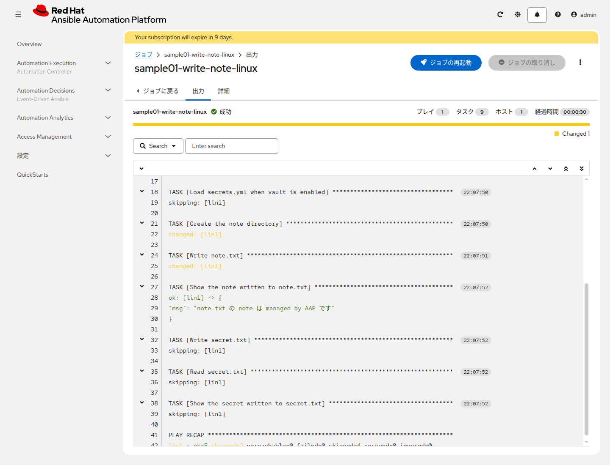
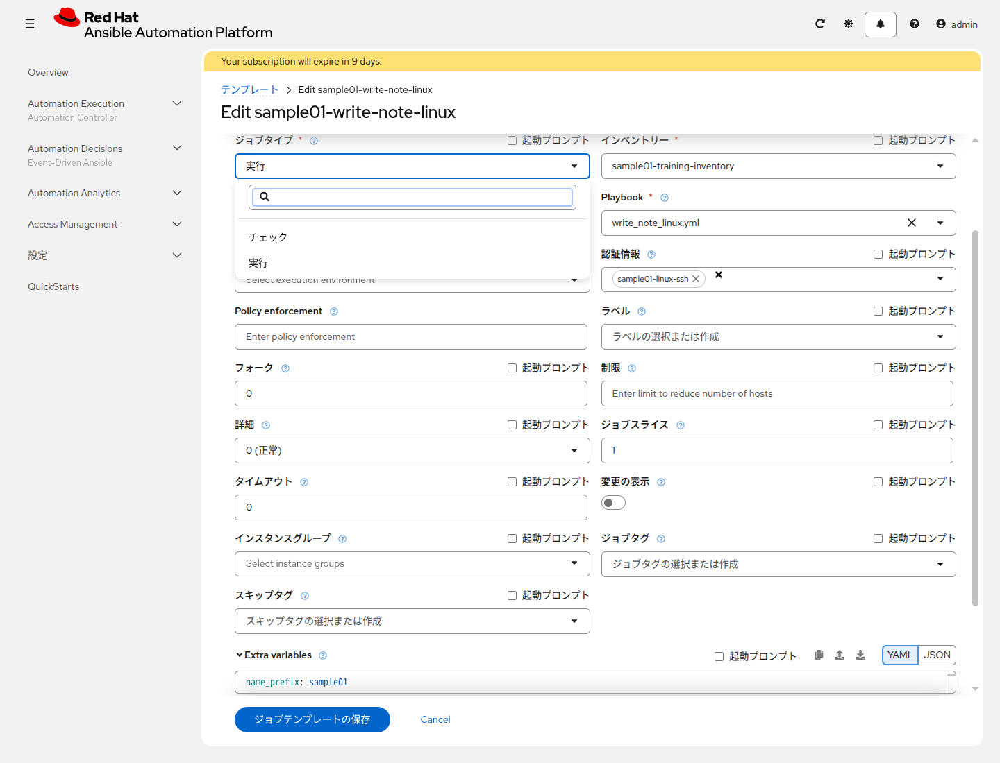
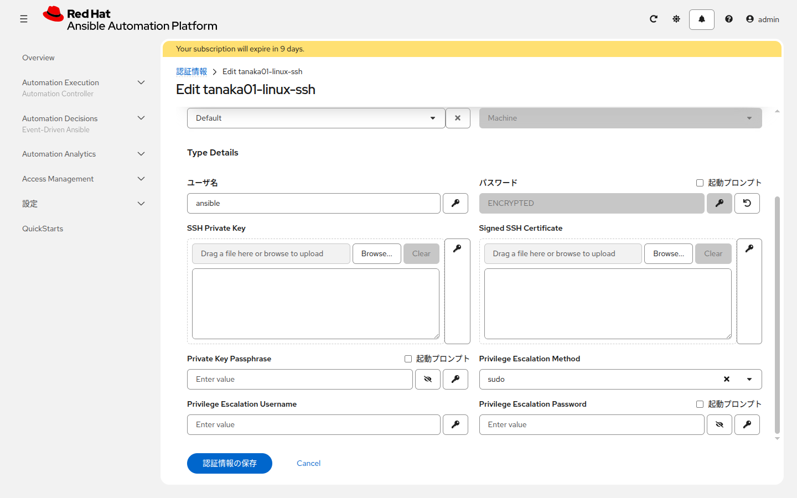
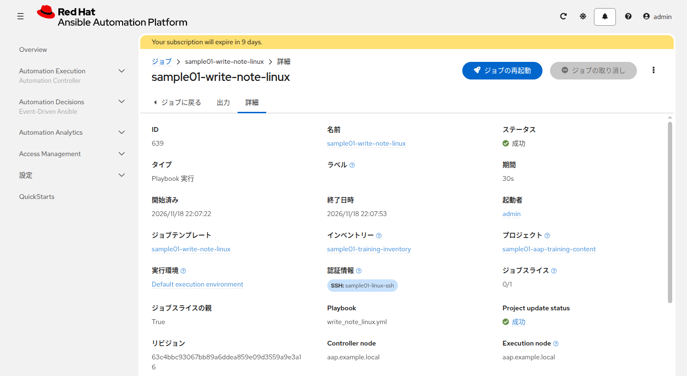

# 演習 7 - ジョブテンプレートを実行する

[演習6](./ex6.md) | [演習8へ](./ex8.md)

> **前提:** [演習2](../basic-intro/ex2.md) の認証情報、[演習3](../basic-intro/ex3.md) のインベントリー、[演習5](./ex5.md) のプロジェクト

Linux と Windows のそれぞれに `note.txt` を書くテンプレートを作成します。Windows 用と Linux 用で別々の認証情報を使うため、テンプレートは2つ作ります。1つのテンプレートには、同じタイプ（Machine）の認証情報を1つしか付けられないからです。

## Section 1: Linux

**Automation Execution > テンプレート** を開き、**テンプレートの作成** > **ジョブテンプレートの作成** をクリックします。



| 項目 | 入力値 |
|---|---|
| 名前 | `<name_prefix>-write-note-linux` |
| インベントリー | `<name_prefix>-training-inventory` |
| プロジェクト | `<name_prefix>-aap-training-content` |
| Playbook | `write_note_linux.yml` |
| 実行環境 | 空欄 |
| 認証情報 | `<name_prefix>-linux-ssh` |
| 制限 | 空欄のまま（Playbook の対象はグループ `linux`） |
| Extra variables | 下の1行 |

```yaml
name_prefix: tanaka01
```

`tanaka01` は演習1で決めた接頭辞にします。Playbook の中の `{{ name_prefix }}` は書き換えません。ファイルは `/tmp/<name_prefix>-aap-training/note.txt` に書かれます。

表に無い欄は空欄のままにします。**起動プロンプト** には、この時点ではチェックを入れません。実行環境も空欄です。空欄のときは、システムの既定の実行環境で動きます。実行環境が何かは [AAPのしくみ](../aap_overview.md) に書いてあります。起動画面には Extra variables は出ないので、この編集画面で保存します。

保存すると詳細画面に戻ります。右上の **テンプレートの起動** をクリックします。

起動すると、ジョブの **出力** が開きます。上部に成功か失敗と、Changed の数が出ます。上部の Changed は、変更のあったホストの数です。各タスクの行は、変更が無ければ `ok`、ファイルを書いたときは黄色の `changed` です。



ジョブが成功すると、出力の `Show the note written to note.txt` に次の行が出ます。`training_note` の既定値は `managed by AAP` です。この行が、ファイルの `note:` に書いた文面です。

```
note.txt の note は managed by AAP です
```

`Load secrets.yml when vault is enabled`、`Write secret.txt`、`Read secret.txt`、`Show the secret written to secret.txt` は `skipping` です。この演習では Vault をまだ使いません。

先頭の `SSH password:` は、認証情報を渡したときの表示です。演習9で Vault 認証情報を付けると、`Vault password:` も出ます。パスワードそのものは出ません。その下に `[WARNING]: Platform linux on host lin1 is using the discovered Python interpreter` で始まる WARNING が出ても、この演習では無視して構いません。

同じテンプレートをもう一度、**テンプレートの起動** から起動します。2回目は、出力の `Write note.txt` の行が `ok` になり、上部の Changed は 0 です。内容が同じなら書き直しません。

ファイルを変えずに結果だけ見るときは、**テンプレートの編集** を開き、**ジョブタイプ** を **チェック** に変えて保存してから起動します。選択肢は **実行** と **チェック** です。ファイルは変わりません。内容が今のファイルと違うタスクは `changed`、同じ内容のタスクは `ok` になります。



写真の `tanaka01` は例です。自分の接頭辞に読み替えます。この演習の認証情報は `<name_prefix>-linux-ssh` だけです。ジョブタイプの横も、制限の横も、**起動プロンプト** は外したままにします。

起動画面には「チェックモード」という項目はありません。ジョブタイプの横の **起動プロンプト** にチェックが無いと、起動画面でジョブタイプを変えても **実行** のままです。この演習では起動画面ではなく、編集画面のジョブタイプを変えます。確認が終わったら、ジョブタイプを **実行** に戻して保存します。

## Section 2: Windows

Section 1 と同じく **テンプレートの作成** > **ジョブテンプレートの作成** で新しく作ります。Section 1 と違う箇所だけ次のとおりです。ほかの欄は Section 1 と同じにします。

| 項目 | 入力値 |
|---|---|
| 名前 | `<name_prefix>-write-note-windows` |
| Playbook | `write_note_windows.yml` |
| 認証情報 | `<name_prefix>-windows-psrp` |

Extra variables には、Linux と同じ `name_prefix` の1行を入れます。ファイルは `C:\temp\<name_prefix>-aap-training\note.txt` に書かれます。

起動して成功することを確認します。`Show the note written to note.txt` は Linux と同じ文面です。

Kerberos の場合は、ユーザー名が `ユーザー@レルム` になっているかを確認します。失敗したら、ホスト変数の `ansible_psrp_auth`、ポート、プロトコルが演習3の Kerberos の値かを確認します。

## Section 3: 読み取り用テンプレート

同じ手順で、変更しない確認用を2つ作ります。

| 名前 | Playbook | 認証情報 |
|---|---|---|
| `<name_prefix>-verify-note-linux` | `verify_note_linux.yml` | `<name_prefix>-linux-ssh` |
| `<name_prefix>-verify-note-windows` | `verify_note_windows.yml` | `<name_prefix>-windows-psrp` |

インベントリーとプロジェクトは、書くときと同じです。Extra variables には、書くときと同じ `name_prefix` の1行を入れます。両方を起動し、成功することを確認します。`Show note.txt` に、ファイルの中身が1行で出ます。`\n` は改行の意味です。Linux は次の形です。`address:` のあとは、自分の `lin1` の `ansible_host` です。Windows は `hostname: win1` で始まります。

```
"msg": "hostname: lin1\naddress: <ansible_host の値>\nnote: managed by AAP\n"
```

ホスト名または `managed by AAP` が無いと、その直後の確認タスクが失敗します。`name_prefix` の行が無いと、ファイルを読む前に失敗します。

## Section 4: 権限昇格（sudo）

<a id="become"></a>

ここまでのジョブは、ログインしたユーザーのまま動いています。実際の運用では、パッケージやサービスの操作に root の権限が要ります。Playbook に `become: true` を書き、認証情報に sudo の方式を入れると、ジョブは sudo で動きます。

この節は、Linux のログインユーザーが sudo を使えるときに行います。AWS で作った Linux のユーザー `ansible` は、パスワードなしで sudo を使えます。既存サーバで sudo を使えるか分からないときは、この節を飛ばして Section 5 へ進みます。

Web IDE で、[sample-content/check_become.yml](../sample-content/check_become.yml) をプロジェクトの直下に置き、**Commit to main** のあと、AAP のプロジェクトを同期します。

**Automation Execution > Infrastructure > 認証情報** で `<name_prefix>-linux-ssh` を開いて **認証情報の編集** を押し、次を入れて **認証情報の保存** を押します。



写真の `tanaka01` は例です。パスワードの欄は、保存済みの値が `ENCRYPTED` と表示されます。触らずにそのままにします。

| 項目 | 入力値 |
|---|---|
| Privilege Escalation Method | `sudo`（入力欄を開くと選択肢に出ます） |
| Privilege Escalation Username | 空欄（空欄のときは `root`） |
| Privilege Escalation Password | AWS で作った Linux は空欄。既存サーバで sudo にパスワードが要るときは、そのパスワード |

方式を入れても、`become: true` が無い Playbook は sudo を使いません。書くジョブと確認ジョブの動きは変わりません。

次のジョブテンプレートを作ります。表に無い欄は空欄です。

| 項目 | 入力値 |
|---|---|
| 名前 | `<name_prefix>-check-become` |
| インベントリー | `<name_prefix>-training-inventory` |
| プロジェクト | `<name_prefix>-aap-training-content` |
| Playbook | `check_become.yml` |
| 実行環境 | 空欄 |
| 認証情報 | `<name_prefix>-linux-ssh` |

起動し、出力の `Show the user after sudo` に次の行が出ることを確認します。

```
sudo のあとのユーザーは root です
```

`The command ran as root` で失敗したときは、認証情報の **Privilege Escalation Method** が `sudo` かを確認します。`Missing sudo password` や `incorrect sudo password` と出たときは、**Privilege Escalation Password** を確認します。

## Section 5: ジョブの記録を見て、もう一度起動する

<a id="relaunch"></a>

ジョブが失敗したときは、まず記録を見て、直したあとに同じ条件でもう一度起動します。

**Automation Execution > ジョブ** を開き、Section 1 で起動した `<name_prefix>-write-note-linux` のジョブ名をクリックします。**詳細** タブで、次を確認します。



写真の `tanaka01` は例です。Extra variables は、この画面を下へスクロールすると出ます。

| 項目 | 見えるもの |
|---|---|
| ステータス | 成功、または失敗 |
| 実行環境 | 使った実行環境の名前。空欄で起動したときは既定の名前 |
| リビジョン | 使った Playbook の GitLab のコミット |
| Extra variables | `name_prefix: tanaka01` のように、渡した値 |

ジョブの詳細画面の右上にある **ジョブの再起動** を押すと、同じテンプレートが同じ値でもう一度起動し、新しいジョブが1件増えます。失敗したジョブでは、このボタンが **ホストパラメーターを使用した再起動** になり、開くと **すべてのホストでの再起動** と **失敗したホストでの再起動** を選べます。

出力の行数を増やして調べるときは、**テンプレートの編集** の **詳細** を `1 (詳細)` 以上に変えて保存し、起動します。`ansible-playbook -v` と同じです。確認が終わったら `0 (正常)` に戻して保存します。

## 次

[演習8](./ex8.md) で、ファイルに書くメモを起動時に入力できるようにします。
