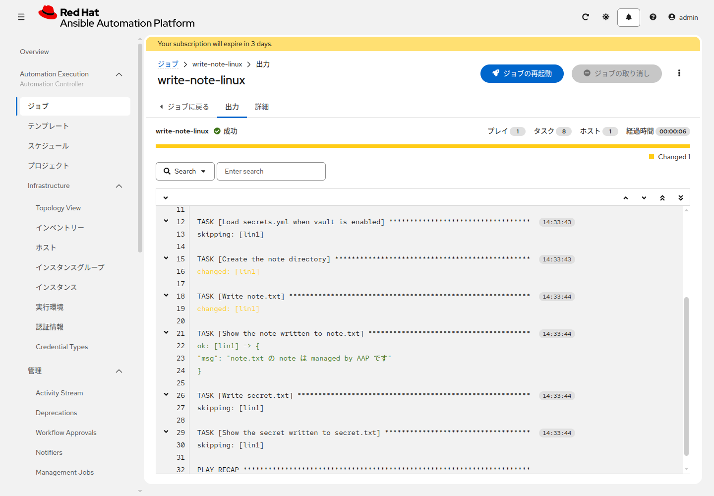
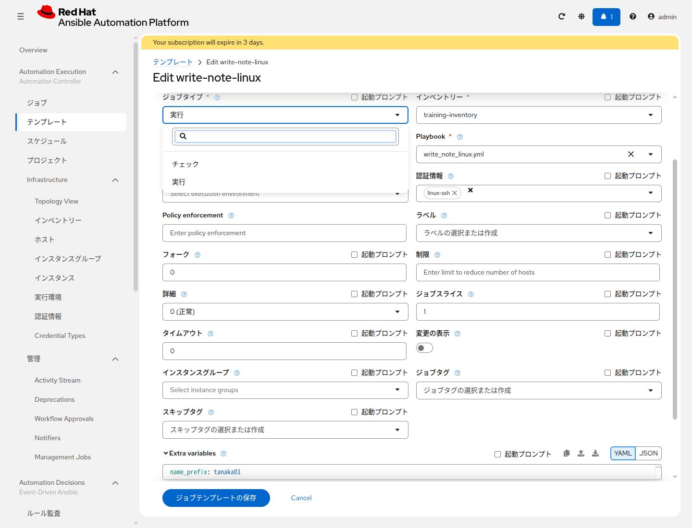

# 演習 7 - Job Templateを実行する

[演習6](./ex6.md) | [演習8へ](./ex8.md)

Linux と Windows のそれぞれに `note.txt` を書きます。1つのジョブに付けられる Machine 認証情報は1つなので、テンプレートは2つ作ります。

## Section 1: Linux

**Automation Execution > テンプレート** を開き、**テンプレートの作成** > **ジョブテンプレートの作成** をクリックします。


| 項目 | 入力値 |
|---|---|
| 名前 | `<name_prefix>-write-note-linux` |
| インベントリー | `<name_prefix>-training-inventory` |
| プロジェクト | `<name_prefix>-aap-training-content` |
| Playbook | `write_note_linux.yml` |
| 実行環境 | 空欄 |
| 認証情報 | `<name_prefix>-linux-ssh` |
| 制限 | 空欄のまま（Playbook の対象はグループ `linux`） |
| Extra variables | 下の1行 |

```yaml
name_prefix: tanaka01
```

`tanaka01` は演習1で決めた接頭辞にします。Playbook の中の `{{ name_prefix }}` は書き換えません。ファイルは `/tmp/<name_prefix>-aap-training/note.txt` に書かれます。

表に無い欄は空欄のままにします。**起動プロンプト** には、この時点ではチェックを入れません。実行環境も空欄です。起動画面には Extra variables は出ないので、この編集画面で保存します。

保存すると詳細画面に戻ります。右上の **テンプレートの起動** をクリックします。

起動すると、ジョブの **出力** が開きます。上部に成功か失敗と、Changed の数が出ます。上部の Changed は、変更のあったホストの数です。各タスクの行は、変更が無ければ `ok`、ファイルを書いたときは黄色の `changed` です。



ジョブが成功すると、出力の `Show the note written to note.txt` に次の行が出ます。`training_note` の既定値は `managed by AAP` です。この行が、ファイルの `note:` に書いた文面です。

```
note.txt の note は managed by AAP です
```

`Load secrets.yml when vault is enabled`、`Write secret.txt`、`Show the secret written to secret.txt` は `skipping` です。この演習では Vault をまだ使いません。

先頭の `SSH password:` と `Vault password:` は、認証情報を渡したときの表示です。パスワードそのものは出ません。その下に Python の WARNING が出ても、この演習では無視して構いません。

同じテンプレートをもう一度、**テンプレートの起動** から起動します。2回目は、出力の `Write note.txt` の行が `ok` になり、上部の Changed は 0 です。内容が同じなら書き直しません。

ファイルを変えずに結果だけ見るときは、**テンプレートの編集** を開き、**ジョブタイプ** を **チェック** に変えて保存してから起動します。選択肢は **実行** と **チェック** です。ファイルは変わりません。内容が今のファイルと違うタスクは `changed`、同じ内容のタスクは `ok` になります。



写真の `tanaka01` は、演習1の例です。自分の接頭辞に読み替えます。この演習の認証情報は `<name_prefix>-linux-ssh` だけです。ジョブタイプの横も、制限の横も、**起動プロンプト** は外したままにします。

起動画面には「チェックモード」という項目はありません。ジョブタイプの横の **起動プロンプト** にチェックが無いと、起動画面でジョブタイプを変えても **実行** のままです。この演習では起動画面ではなく、編集画面のジョブタイプを変えます。確認が終わったら、ジョブタイプを **実行** に戻して保存します。

## Section 2: Windows

`<name_prefix>-write-note-linux` をコピーできる場合はコピーし、コピーのメニューが無い場合は同じ項目で新規作成します。違う箇所だけ次のとおりです。

| 項目 | 入力値 |
|---|---|
| 名前 | `<name_prefix>-write-note-windows` |
| Playbook | `write_note_windows.yml` |
| 認証情報 | `<name_prefix>-windows-psrp` |

コピーした場合、Extra variables の `name_prefix` はそのままにします。新規作成の場合は、Linux と同じ1行を入れます。ファイルは `C:\temp\<name_prefix>-aap-training\note.txt` に書かれます。

起動して成功することを確認します。`Show the note written to note.txt` は Linux と同じ文面です。

Kerberos の場合は、ユーザー名が `ユーザー@レルム` になっているかを確認します。失敗したら、ホスト変数の `ansible_psrp_auth`、ポート、プロトコルが演習3の Kerberos の値かを確認します。

## Section 3: 読み取り用テンプレート

同じ手順で、変更しない確認用を2つ作ります。

| 名前 | Playbook | 認証情報 |
|---|---|---|
| `<name_prefix>-verify-note-linux` | `verify_note_linux.yml` | `<name_prefix>-linux-ssh` |
| `<name_prefix>-verify-note-windows` | `verify_note_windows.yml` | `<name_prefix>-windows-psrp` |

インベントリーとプロジェクトは、書くときと同じです。コピーした場合、Extra variables の `name_prefix` は残します。新規作成の場合は、書くときと同じ1行を入れます。両方を起動し、成功することを確認します。`Show note.txt` に、ファイルの中身が出ます。Linux は次の形です。アドレスの行は、自分の `lin1` の `ansible_host` です。Windows は、1行目が `hostname: win1` です。

```
hostname: lin1
address: <ansible_host の値>
note: managed by AAP
```

ホスト名または `managed by AAP` が無いと、その直後の確認タスクが失敗します。`name_prefix` の行が無いと、ファイルを読む前に失敗します。

## 次

[演習8](./ex8.md) で、ファイルに書くメモを起動時に入力できるようにします。
