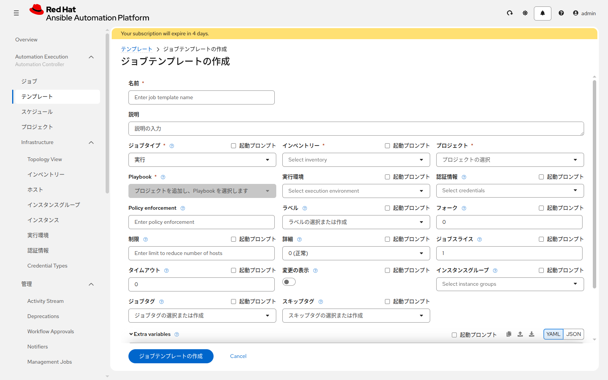
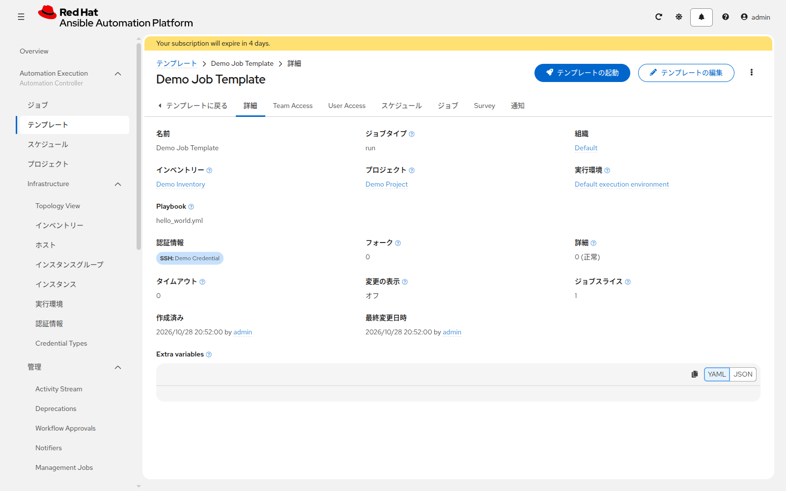

# 演習 7 - Job Templateを実行する

[演習6](./ex6.md) | [演習8へ](./ex8.md)

Linux と Windows のそれぞれに `note.txt` を書きます。1つのジョブに付けられる Machine 認証情報は1つなので、テンプレートは2つ作ります。

## Section 1: Linux

**Automation Execution > テンプレート** を開き、**テンプレートの作成** > **ジョブテンプレートの作成** をクリックします。



| 項目 | 入力値 |
|---|---|
| 名前 | `write-note-linux` |
| インベントリー | `training-inventory` |
| プロジェクト | `aap-training-content` |
| Playbook | `write_note_linux.yml` |
| 実行環境 | 空欄 |
| 認証情報 | `linux-ssh` |
| 制限 | 空欄のまま（Playbook の対象はグループ `linux`） |

保存し、**テンプレートの起動** をクリックします。ジョブの画面では、右上からログを開きます。



ジョブが成功すると、`lin1` の `/var/tmp/aap-training/note.txt` は次の内容になります。`training_note` の既定値は `managed by AAP` です。

```
hostname: lin1
address: <ansible_host の値>
note: managed by AAP
```

同じテンプレートをもう一度起動します。2回目は `note.txt` を書くタスクが `ok` になり、`changed` は 0 です。内容が同じなら書き直しません。

**チェックモード** を有効にして起動すると、ファイルは変わりません。内容が今のファイルと違うタスクは `changed`、同じ内容のタスクは `ok` になります。確認が終わったら、チェックモードを外してください。

## Section 2: Windows

`write-note-linux` をコピーするか、同じ項目で新規作成します。違う箇所だけ次のとおりです。

| 項目 | 入力値 |
|---|---|
| 名前 | `write-note-windows` |
| Playbook | `write_note_windows.yml` |
| 認証情報 | `windows-psrp` |

起動して成功することを確認します。ファイルは `C:\Users\Public\aap-training\note.txt` です。中身の形は Linux と同じで、1行目は `hostname: win1` です。

Kerberos の場合は、演習5で `krb5.conf` を置いてから実行します。失敗したら、レルム、KDC、ユーザー名が `ユーザー@レルム` になっているかを確認します。

## Section 3: 読み取り用テンプレート

同じ手順で、変更しない確認用を2つ作ります。

| 名前 | Playbook | 認証情報 |
|---|---|---|
| `verify-note-linux` | `verify_note_linux.yml` | `linux-ssh` |
| `verify-note-windows` | `verify_note_windows.yml` | `windows-psrp` |

インベントリーとプロジェクトは、書くときと同じです。両方を起動し、成功することを確認します。`note.txt` にホスト名または `managed by AAP` が無いと、ここで失敗します。

## 次

[演習8](./ex8.md) で、ファイルに書くメモを起動時に入力できるようにします。
