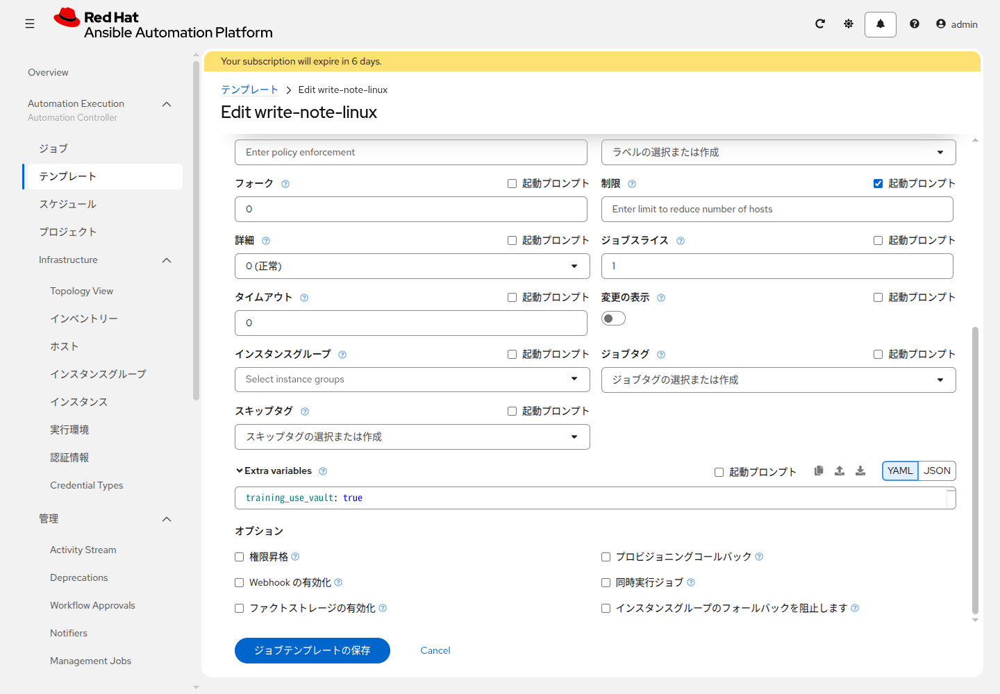
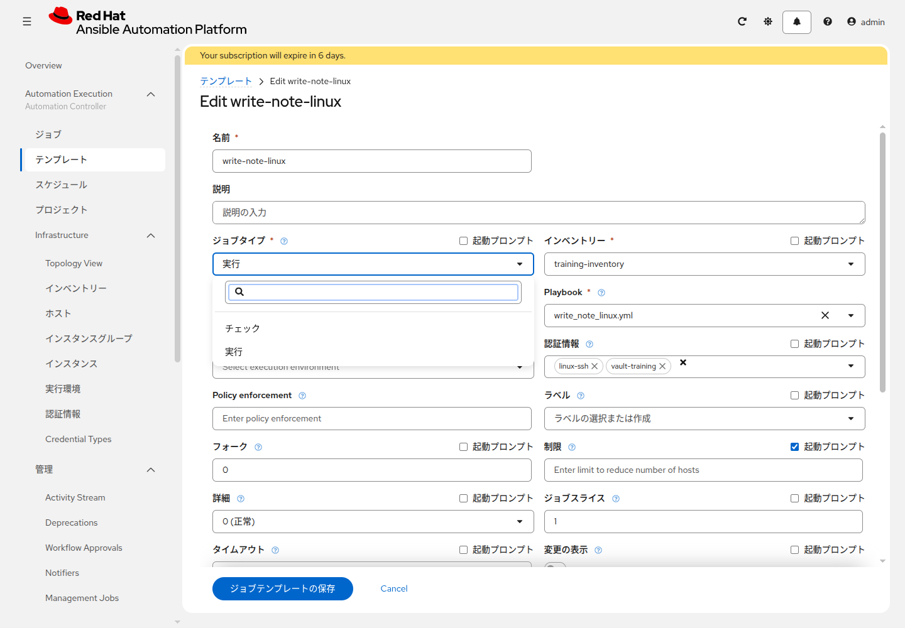
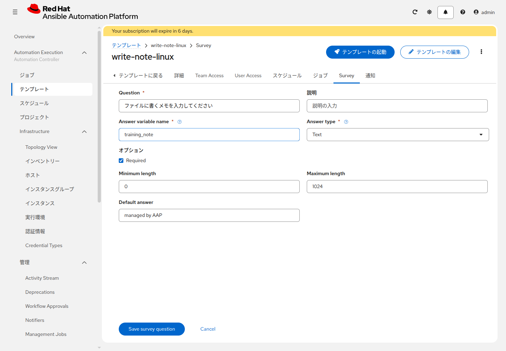
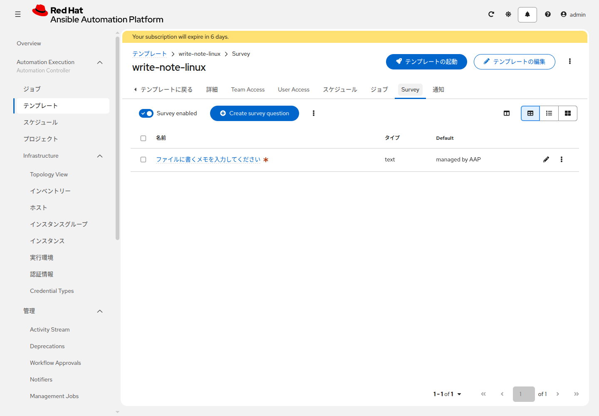

# 演習 8 - 起動時の値、制限、Survey

[演習7](./ex7.md) | [演習9へ](./ex9.md)

`training_note` は `group_vars/all.yml` では `managed by AAP` です。この演習では、節ごとにジョブを起動します。Section 1 はメモの文面、Section 2 は対象ホスト、Section 3 は起動時の質問です。`name_prefix` の行は、どの節でも残します。

## Section 1: Extra variables

`<name_prefix>-write-note-linux` の **テンプレートの編集** を開き、下までスクロールします。入れる欄の名前は **Extra variables** です。「変数」という欄はありません。



この写真の `training_use_vault: true` は、[演習9](./ex9.md) で入れる行です。この演習では、その行は入れません。演習7で保存した `name_prefix` の行は残します。この行が無いと、ファイルを書く前に失敗します。

欄の中を、次の2行にします。`tanaka01` は、演習7で保存してある自分の接頭辞のままにします。

```yaml
name_prefix: tanaka01
training_note: hello from survey
```

**ジョブテンプレートの保存** を押し、起動します。出力の `Write note.txt` が `changed` になり、ファイルの `note:` の行が `hello from survey` になります。

これは `ansible-playbook write_note_linux.yml -e "training_note=hello from survey"` と同じです。`name_prefix` は、ファイルの置き場所に使われます。

確認が終わったら、`training_note` の行だけを消して保存します。`name_prefix` の行は残します。Survey と Extra variables の両方に `training_note` があると、どちらがメモの文面になるか分かりにくくなります。

もう一度起動します。`note:` の行は、`group_vars/all.yml` の既定値 `managed by AAP` に戻ります。

## Section 2: 制限

もう一度 **テンプレートの編集** を開きます。Extra variables は、次の1行のままです。

```yaml
name_prefix: tanaka01
```

**制限** の右にある **起動プロンプト** にチェックを入れます。ジョブタイプの横の起動プロンプトは外したままです。



保存して起動すると、実行前に制限の入力欄が出ます。`lin1` と入力して起動し、出力の対象が `lin1` だけであることを確認します。`note:` の行は `managed by AAP` のままです。写真の認証情報に `<name_prefix>-vault-training` が見えるのは演習9のあとです。この演習では `<name_prefix>-linux-ssh` だけです。

## Section 3: Survey

`<name_prefix>-write-note-linux` の **Survey** タブを開き、**Create survey question** をクリックします。Extra variables の `name_prefix` は、このまま残します。



| 項目 | 入力値 |
|---|---|
| Question | `ファイルに書くメモを入力してください` |
| Answer variable name | `training_note` |
| Answer type | Text |
| Required | 有効 |
| Default answer | `managed by AAP` |

**Save survey question** を押します。一覧に戻ったら、左の **Survey enabled** をオンにします。オフのままだと、起動時に質問が出ません。



起動すると、メモの入力欄が出ます。Extra variables の `training_note` は Section 1 で消してあるので、文面はこの入力が決めます。`second note` と入力して実行し、`note.txt` の `note:` が `second note` になることを確認します。終わったら、もう一度起動して既定の `managed by AAP` に戻します。

`<name_prefix>-write-note-windows` の Extra variables にも、演習7で入れた `name_prefix` の行が残っています。同じ質問を1つ作り、`second note` で起動してから、既定の `managed by AAP` でもう一度起動します。

## 次

[演習9](./ex9.md) で、ファイルに書く秘密の値だけを暗号化して渡します。
