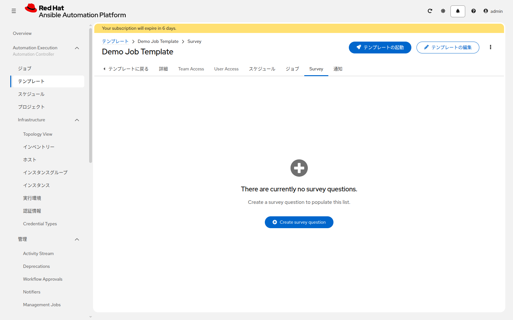

# 演習 8 - 変数、制限、Survey

[演習7](./ex7.md) | [演習9へ](./ex9.md)

`training_note` は `group_vars/all.yml` では `managed by AAP` です。ジョブの起動時に別の文字列へ変え、対象ホストを1台に絞ります。

## Section 1: Extra variables

`write-note-linux` の編集画面を開き、変数に次を入れます。

```yaml
training_note: hello from survey
```

起動します。`note.txt` を書くタスクが `changed` になり、ファイルの `note:` の行が `hello from survey` になります。

これは `ansible-playbook write_note_linux.yml -e "training_note=hello from survey"` と同じです。画面の変数は Extra Variables として渡されます。

確認が終わったら、この変数は消してください。Survey と両方に値があると、どちらが効くか分かりにくくなります。

## Section 2: 制限

編集画面の **起動プロンプト** で、制限にチェックを入れます。保存して起動すると、実行前に制限の入力欄が出ます。`lin1` と入力して起動し、対象が `lin1` だけであることをログで確認します。

## Section 3: Survey

`write-note-linux` の **Survey** タブを開き、**Create survey question** をクリックします。



| 項目 | 入力値 |
|---|---|
| Question | `ファイルに書くメモを入力してください` |
| Answer variable name | `training_note` |
| Answer type | Text |
| Required | 有効 |
| Default answer | `managed by AAP` |

Survey 自体も有効にして保存します。起動すると入力欄が出ます。`second note` と入力して実行し、`note.txt` の `note:` が `second note` になることを確認します。終わったら、もう一度起動して既定の `managed by AAP` に戻します。

`write-note-windows` にも、同じ質問を1つ作り、同じ確認をします。

## 次

[演習9](./ex9.md) で、パスワードを暗号化したファイルとして渡します。
