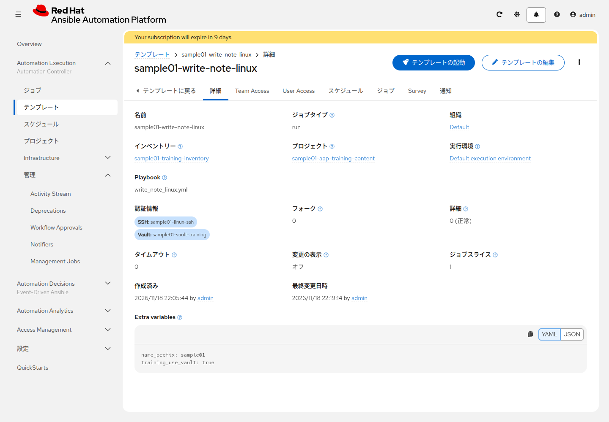
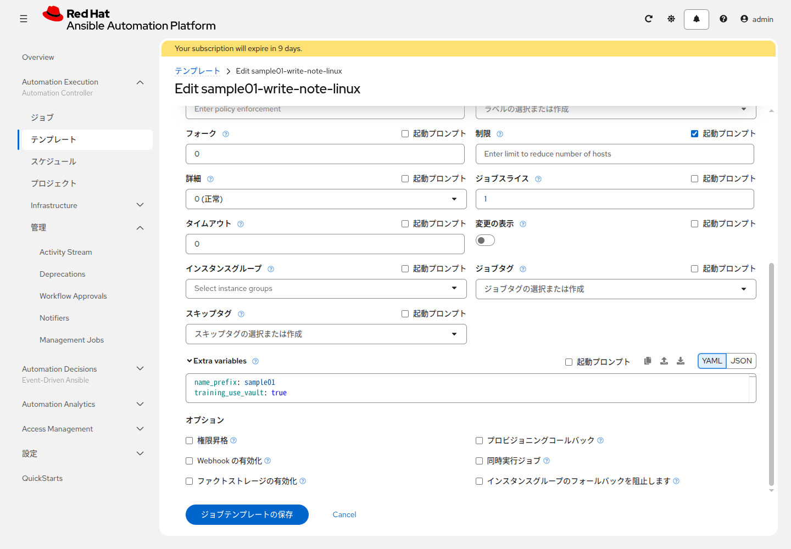

# 演習 9 - Vault

[演習8](./ex8.md) | [演習10へ](./ex10.md)

> **前提:** [演習8](./ex8.md) の制限の起動プロンプトと Survey。[事前準備](../prepare_training_environment.md) で控えた作業用サーバへ SSH できること

この演習では、Vault で値を暗号化します。
`training_secret` の値だけを暗号化して GitLab に置き、ジョブの中で復号してファイルへ書きます。暗号化は、`ansible-vault` コマンドが使えるサーバで行います。この研修では、[事前準備](../prepare_training_environment.md) で控えた作業用サーバを使います。作業ディレクトリは、そのサーバの `/tmp` です。Web IDE には、`ansible-vault encrypt_string` が表示した文字列を貼ります。Web IDE では `ansible-vault` を実行できません。

書かれるファイル:

| OS | パス | 権限 |
|---|---|---|
| Linux | `/tmp/<name_prefix>-aap-training/secret.txt` | `0600`（接続ユーザーだけが読める） |
| Windows | `C:\temp\<name_prefix>-aap-training\secret.txt` | `C:\temp` の権限を引き継ぐ |

Windows の `secret.txt` は、`C:\temp` の権限をそのまま引き継ぎます。そのサーバにログインできる他のユーザーも読める場合があります。実際の運用では、`ansible.windows.win_acl` で読めるユーザーを絞ります。

## Section 1: ansible-vault が使えるサーバで値を暗号化する

事前準備で控えた作業用サーバへ SSH します。

```bash
ssh <ユーザー>@<作業用サーバ>
cd /tmp
command -v ansible-vault
```

`ansible-vault` のパス（例: `/usr/bin/ansible-vault`）が表示された場合は、その場で次を実行します。何も表示されなかった場合は、この Section の最後にある「AAP のコンテナで暗号化する場合」の手順で暗号化します。

暗号化する文字列は、コマンドの引数には書きません。引数に書くと、シェルの履歴に残ります。

```bash
cd /tmp
ansible-vault encrypt_string --prompt --output '/tmp/<name_prefix>-secrets.yml'
```

入力要求は、上から次の順です。

1. `New Vault password:` と `Confirm New Vault password:` には、同じパスワードを入れます。これは復号用です。`TrainingSecret1` とは別の、自分だけが知る値を決め、控えます。
2. `Variable name (enter for no name):` には `training_secret` と入れます。
3. `String to encrypt (hidden):` には `TrainingSecret1` と入れます。別の英数字でも構いません。入力した文字は画面に出ません。

`Encryption successful` と出て、`/tmp/<name_prefix>-secrets.yml` の先頭が `training_secret: !vault |`、次の行が `$ANSIBLE_VAULT;1.1;AES256` なら、値だけが暗号化されています。次のコマンドでファイルの中身を表示し、全文をコピーします。

```bash
cat '/tmp/<name_prefix>-secrets.yml'
```

<details>
<summary>AAP のコンテナで暗号化する場合</summary>

作業用サーバが AAP サーバで、`ansible-vault` が AAP のコンテナの中にだけある場合の手順です。名前に `controller` を含むコンテナを使います。`<コンテナ>` は `podman ps` に出た名前です。AAP のコンテナは、AAP のコンテナを動かしているユーザーの `podman` で動いています。`podman ps` に何も出ないときは、別のユーザーで SSH しています。事前準備で控えた、AAP サーバへ SSH するユーザーで入り直します。入力要求は、上の1から3と同じです。画面の `training_secret: !vault |` から、暗号の最後の行までをコピーします。`Encryption successful` は含めません。

```bash
cd /tmp
podman ps
podman exec -it <コンテナ> ansible-vault encrypt_string --prompt
```

</details>

> [!IMPORTANT]
> **SSH で作業用サーバに入れない、または `ansible-vault` も `podman` も使えない場合は、この演習を全部飛ばして [演習10](./ex10.md) へ進みます。** `secret.txt` は作られません。サーバへ入れるようになったら、Section 1 から実施します。

## Section 2: Web IDEに貼る

GitLab の **Code** を開き、**Web IDE** で、プロジェクトの直下に `secrets.yml` を作り、コピーした全文を貼ります。メニューが **Edit** の環境では、その中の **Web IDE** を選びます。平文の `TrainingSecret1` は貼りません。

**Commit to main** でコミットします。

<details>
<summary>git CLIで行う場合</summary>

`/tmp/<name_prefix>-secrets.yml` を、clone した作業ディレクトリへコピーしてから push します。

```bash
git add secrets.yml
git commit -m "Add encrypted training secret"
git push
```

</details>

コミットしたあと、AAP のプロジェクト `<name_prefix>-aap-training-content` を同期します。

## Section 3: Vault認証情報

**認証情報の作成** を開きます。


| 項目 | 入力値 |
|---|---|
| 名前 | `<name_prefix>-vault-training` |
| 認証情報タイプ | `Vault` |
| Vault Password | Section 1 の `New Vault password:` に入れたパスワード |

`String to encrypt (hidden):` に入れた値ではありません。

## Section 4: ジョブで復号する

`<name_prefix>-write-note-linux` の編集で、認証情報に `<name_prefix>-vault-training` を追加します。`<name_prefix>-linux-ssh` も付けたままにします。**Extra variables** は、演習8で残した `name_prefix` の行を残したまま、次の行を足します。起動画面にはこの欄は出ないので、編集画面で保存します。

```yaml
name_prefix: sample01
training_use_vault: true
```

`sample01` は、演習7で保存してある自分の接頭辞のままにします。





制限の起動プロンプトは、演習8で入れたままにします。

起動すると、演習8と同じ **Prompt on Launch** が開きます。**制限** は空欄のまま **Next** を押します。**Survey** は `managed by AAP` のまま **Next** を押し、**Review** で **Finish** を押します。メモの文面は変えません。`Show the note written to note.txt` は `note.txt の note は managed by AAP です` のままです。成功すると、`Show the secret written to secret.txt` に `secret.txt を書きました。権限は 0600 です` と出ます。ログに出るのは、ファイルを書いたことと権限です。復号した値は出ません。

Playbook の `Write secret.txt` には `no_log: true` が付いています。付いていないと、テンプレートの **詳細** を上げて起動したときに、書いた値が出力に出ることがあります。付いていれば、**詳細** を上げても、結果は `the output has been hidden due to the fact that 'no_log: true' was specified for this result` に置き換わります。実際の運用でも、秘密の値を扱うタスクには `no_log: true` を付けます。ファイルは `/tmp/<name_prefix>-aap-training/secret.txt` です。

`<name_prefix>-write-note-windows` にも `<name_prefix>-vault-training` と `<name_prefix>-windows-psrp` を付けます。Extra variables は、`name_prefix` の行を残したまま `training_use_vault: true` を足します。起動画面に **Prompts** は出ません。**Survey** は `managed by AAP` のまま **Next** を押し、**Review** で **Finish** を押します。成功すると、`Show the secret written to secret.txt` に `secret.txt を書きました` と出ます。ファイルは `C:\temp\<name_prefix>-aap-training\secret.txt` です。

`training_use_vault: true` を足し忘れると、`Load secrets.yml when vault is enabled`、`Write secret.txt`、`Read secret.txt` は `skipping` になり、`Show the secret written to secret.txt` は出ません。Vault 認証情報のパスワードが Section 1 の復号用パスワードと違うと、`training_secret` を初めて使う `Write secret.txt` が `fatal` になります。このタスクには `no_log: true` が付いているので、失敗の理由も `the output has been hidden due to the fact that 'no_log: true' was specified for this result` に置き換わります。`Write secret.txt` だけが失敗したときは、`<name_prefix>-vault-training` の Vault Password が、Section 1 の `New Vault password:` に入れた値かを確認します。

## 次

[演習10](./ex10.md) で、確認用ジョブを毎日実行する予定を作ります。
