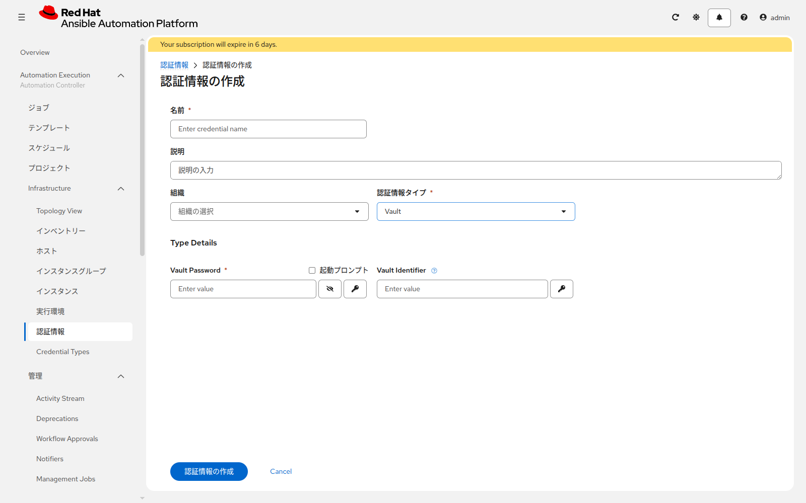
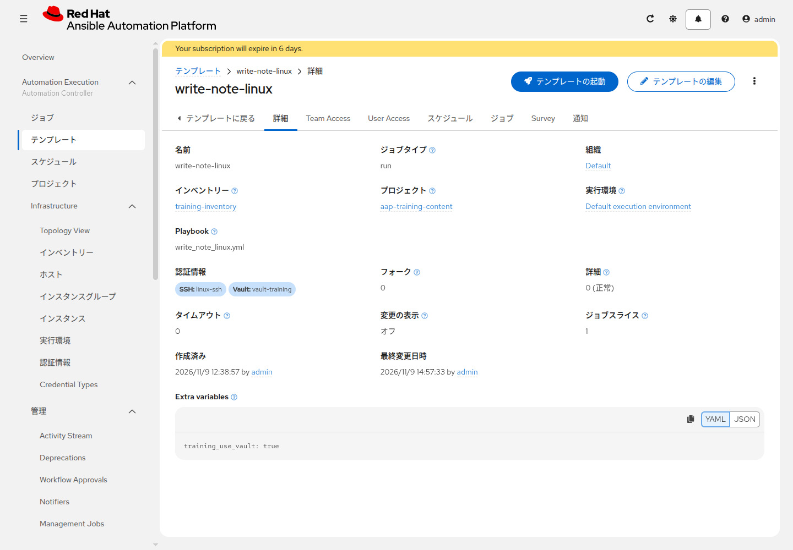
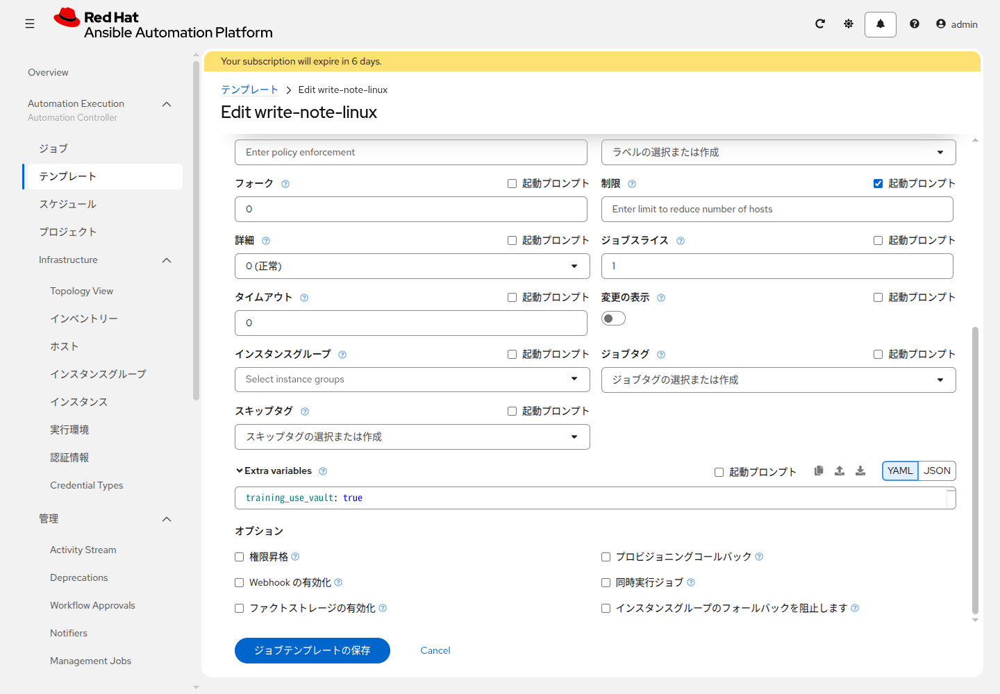

# 演習 9 - Vault

[演習8](./ex8.md) | [演習10へ](./ex10.md)

`training_secret` の値だけを暗号化して GitLab に置き、ジョブの中で復号してファイルへ書きます。暗号化は AAP サーバの `/tmp` で行います。Web IDE には、`ansible-vault encrypt_string` が表示した文字列を貼ります。Web IDE では `ansible-vault` を実行できません。

書かれるファイル:

| OS | パス | 権限 |
|---|---|---|
| Linux | `/tmp/aap-training/secret.txt` | `0600` |
| Windows | `C:\temp\aap-training\secret.txt` | 接続ユーザーが書き込める場所 |

## Section 1: AAPサーバの /tmp で値を暗号化する

AAP サーバへ SSH します。

```bash
ssh <ユーザー>@<AAPサーバ>
cd /tmp
command -v ansible-vault
```

コマンドが表示された場合は、その場で次を実行します。`TrainingSecret1` は例です。英数字で自分の値にしてください。

```bash
cd /tmp
ansible-vault encrypt_string 'TrainingSecret1' --name training_secret | tee /tmp/secrets.yml
```

`ansible-vault` が聞くパスワードは、`TrainingSecret1` とは別です。復号用なので、自分だけが知る値を決め、控えます。

`/tmp/secrets.yml` の先頭が `training_secret: !vault |` で、次の行に `$ANSIBLE_VAULT;1.1;AES256` があれば、値だけが暗号化されています。表示された全文をコピーします。

`ansible-vault` がホストに無く、コンテナで動いている場合は、名前に `controller` を含むコンテナを選びます。`<コンテナ>` は `podman ps` に出た名前です。出力は画面に出るので、全文をコピーします。

```bash
cd /tmp
podman ps
podman exec -it <コンテナ> ansible-vault encrypt_string 'TrainingSecret1' --name training_secret
```

SSH で AAP サーバに入れない、または `ansible-vault` も `podman` も使えない場合は、この演習を全部飛ばして [演習10](./ex10.md) へ進みます。`secret.txt` は作られません。サーバへ入れるようになったら、Section 1 から実施します。

## Section 2: Web IDEに貼る

GitLab の **Code** を開き、**Web IDE** で、プロジェクトの直下に `secrets.yml` を作り、コピーした全文を貼ります。メニューが **Edit** の環境では、その中の **Web IDE** を選びます。平文の `TrainingSecret1` は貼りません。

**Commit to main** でコミットします。

<details>
<summary>git CLIで行う場合</summary>

`/tmp/secrets.yml` を、clone した作業ディレクトリへコピーしてから push します。

```bash
git add secrets.yml
git commit -m "Add encrypted training secret"
git push
```

</details>

コミットしたあと、AAP のプロジェクト `aap-training-content` を同期します。

## Section 3: Vault認証情報

**認証情報の作成** を開きます。



| 項目 | 入力値 |
|---|---|
| 名前 | `vault-training` |
| 認証情報タイプ | `Vault` |
| Vault Password | Section 1 で `ansible-vault encrypt_string` に入力したパスワード |

`TrainingSecret1` の方ではありません。

## Section 4: ジョブで復号する

`write-note-linux` の編集で、認証情報に `vault-training` を追加します。`linux-ssh` も付けたままにします。**Extra variables** に次を入れます。起動画面にはこの欄は出ないので、編集画面で保存します。

```yaml
training_use_vault: true
```





起動します。成功すると `/tmp/aap-training/secret.txt` の内容は `TrainingSecret1` です。ログには値を出さないようにしてあります。

`write-note-windows` にも `vault-training` と `windows-psrp` を付け、同じ Extra variables で起動します。ファイルは `C:\temp\aap-training\secret.txt` です。

Extra variables を付け忘れると `secrets.yml` は読まれず、`secret.txt` は作られません。暗号化パスワードが違うと、ジョブは `secrets.yml` の読み込みで失敗します。

## 次

[演習10](./ex10.md) で、確認用ジョブを毎日実行する予定を作ります。
