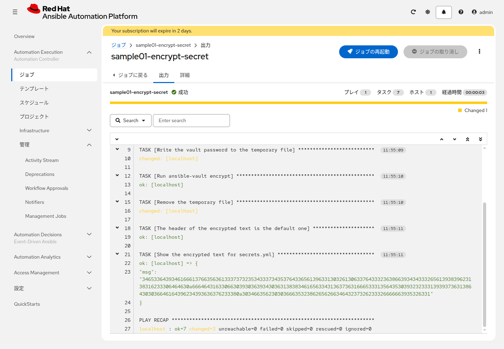
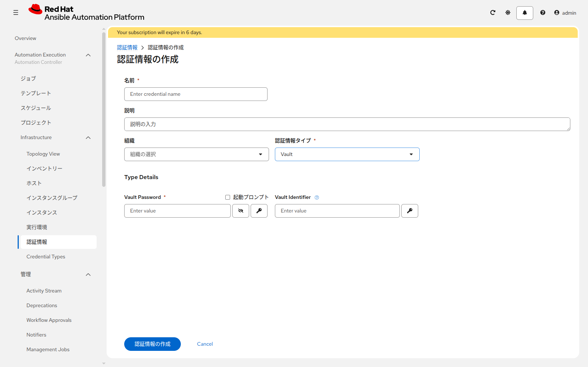

# 演習 9 - Vault

[演習8](./ex8.md) | [演習10へ](./ex10.md)

> **前提:** [演習8](./ex8.md) の制限の起動プロンプトと Survey

この演習では、`training_secret` の値だけを Vault で暗号化して GitLab に置き、ジョブの中で復号してファイルへ書き込みます。暗号化には `ansible-vault` コマンドを使います。Web IDE では `ansible-vault` を実行できないため、`ansible-vault` を実行できる場所で暗号化し、表示された暗号文を Web IDE に貼り付けます。

この演習で書き込まれるファイルは次のとおりです。

| OS | パス | 権限 |
|---|---|---|
| Linux | `/tmp/<name_prefix>-aap-training/secret.txt` | `0600`（接続ユーザーだけが読める） |
| Windows | `C:\temp\<name_prefix>-aap-training\secret.txt` | `C:\temp` の権限を引き継ぐ |

Windows の `secret.txt` は、`C:\temp` の権限をそのまま引き継ぐため、そのサーバにログインできる他のユーザーも読める場合があります。実際の運用では、`ansible.windows.win_acl` で読めるユーザーを絞ります。

## 始める前に: 暗号化する場所を決める

> [!IMPORTANT]
> **次の表の上から順に確かめ、最初に使えた方法で Section 1 を行います。** 方法C は、作業用サーバが無くても AAP の画面だけで行えるので、この演習は飛ばさずに進めます。方法C のジョブが失敗するときは、講師に確認します。
>
> | 方法 | 使える条件 | 確かめ方 |
> |---|---|---|
> | A: 作業用サーバで暗号化する | [事前準備](../prepare_training_environment.md) で控えた作業用サーバに SSH でき、`ansible-vault` がある | SSH して `command -v ansible-vault` を実行し、パスが表示される |
> | B: AAP サーバのコンテナで暗号化する | 作業用サーバが AAP サーバで、`ansible-vault` が AAP のコンテナの中にだけある | AAP のコンテナを動かしているユーザーで SSH して `podman ps` を実行し、名前に `controller` を含むコンテナが表示される |
> | C: AAP のジョブで暗号化する | A も B も使えない | 確かめることはありません。AAP の画面だけで行います |

## Section 1: 値を暗号化する

### 方法A: 作業用サーバで暗号化する

事前準備で控えた作業用サーバへ SSH します。

```bash
ssh <ユーザー>@<作業用サーバ>
cd /tmp
command -v ansible-vault
```

`ansible-vault` のパス（例: `/usr/bin/ansible-vault`）が表示されたら、その場で次を実行します。何も表示されなかった場合は、方法B か方法C に切り替えます。

暗号化する文字列は、シェルの履歴に残らないよう、コマンドの引数には書きません。

```bash
cd /tmp
ansible-vault encrypt_string --prompt --output '/tmp/<name_prefix>-secrets.yml'
```

入力要求は、上から次の順です。

1. `New Vault password:` と `Confirm New Vault password:` には、同じパスワードを入れます。これは復号に使うパスワードで、`TrainingSecret1` とは別の、自分だけが知る値を決めて控えておきます。
2. `Variable name (enter for no name):` には `training_secret` と入れます。
3. `String to encrypt (hidden):` には `TrainingSecret1` と入れます。別の英数字でも構いません。入力した文字は画面に出ません。

`Encryption successful` と出て、`/tmp/<name_prefix>-secrets.yml` の先頭が `training_secret: !vault |`、次の行が `$ANSIBLE_VAULT;1.1;AES256` なら、値だけが暗号化されています。次のコマンドでファイルの中身を表示し、全文をコピーします。

```bash
cat '/tmp/<name_prefix>-secrets.yml'
```

コピーしたら、Section 2 へ進みます。

### 方法B: AAP サーバのコンテナで暗号化する

作業用サーバが AAP サーバで、`ansible-vault` が AAP のコンテナの中にだけある場合の手順です。`<コンテナ>` には、`podman ps` に出た名前のうち `controller` を含むものを入れます。AAP のコンテナは、それを動かしているユーザーの `podman` で動いているため、`podman ps` に何も出ないときは別のユーザーで SSH しています。事前準備で控えた、AAP サーバへ SSH するユーザーで入り直します。入力要求は、方法A の1から3と同じです。画面の `training_secret: !vault |` から、暗号の最後の行までをコピーします。`Encryption successful` は含めません。

```bash
cd /tmp
podman ps
podman exec -it <コンテナ> ansible-vault encrypt_string --prompt
```

コピーしたら、Section 2 へ進みます。

<a id="encrypt-job"></a>

### 方法C: AAP のジョブで暗号化する

実行環境には `ansible` 本体が入っていて、`ansible-vault` も使えます。この方法では、Survey で受け取った値を、ジョブの中で `ansible-vault` を使って暗号化し、暗号文だけを出力します。Survey の Answer type を Password にするので、入力した値はジョブの詳細に平文で残りません。

1. Web IDE で、[sample-content/encrypt_secret.yml](../sample-content/encrypt_secret.yml) をプロジェクトの直下に置き、**Commit to main** でコミットします。そのあと、AAP のプロジェクト `<name_prefix>-aap-training-content` を同期します。
2. **ジョブテンプレートの作成** で、次を作ります。表に無い欄は空欄のままにします。この Playbook は `hosts: localhost` で、実行環境の中だけで動くため、認証情報は付けません。

   | 項目 | 入力値 |
   |---|---|
   | 名前 | `<name_prefix>-encrypt-secret` |
   | インベントリー | `<name_prefix>-training-inventory` |
   | プロジェクト | `<name_prefix>-aap-training-content` |
   | Playbook | `encrypt_secret.yml` |
   | 実行環境 | 空欄 |
   | 認証情報 | 空欄 |

3. 保存したら、**Survey** タブの **Create survey question** で、次の2つの質問を作ります。作り方は [演習8](./ex8.md) の Section 3 と同じです。Answer type は、どちらも **Password** にします。

   | Question | Answer variable name | Answer type |
   |---|---|---|
   | `復号用のパスワード` | `vault_password` | Password |
   | `暗号化する文字列` | `secret_value` | Password |

4. 一覧に戻ったら、**Survey enabled** をオンにします。
5. **テンプレートの起動** を押します。**Survey** の「復号用のパスワード」には、`TrainingSecret1` とは別の、自分だけが知る値を決めて入れ、控えておきます。Section 3 の Vault 認証情報で使います。「暗号化する文字列」には `TrainingSecret1` と入れます。**Next** を押し、**Review** で **Finish** を押します。
6. ジョブが成功すると、出力の最後の `Show the encrypted text for secrets.yml` の `"msg":` の下に、英数字だけの長い文字列が出ます。画面では途中で折り返して表示されますが、1つの文字列です。前後の `"` を含めずに、英数字をすべてコピーします。



出力に出るのは暗号文だけで、復号用のパスワードと平文は出ません。ジョブの **詳細** の Extra variables でも、2つの答えは `$encrypted$` と表示されます。コピーしたら、Section 2 へ進みます。

## Section 2: Web IDEに貼る

GitLab のプロジェクト画面で **Code** を開き、**Web IDE** をクリックします。メニューが **Edit** の環境では、その中の **Web IDE** を選びます。プロジェクトの直下に `secrets.yml` を作り、Section 1 でコピーした暗号文を貼り付けます。平文の `TrainingSecret1` は貼りません。

* 方法A と方法B: コピーした全文（`training_secret: !vault |` から暗号の最後の行まで）を、そのまま貼り付けます。
* 方法C: 次の3行を貼り付け、`<ジョブに出た英数字>` を、ジョブの出力からコピーした英数字に置き換えます。2行目と3行目の先頭には、半角スペースを2つ入れます。

```yaml
training_secret: !vault |
  $ANSIBLE_VAULT;1.1;AES256
  <ジョブに出た英数字>
```

**Commit to main** でコミットします。

<details>
<summary>git CLIで行う場合</summary>

`/tmp/<name_prefix>-secrets.yml` を、clone した作業ディレクトリへコピーしてから push します。

```bash
git add secrets.yml
git commit -m "Add encrypted training secret"
git push
```

</details>

コミットしたあと、AAP のプロジェクト `<name_prefix>-aap-training-content` を同期します。

## Section 3: Vault認証情報

**認証情報の作成** を開きます。



| 項目 | 入力値 |
|---|---|
| 名前 | `<name_prefix>-vault-training` |
| 認証情報タイプ | `Vault` |
| Vault Password | Section 1 で決めた復号用のパスワード（方法A と方法B は `New Vault password:` に入れた値、方法C は Survey の「復号用のパスワード」に入れた値） |

Vault Password に入れるのは復号用のパスワードで、暗号化した文字列（`TrainingSecret1`）ではありません。

## Section 4: ジョブで復号する

`<name_prefix>-write-note-linux` の編集で、認証情報に `<name_prefix>-vault-training` を追加します。`<name_prefix>-linux-ssh` は付けたままにします。**Extra variables** には、演習8で残した `name_prefix` の行に続けて、次の行を足します。この欄は起動画面には出ないため、編集画面で保存します。

```yaml
name_prefix: sample01
training_use_vault: true
```

`sample01` は、演習7で保存してある自分の接頭辞のままにします。


制限の起動プロンプトは、演習8で入れたままにします。

起動すると、演習8と同じ **Prompt on Launch** が開きます。**制限** は空欄のまま **Next** を押します。**Survey** は `managed by AAP` のまま **Next** を押し、**Review** で **Finish** を押します。メモの文面は変えないので、`Show the note written to note.txt` は `note.txt の note は managed by AAP です` のままです。成功すると、`Show the secret written to secret.txt` に `secret.txt を書きました。権限は 0600 です` と出ます。ログに出るのはファイルを書いたことと権限だけで、復号した値は出ません。

Playbook の `Write secret.txt` には `no_log: true` が付いています。付いていないと、テンプレートの **詳細** を上げて起動したときに、書いた値が出力に出ることがあります。付いていれば、**詳細** を上げても、結果は `the output has been hidden due to the fact that 'no_log: true' was specified for this result` に置き換わります。実際の運用でも、秘密の値を扱うタスクには `no_log: true` を付けます。書き込まれるファイルは `/tmp/<name_prefix>-aap-training/secret.txt` です。

`<name_prefix>-write-note-windows` にも `<name_prefix>-vault-training` と `<name_prefix>-windows-psrp` を付けます。Extra variables は、`name_prefix` の行を残したまま `training_use_vault: true` を足します。起動画面に **Prompts** は出ません。**Survey** は `managed by AAP` のまま **Next** を押し、**Review** で **Finish** を押します。成功すると、`Show the secret written to secret.txt` に `secret.txt を書きました` と出ます。書き込まれるファイルは `C:\temp\<name_prefix>-aap-training\secret.txt` です。

`training_use_vault: true` を足し忘れると、`Load secrets.yml when vault is enabled`、`Write secret.txt`、`Read secret.txt` は `skipping` になり、`Show the secret written to secret.txt` は出ません。Vault 認証情報のパスワードが Section 1 の復号用パスワードと違うと、`training_secret` を初めて使う `Write secret.txt` が `fatal` になります。このタスクには `no_log: true` が付いているので、失敗の理由も `the output has been hidden due to the fact that 'no_log: true' was specified for this result` に置き換わります。`Write secret.txt` だけが失敗したときは、`<name_prefix>-vault-training` の Vault Password が、Section 1 で決めた復号用のパスワードかを確認します。方法C で暗号化した場合は、`secrets.yml` に貼った英数字の前後に `"` や空白が入っていないかも確認します。

## 次

[演習10](./ex10.md) で、確認用ジョブを毎日実行する予定を作ります。
