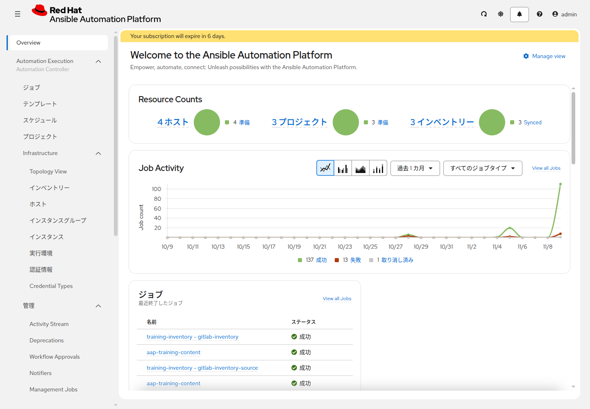

# 演習 1 - AAPへのログイン

> **前提:** [事前準備](../prepare_training_environment.md) で控えた AAP の URL とログイン情報。この演習は、すべてブラウザの AAP の画面で行います

この演習では、AAP（Ansible Automation Platform）にログインし、次の演習で使うメニューと組織名を確認します。

## Section 1: ログイン

### Step 1: ログイン画面を開く

ブラウザで、事前準備で確認したAAPのURLにアクセスします。

```
https://<AAPのURL>/
```

ログイン画面が表示されたら、配布されたユーザー名とパスワードを入力してログインしてください。

### Step 2: ログイン後の画面を確認

ログインに成功すると、**Overview** が表示されます。見出しは「Welcome to the Ansible Automation Platform」です。左側にメニューがあることを確認してください。



黄色い帯はサブスクリプション期限の通知です。手順とは関係ありません。

メニュー名とボタン名は [画面ラベル対応表](../ui-labels.md) にまとめてあります。以降の演習も、この対応表の表記で操作します。

**Note:** ログインできない場合は、URL、ユーザー名とパスワードの大文字小文字、VPN や社内ネットワークが必要かを確認してください。

## Section 2: 左メニュー

左メニューは3つのグループに分かれています。この演習で開くのは **Automation Execution** と **Access Management** です。

| グループ | この資料で使うもの |
|---|---|
| **Automation Execution** | ジョブ、テンプレート、スケジュール、プロジェクト。Infrastructure の中にインベントリー、実行環境、認証情報 |
| **Automation Decisions** | [応用演習7](../advanced/ex7.md) 以降 |
| **Access Management** | 組織。チームと API Tokens は応用演習 |

各メニューが何をするかは [AAPのしくみ](../aap_overview.md) にまとめてあります。

### Step 1: Automation Executionを開く

**Automation Execution** を開き、次があることを確認します。

* **ジョブ**
* **テンプレート**
* **スケジュール**
* **プロジェクト**
* **Infrastructure** の中の **インベントリー**、**実行環境**、**認証情報**

一覧が空とは限りません。Demo Project や Demo Job Template のようなサンプルが最初から入っている環境があります。演習ではそれらを編集せず、別名で新規作成します。

### Step 2: 組織名を控える

**Access Management > 組織** を開きます。以降の作成画面で選ぶ組織名を控えてください。1つだけの環境では `Default` であることが多いです。

作るオブジェクトは、すべていずれかの組織に属します。以降の手順で「組織を選択」と書いたときは、ここで控えた組織を選びます。

誰にどの操作を許すかは [応用演習1](../advanced/ex1.md) で扱います。この演習では確認しません。

## Section 3: 名前の接頭辞

複数人で同時に作業しても名前が重ならないように、ここで決めた文字列を、資料に書いてあるリソース名の先頭に付けます。演習が終わったら、[削除手順](../cleanup.md) で、その接頭辞が付いたものをまとめて消します。

ログイン名を小文字にし、次に合うように整えます。

* 先頭は英小文字
* 使える文字は英小文字、数字、ハイフン
* 2文字以上、13文字以内
* 末尾はハイフンにしない

決めた接頭辞は控えておきます。以降の演習に出てくる `<name_prefix>` は、この文字列に置き換えてから入力します。たとえば接頭辞が `sample01` なら、`<name_prefix>-linux-ssh` は `sample01-linux-ssh` と入力します。

この資料の画面写真とコード例では、例として `sample01` を使っています。写真やコード例に `sample01` が出てきたら、自分の接頭辞に読み替えます。接頭辞が写っていない写真もあります。その場合も、名前の前に自分の接頭辞とハイフンを付けて入力します。どの名前に接頭辞を付けるかは、各演習の入力値の表に書いてあります。

## 次

[演習2](./ex2.md) で、接続に使う認証情報を作ります。
