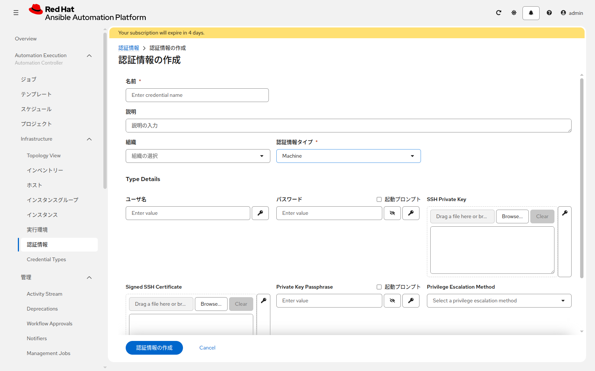
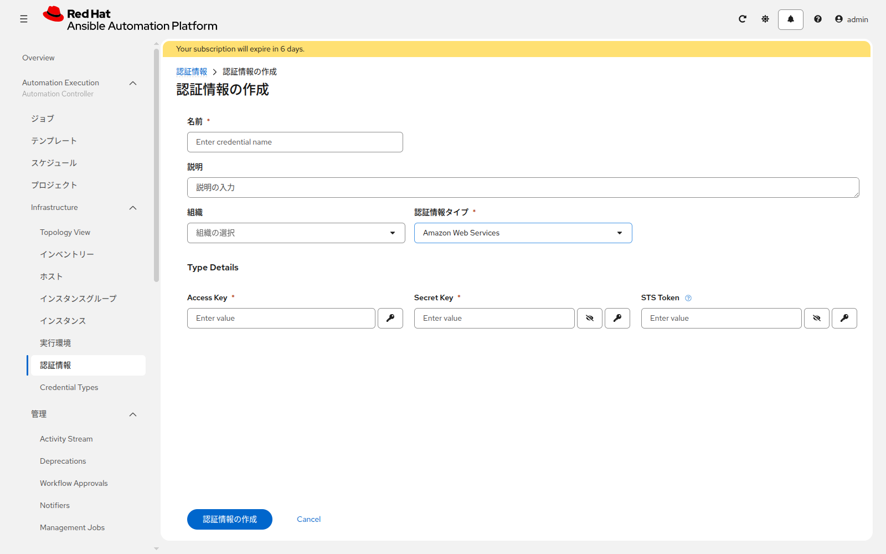

# 演習 2 - 認証情報の作成

[演習1](./ex1.md) | [次へ](./ex3.md)

> **前提:** [演習1](./ex1.md) の組織名と接頭辞

認証情報は、AAP が接続先へログインするためのユーザー名とパスワードを保存するオブジェクトです。認証情報には種類（認証情報タイプ）があり、種類ごとに入力欄が異なります。

## この演習で作るもの

| 自分の状況 | この演習で作る | あとに回すもの |
|---|---|---|
| 既存サーバを使用 | Linux 用、Windows 用、GitLab 用 | AWS 用は作らない。次は [演習3](./ex3.md)。[演習4](./ex4.md) は飛ばす |
| サーバが無く、AWS で作る | AWS 用、GitLab 用 | Linux 用と Windows 用は、演習4でパスワードを決めたあとに作る |

GitLab 用は、どちらの場合も作ります。ユーザー名とパスワードには、GitLab のログインに使うものをそのまま入れます。

## Section 1: 作成画面を開く

**Automation Execution > Infrastructure > 認証情報** を開き、**認証情報の作成** をクリックします。

組織には、[演習1](./ex1.md) で控えた組織を選びます。このあと作る認証情報も、すべて同じ組織にします。

## Section 2: Linux用（既存サーバを使用する場合）

| 項目 | 入力値 |
|---|---|
| 名前 | `<name_prefix>-linux-ssh` |
| 認証情報タイプ | `Machine` |
| ユーザ名 | Linux へ SSH するユーザー |
| パスワード | そのユーザーのパスワード |
| Privilege Escalation Method | 空欄のまま |

保存します。

## Section 3: Windows用（既存サーバを使用する場合）

もう一度 **認証情報の作成** を開き、次を入力します。認証情報タイプは同じく `Machine` です。

| Windows の状態 | ユーザ名 | パスワード |
|---|---|---|
| ドメインに参加していない | ローカルユーザー | そのパスワード |
| ドメインに参加している | `ユーザー@レルム`（例: `ops@EXAMPLE.COM`） | そのドメインユーザーのパスワード |

名前は `<name_prefix>-windows-psrp` にします。**Privilege Escalation Method** は空欄のままにします。

接続方式（PSRP）と認証方式（NTLM か Kerberos か）は、認証情報ではなく [演習3](./ex3.md) のホスト変数で指定します。

## Section 4: GitLab用（どちらの場合も）

| 項目 | 入力値 |
|---|---|
| 名前 | `<name_prefix>-gitlab-scm` |
| 認証情報タイプ | `Source Control` |
| ユーザ名 | GitLab のログインユーザー名 |
| パスワード | GitLab のログインパスワード |

> [!CAUTION]
> **研修だけの設定です。** 研修では手順を短くするため、GitLab のログインパスワードをそのまま AAP に保存します。実際の運用では、個人のパスワードを保存しません。GitLab で、リポジトリの読み取りだけを許可したトークン（Deploy token や Project access token など）を発行し、それを **パスワード** に入れます。

## Section 5: AWS用（サーバをこれから作る場合だけ）

> [!IMPORTANT]
> **既存サーバを使用する場合は、この Section を飛ばして [演習3](./ex3.md) へ進みます。**

| 項目 | 入力値 |
|---|---|
| 名前 | `<name_prefix>-aws-training` |
| 認証情報タイプ | `Amazon Web Services` |
| Access Key | 配布された Access Key |
| Secret Key | 配布された Secret Key |
| STS Token | 空欄（一時トークンを渡されているときだけ入力） |

Linux 用 `<name_prefix>-linux-ssh` と Windows 用 `<name_prefix>-windows-psrp` は、[演習4](./ex4.md) の Section 4 で作ります。ユーザー名は Linux が `ansible`、Windows が `Administrator` です。パスワードは演習4で自分で決めた値です。

## 次

既存サーバを使用する場合も、AWS で作る場合も、次は [演習3](./ex3.md) へ進みます。AWS で作る場合に演習4へ移るタイミングは、演習3の冒頭の表に書いてあります。
