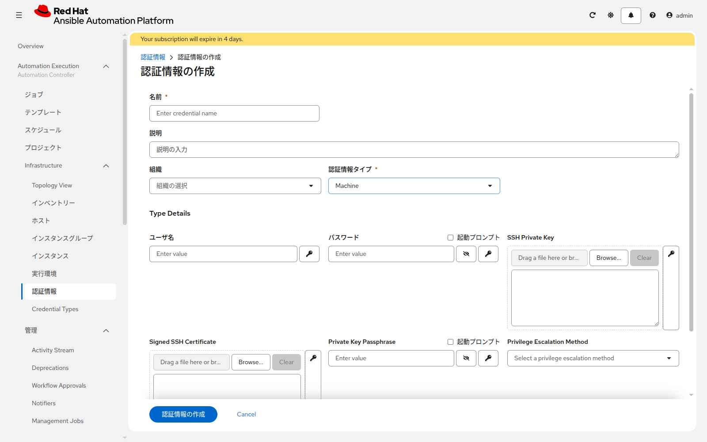
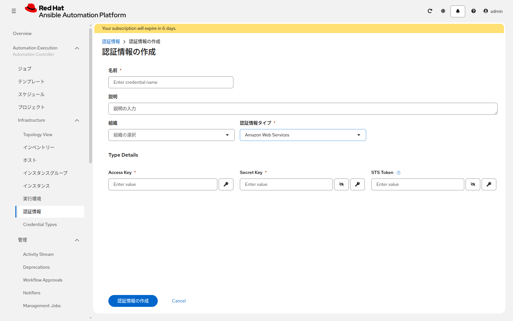

# 演習 2 - 認証情報の作成

[演習1](./ex1.md) | [次へ](./ex3.md)

認証情報は、AAP が接続先へログインするためのユーザー名とパスワードをしまうオブジェクトです。種類ごとに入力欄が違います。

## この演習で作るもの

| 自分の状況 | この演習で作る | あとに回すもの |
|---|---|---|
| サーバがすでにある | Linux 用、Windows 用、GitLab 用 | AWS 用は作らない。次は [演習3](./ex3.md)。[演習4](./ex4.md) は飛ばす |
| サーバが無く、AWS で作る | AWS 用、GitLab 用 | Linux 用と Windows 用は、演習4でパスワードを決めたあとに作る |

GitLab 用はどちらも作ります。ユーザー名とパスワードは、GitLab のログインに使うものと同じです。

## Section 1: 作成画面を開く

**Automation Execution > Infrastructure > 認証情報** を開き、**認証情報の作成** をクリックします。

組織は [演習1](./ex1.md) で控えた名前を選びます。以降も同じ組織です。

## Section 2: Linux用（サーバがすでにある場合）

| 項目 | 入力値 |
|---|---|
| 名前 | `<name_prefix>-linux-ssh` |
| 認証情報タイプ | `Machine` |
| ユーザー名 | Linux へ SSH するユーザー |
| パスワード | そのユーザーのパスワード |
| 権限昇格の方式 | 空欄のまま |

保存します。

## Section 3: Windows用（サーバがすでにある場合）

もう一度 **認証情報の作成** を開き、次を入力します。認証情報タイプは同じく `Machine` です。

| Windows の状態 | ユーザー名 | パスワード |
|---|---|---|
| ドメインに参加していない | ローカルユーザー | そのパスワード |
| ドメインに参加している | `ユーザー@レルム`（例: `ops@EXAMPLE.COM`） | そのドメインユーザーのパスワード |

名前は `<name_prefix>-windows-psrp` にします。権限昇格は空欄です。

PSRP にするか NTLM か Kerberos かは、認証情報ではなく [演習3](./ex3.md) のホスト変数で指定します。

## Section 4: GitLab用（どちらの場合も）

| 項目 | 入力値 |
|---|---|
| 名前 | `<name_prefix>-gitlab-scm` |
| 認証情報タイプ | `Source Control` |
| ユーザー名 | GitLab のログインユーザー名 |
| パスワード | GitLab のログインパスワード |

パスワードの欄には、GitLab のログインパスワードを入れます。

## Section 5: AWS用（サーバをこれから作る場合だけ）

サーバがすでにある場合は、この Section を飛ばしてください。

| 項目 | 入力値 |
|---|---|
| 名前 | `<name_prefix>-aws-training` |
| 認証情報タイプ | `Amazon Web Services` |
| アクセスキー | 配布された Access Key |
| シークレットキー | 配布された Secret Key |
| STSトークン | 空欄（一時トークンを渡されているときだけ入力） |

Linux 用 `<name_prefix>-linux-ssh` と Windows 用 `<name_prefix>-windows-psrp` は、[演習4](./ex4.md) の Section 4 で作ります。ユーザー名は Linux が `ansible`、Windows が `Administrator` です。パスワードは演習4で自分で決めた値です。

## 次

どちらも [演習3](./ex3.md) へ進みます。サーバが無い場合に演習4へ入るタイミングは、演習3の表に書いてあります。
