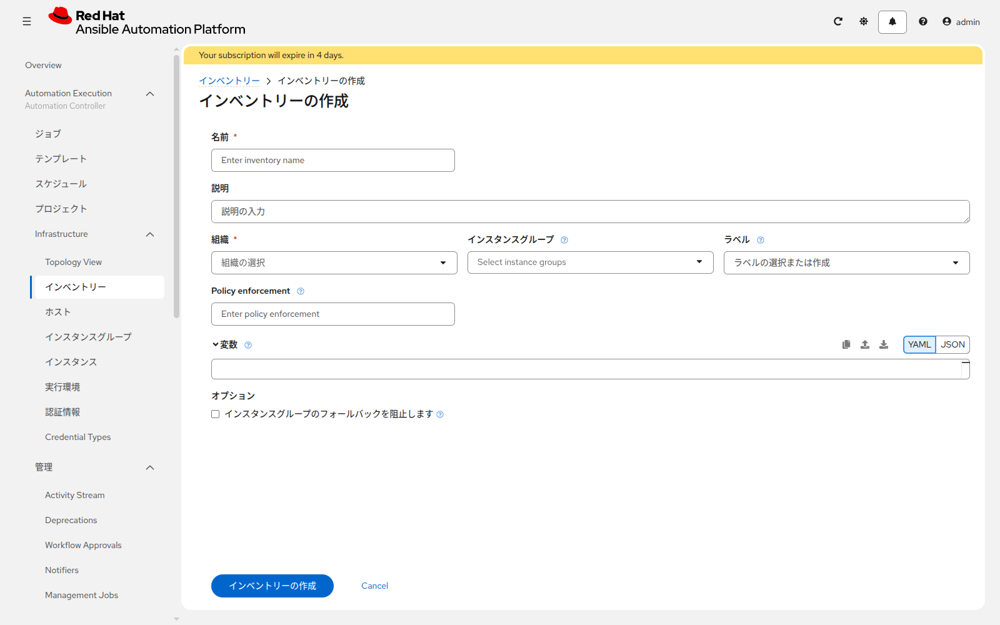
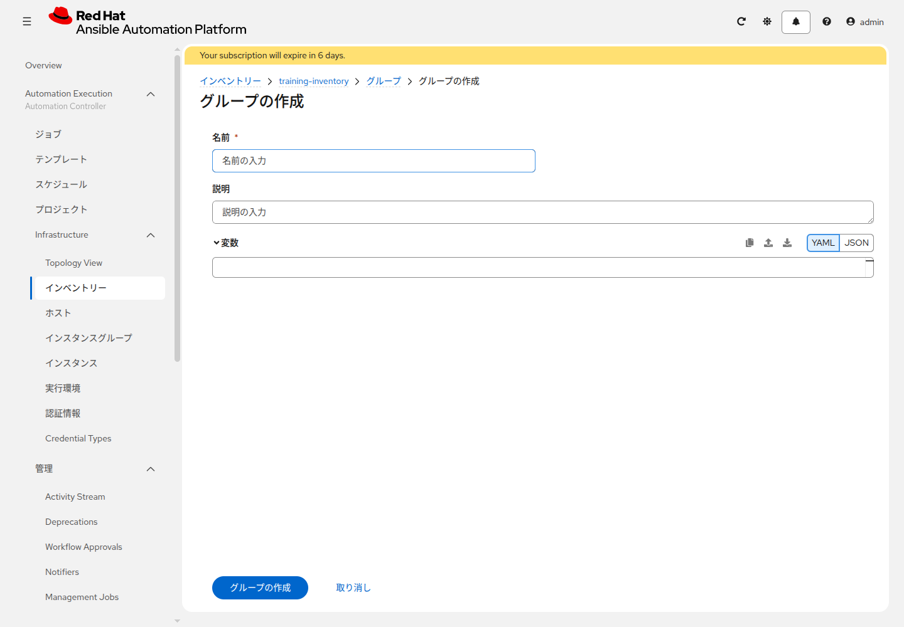
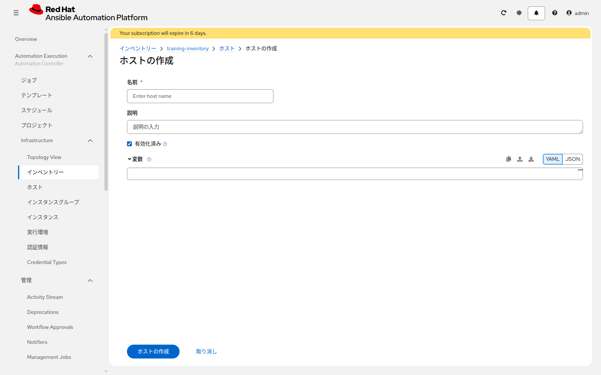
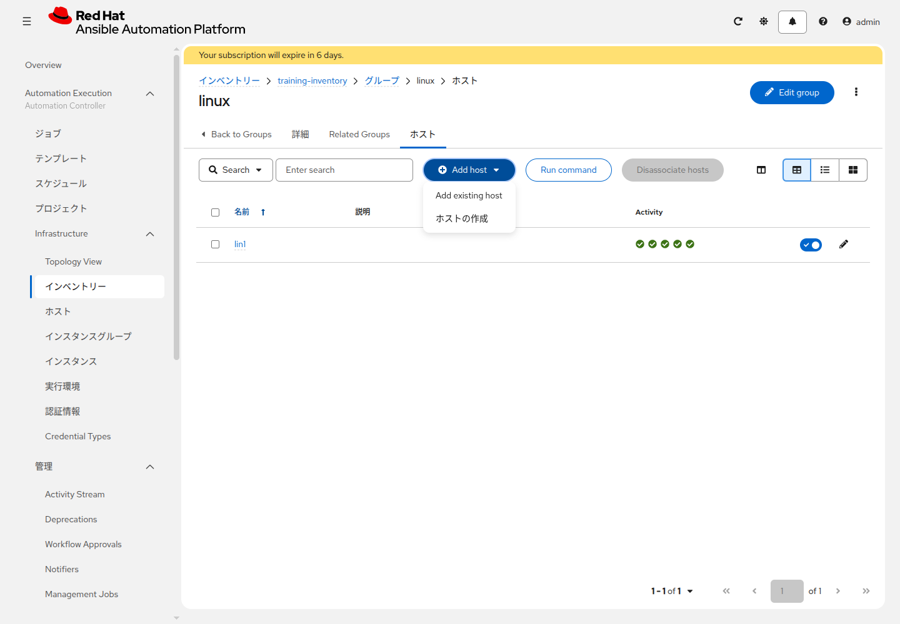
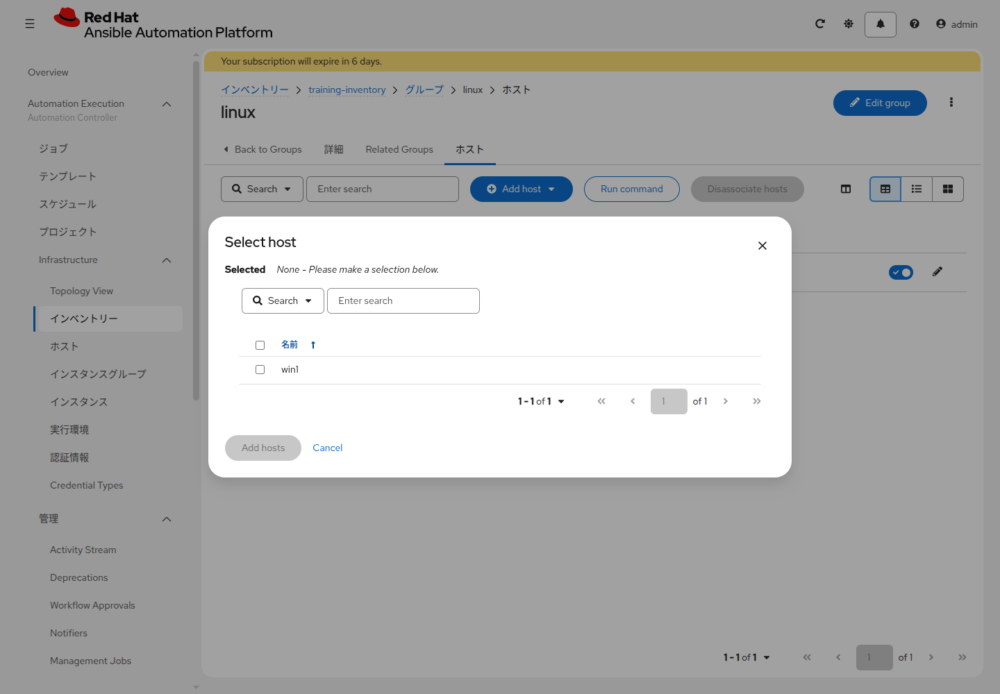
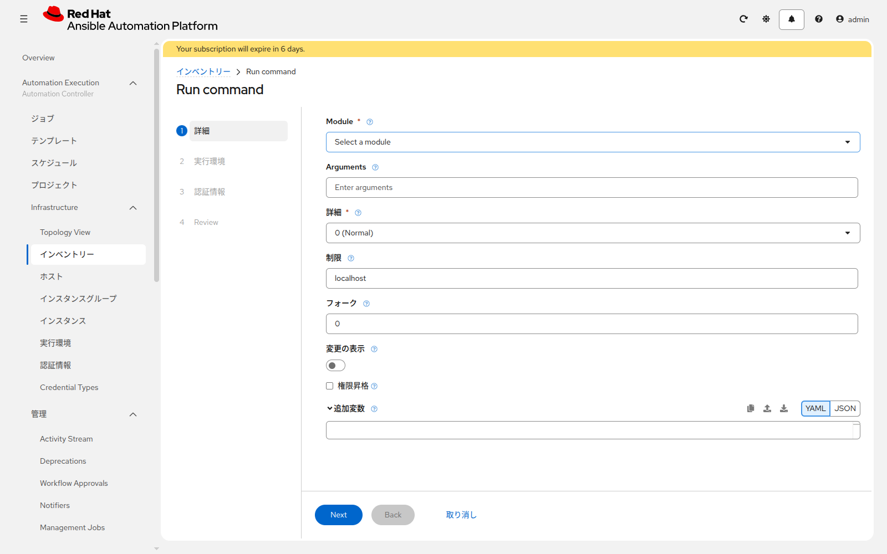

# 演習 3 - インベントリと疎通確認

[演習2](./ex2.md) | [演習4へ](./ex4.md)

AAP から Linux と Windows へ接続するための一覧を作ります。

| 自分の状況 | この演習で今やる Section | その次 |
|---|---|---|
| サーバがすでにある | 1、2、4、5。Section 3 は飛ばす | [演習4](./ex4.md) は飛ばして [演習5](../basic-controller/ex5.md) |
| サーバが無い | 1、2、3 だけ。アドレスはまだ無い | [演習4](./ex4.md)。サーバができたら、このページの Section 4 と Section 5 に戻る |

## Section 1: インベントリーを作る

**Automation Execution > Infrastructure > インベントリー** を開き、**インベントリーの作成** > **インベントリーの作成** をクリックします。



| 項目 | 入力値 |
|---|---|
| 名前 | `<name_prefix>-training-inventory` |
| 組織 | 演習1で確認した組織 |

保存します。

## Section 2: グループを作る

`<name_prefix>-training-inventory` を開き、**グループ** タブの **グループの作成** をクリックします。



名前に `linux` と入力し、変数は空のまま **グループの作成** を押します。同じ手順で `windows` も作ります。ホストはこの画面では入れません。ホストの作成画面にも、グループを選ぶ欄はありません。入れ方は Section 4 で行います。

## Section 3: AWS用の実行場所（サーバが無い場合だけ）

サーバがすでにある場合は、この Section を飛ばして Section 4 へ進みます。

[演習4](./ex4.md) の作成ジョブは、これから作るサーバの中ではなく、AAP の実行環境の中で動きます。実行環境が何かは [AAPのしくみ](../aap_overview.md) に書いてあります。そのための一覧を、ここで先に作ります。Linux と Windows は入れません。ソースも追加しません。

1. **インベントリーの作成** で、名前 `<name_prefix>-aws-runner`、組織は演習1と同じ、で保存する
2. **ホスト** タブでホストを追加する。名前は `localhost`
3. ホストの変数に次を入れる

```yaml
ansible_connection: local
```

`<name_prefix>-aws-runner` は演習4のジョブテンプレートで選びます。`<name_prefix>-training-inventory` には足しません。

ここまで終わったら、Section 4 には進まず [演習4](./ex4.md) を実施してください。演習4が終わったあと、下の Section 4 でホストを登録し、Section 5 で疎通を確認します。

## Section 4: ホストを追加する

<a id="add-hosts"></a>

サーバが無く、演習4のログにアドレスがまだ無い場合は、ここで止めます。アドレスを控えてから戻ってきてください。

**ホスト** タブでホストを追加します。



Linux:

| 項目 | 入力値 |
|---|---|
| 名前 | `lin1` |
| 変数 | 下の YAML |

```yaml
ansible_host: 203.0.113.10
```

`203.0.113.10` は例です。自分の Linux のアドレスに置き換えてから保存します。AWS で作った場合は、演習4のログの「Linuxの接続先」です。保存しただけでは `linux` には入りません。入れ方はこの Section の最後です。

Windows（ドメインに参加していない場合。AWS で作ったサーバはこちら）:

| 項目 | 入力値 |
|---|---|
| 名前 | `win1` |
| 変数 | 下の YAML |

```yaml
ansible_host: 203.0.113.11
ansible_connection: psrp
ansible_psrp_auth: ntlm
ansible_psrp_protocol: http
ansible_psrp_port: 5985
ansible_psrp_cert_validation: ignore
```

アドレスを自分の値に置き換えて保存します。認証は NTLM です。接続プラグインは `psrp` にします。AWS で作った場合のアドレスは、ログの「Windowsの接続先」です。ドメインに参加している Windows は、この NTLM の変数ではなく、下の Kerberos の変数で保存します。

### ホストをグループに入れる

1. **グループ** タブで、入れる先のグループを開く
2. **ホスト** タブの **Add host** を開く
3. **Add existing host** を選ぶ
4. 入れるホストにチェックを入れ、**Add hosts** をクリックする





`lin1` はグループ `linux`、`win1` はグループ `windows` に入れます。写真の Select host に出ているのは、そのグループにまだ入っていないホストです。`linux` を開いたときに `win1` が見えても、チェックするのは `lin1` だけです。

### ドメインに参加している Windows の場合

上の変数の代わりに、次を使います。認証は Kerberos です。ユーザー名は演習2の `<name_prefix>-windows-psrp` に入れた `ユーザー@レルム` です。AWS で作った Windows は、この節ではなく NTLM の変数を使います。

```yaml
ansible_host: 203.0.113.11
ansible_connection: psrp
ansible_psrp_auth: kerberos
ansible_psrp_protocol: https
ansible_psrp_port: 5986
ansible_psrp_cert_validation: ignore
```

この変数で保存します。`win1` をグループ `windows` に入れる手順は、上の「ホストをグループに入れる」と同じです。NTLM の変数で保存済みの場合は、ホストを開いて変数を置き換えてからグループへ入れます。

演習5で置く `inventory.yml` のサンプルは NTLM です。Kerberos のときは、`ansible_psrp_auth`、`ansible_psrp_protocol`、`ansible_psrp_port` の3つを、ここで保存した `kerberos`、`https`、`5986` に置き換えます。

## Section 5: 疎通確認

ジョブテンプレートに認証情報を付けるのは [演習7](../basic-controller/ex7.md) です。この演習の疎通確認では、実行時に認証情報を選びます。

`<name_prefix>-training-inventory` の **ホスト** タブを開き、`lin1` にチェックを入れます。**Run command** をクリックします。



| 項目 | Linux | Windows |
|---|---|---|
| モジュール | `ping` | `win_ping` |
| 認証情報 | `<name_prefix>-linux-ssh` | `<name_prefix>-windows-psrp` |

起動し、`SUCCESS` と表示されることを確認します。Windows は、`lin1` のチェックを外し、`win1` だけを選んでから実行します。1つの実行に付けられる Machine 認証情報は1つなので、Linux と Windows は別々に確認します。NTLM でも Kerberos でも、ここで `win_ping` を実行します。

`ping` が `SUCCESS` なら、SSH のユーザー名とパスワード、アドレスが合っています。`win_ping` が `SUCCESS` なら、PSRP の認証とポートが合っています。

失敗したときの確認箇所:

* `ansible_host` が、控えたアドレスと一致しているか
* 認証情報のユーザー名とパスワード
* Windows の `ansible_psrp_auth` が、参加状況（NTLM か Kerberos か）と一致しているか
* ファイアウォールが、AAP から TCP 22（Linux）または 5985（NTLM）または 5986（Kerberos）を許可しているか

## 次

Section 5 まで終わったら、[演習5](../basic-controller/ex5.md) へ進みます。サーバが無い人で Section 3 で止まっている場合は、先に [演習4](./ex4.md) です。
