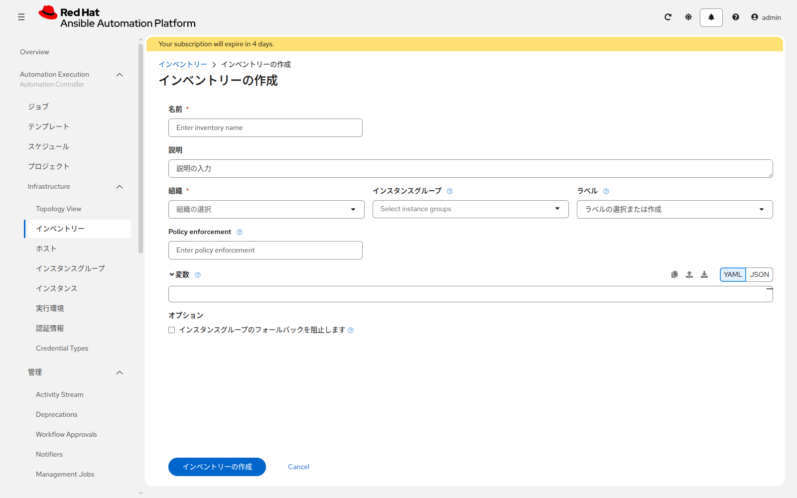
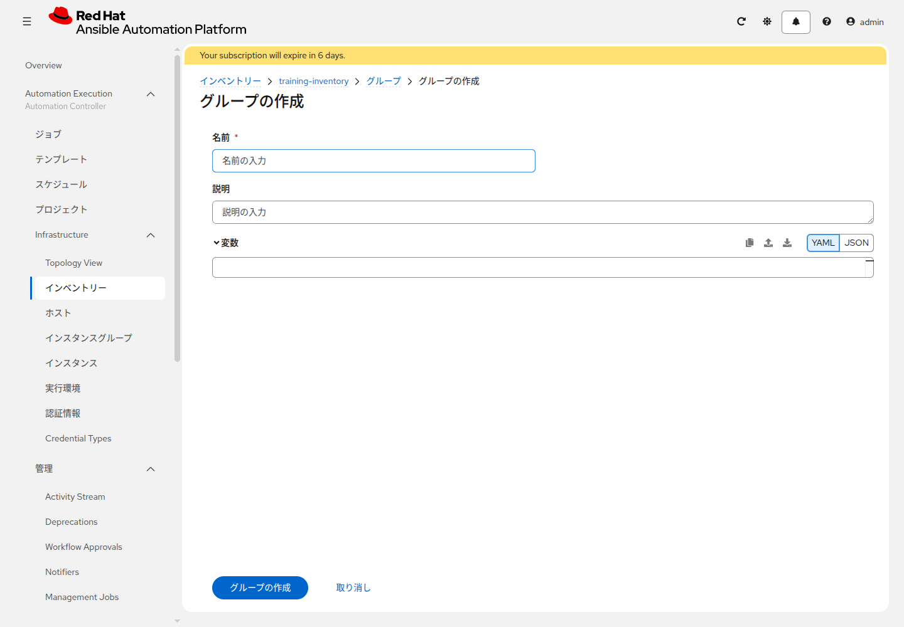
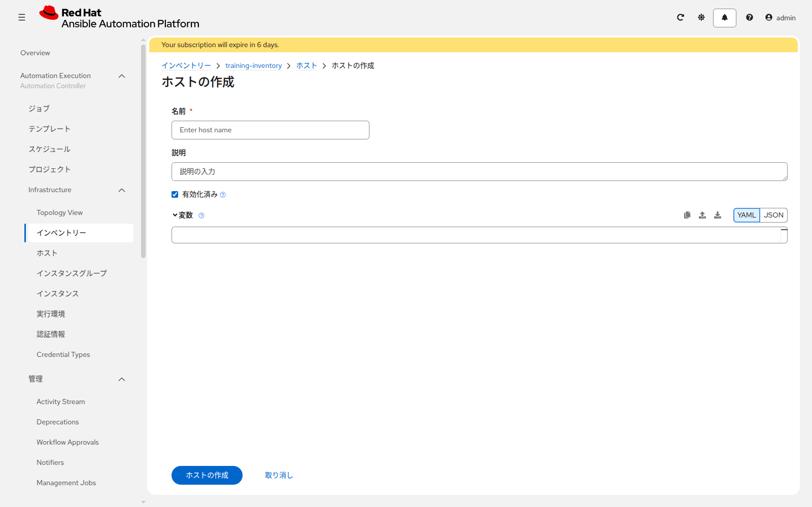
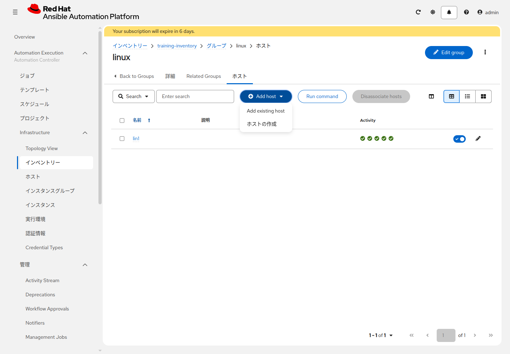
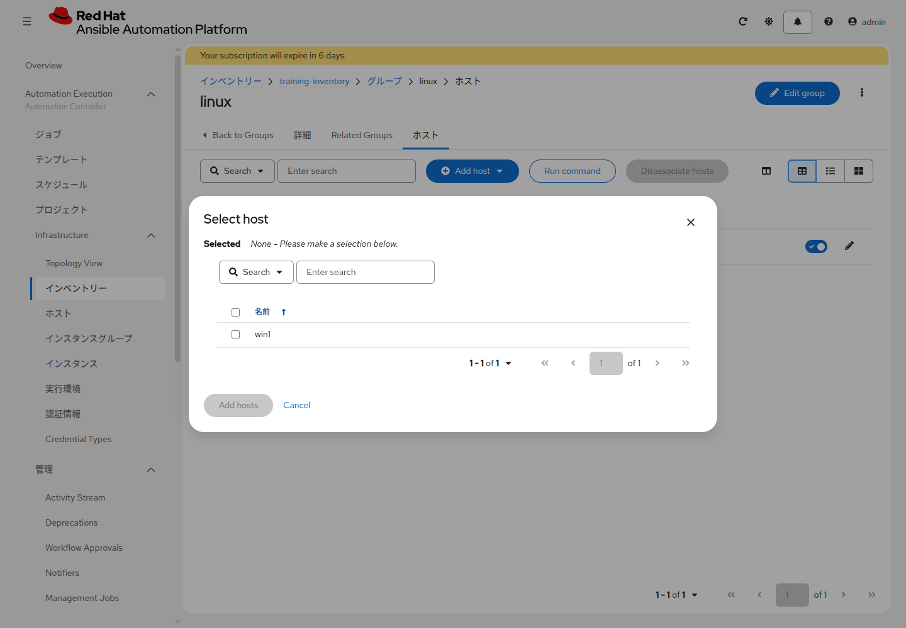
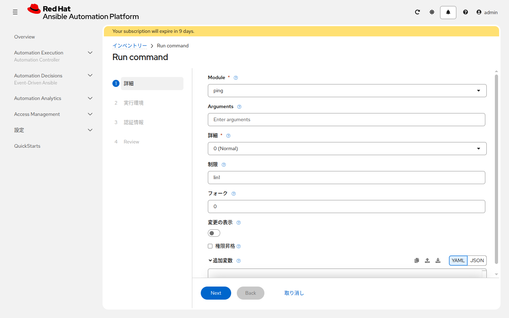

# 演習 3 - インベントリーと疎通確認

[演習2](./ex2.md) | [演習4へ](./ex4.md)

> **前提:** [演習1](./ex1.md) の接頭辞。Section 5 は [演習2](./ex2.md) の認証情報

この演習では、AAP の接続先となる Linux と Windows の一覧（インベントリー）を作り、AAP から接続できることを確かめます。

| 自分の状況 | この演習で今やる Section | その次 |
|---|---|---|
| 既存サーバを使用 | 1、2、4、5。Section 3 は飛ばす | [演習4](./ex4.md) は飛ばして [演習5](../basic-controller/ex5.md) |
| サーバが無い | 1、2、3 だけ。アドレスはまだ無い | [演習4](./ex4.md)。サーバができたら、このページの Section 4 と Section 5 に戻る |

## Section 1: インベントリーを作る

**Automation Execution > Infrastructure > インベントリー** を開き、**インベントリーの作成** > **インベントリーの作成** をクリックします。



| 項目 | 入力値 |
|---|---|
| 名前 | `<name_prefix>-training-inventory` |
| 組織 | 演習1で確認した組織 |

保存します。

## Section 2: グループを作る

`<name_prefix>-training-inventory` を開き、**グループ** タブの **グループの作成** をクリックします。



名前に `linux` と入力し、変数は空のまま **グループの作成** を押します。同じ手順で `windows` も作ります。グループにホストを入れる操作は、ホストを作ったあとの Section 4 で行います（ホストの作成画面には、グループを選ぶ欄がありません）。

## Section 3: AWS用の実行場所（サーバが無い場合だけ）

> [!IMPORTANT]
> **既存サーバを使用する場合は、この Section を飛ばして [Section 4](#add-hosts) へ進みます。**

[演習4](./ex4.md) でサーバを作るジョブは、これから作るサーバの中ではなく、AAP の実行環境の中で動きます（実行環境については [AAPのしくみ](../aap_overview.md) を参照）。そのジョブで使うインベントリーを、ここで先に作ります。登録するホストは `localhost` の1つだけです。

1. **インベントリーの作成** で、名前 `<name_prefix>-aws-runner`、組織は演習1と同じ、で保存する
2. **ホスト** タブの **ホストの作成** で、名前 `localhost` のホストを作る
3. ホストの変数に次を入れる

```yaml
ansible_connection: local
```

`<name_prefix>-aws-runner` は、演習4のジョブテンプレートで選びます。この `localhost` は `<name_prefix>-training-inventory` には足しません。

> [!IMPORTANT]
> **AWS でサーバを作る場合は、ここで Section 4 には進まず、[演習4](./ex4.md) へ進みます。** 演習4でサーバができたら、このページの Section 4 に戻ってホストを登録し、Section 5 で疎通を確認します。

## Section 4: ホストを作る

<a id="add-hosts"></a>

> [!IMPORTANT]
> **AWS でサーバを作る場合、[演習4](./ex4.md) がまだ終わっていなければ、ここから先には進みません。** 演習4でサーバのアドレスを控えてから戻ってきます。

**ホスト** タブの **ホストの作成** を押します。



Linux:

| 項目 | 入力値 |
|---|---|
| 名前 | `lin1` |
| 変数 | 下の YAML |

```yaml
ansible_host: 203.0.113.10
```

`203.0.113.10` は例なので、自分の Linux のアドレスに置き換えてから保存します。AWS で作った場合は、演習4のログに出た「Linuxの接続先」のアドレスを使います。保存しただけでは、`lin1` はグループ `linux` に入りません。グループへの入れ方は、下の「ホストをグループに入れる」で説明します。

Windows（ドメインに参加していない場合。AWS で作ったサーバはこちら）:

| 項目 | 入力値 |
|---|---|
| 名前 | `win1` |
| 変数 | 下の YAML |

```yaml
ansible_host: 203.0.113.11
ansible_connection: psrp
ansible_psrp_auth: ntlm
ansible_psrp_protocol: http
ansible_psrp_port: 5985
ansible_psrp_cert_validation: ignore
```

この変数では、接続プラグインに `psrp`、認証に NTLM を指定しています。アドレスは自分の値に置き換えてから保存します。AWS で作った場合は、演習4のログに出た「Windowsの接続先」のアドレスを使います。ドメインに参加している Windows は、この NTLM の変数ではなく、下の Kerberos の変数で保存します。

### ホストをグループに入れる

1. **グループ** タブで、入れる先のグループを開く
2. **ホスト** タブの **Add host** を開く
3. **Add existing host** を選ぶ
4. 入れるホストにチェックを入れ、**Add hosts** をクリックする





`lin1` はグループ `linux`、`win1` はグループ `windows` に入れます。写真の Select host に出ているのは、そのグループにまだ入っていないホストです。`linux` を開いたときに `win1` が見えても、チェックするのは `lin1` だけです。

### ドメインに参加している Windows の場合

上の NTLM の変数の代わりに、次の Kerberos の変数を使います。ログインには、演習2で `<name_prefix>-windows-psrp` に入れた `ユーザー@レルム` のユーザー名を使います。AWS で作った Windows は、この節ではなく NTLM の変数を使います。

```yaml
ansible_host: win1.example.com
ansible_connection: psrp
ansible_psrp_auth: kerberos
ansible_psrp_protocol: https
ansible_psrp_port: 5986
ansible_psrp_cert_validation: ignore
```

`win1.example.com` は例です。Kerberos は IP アドレスでは認証できないので、`ansible_host` には、事前準備で控えた、その Windows のドメイン上のホスト名（FQDN）を指定します。

<a id="caution-psrp-cert"></a>

> [!CAUTION]
> **研修だけの設定です。** NTLM と Kerberos のどちらの変数にも `ansible_psrp_cert_validation: ignore` があります。これは Windows の証明書を検証しない指定で、HTTPS（Kerberos の 5986）で接続するときに、なりすました相手へ接続しても気づけません。研修では、自己署名の証明書の Windows にも接続できるよう、検証を外しています。実際の運用では、Windows に信頼できる CA の証明書を入れ、この行を外して検証します。

この変数で保存します。`win1` をグループ `windows` に入れる手順は、上の「ホストをグループに入れる」と同じです。NTLM の変数で保存済みの場合は、ホストを開いて変数を置き換えてからグループへ入れます。

演習5で置く `inventory.yml` のサンプルは NTLM です。Kerberos のときは、`ansible_host` をここで保存した FQDN にし、`ansible_psrp_auth`、`ansible_psrp_protocol`、`ansible_psrp_port` の3つを `kerberos`、`https`、`5986` に置き換えます。

## Section 5: 疎通確認

<a id="adhoc"></a>

ジョブテンプレートに認証情報を付ける方法は [演習7](../basic-controller/ex7.md) で扱います。この演習では、アドホック実行（**Run command**）で疎通を確認し、実行するときに認証情報を選びます。

`<name_prefix>-training-inventory` の **ホスト** タブを開き、`lin1` にチェックを入れて、**Run command** をクリックします。画面の左に **詳細**、**実行環境**、**認証情報**、**Review** の4つの段階が表示されます。



1. **詳細** で、**Module** を選びます。Linux は `ping`、Windows は `win_ping` です。**制限** には、チェックを入れたホスト名が入っています。ほかの欄はそのままにして **Next** を押します
2. **実行環境** は空欄のまま **Next** を押します。空欄のときは既定の実行環境で動きます
3. **認証情報** で **認証情報の選択** を開き、Linux は `<name_prefix>-linux-ssh`、Windows は `<name_prefix>-windows-psrp` を選んで **Next** を押します
4. **Review** で、Module、制限、認証情報を確かめて **Finish** を押します

ジョブの出力に `lin1 | SUCCESS` と出ることを確認します。1回の実行に付けられる Machine 認証情報は1つだけなので、Linux と Windows は別々に確認します。Windows は、`lin1` のチェックを外して `win1` だけを選び、同じ手順で実行します。Module は、NTLM でも Kerberos でも `win_ping` を使います。

`ping` が `SUCCESS` なら、SSH のユーザー名とパスワード、アドレスが合っています。`win_ping` が `SUCCESS` なら、PSRP の認証とポートが合っています。

失敗したときは、次の点を確認します。

* `ansible_host` が、控えたアドレスと一致しているか。Kerberos のときは IP アドレスではなく FQDN か
* 認証情報のユーザー名とパスワード
* Windows の `ansible_psrp_auth` が、参加状況（NTLM か Kerberos か）と一致しているか
* ファイアウォールが、AAP から TCP 22（Linux）または 5985（NTLM）または 5986（Kerberos）を許可しているか

## 次

| 今の状況 | 次に進む先 |
|---|---|
| Section 5 の疎通確認まで終わった（既存サーバを使用、または演習4のあとに戻ってきた） | [演習5](../basic-controller/ex5.md) |
| AWS でサーバを作る場合で、Section 3 まで終わった | [演習4](./ex4.md) |
