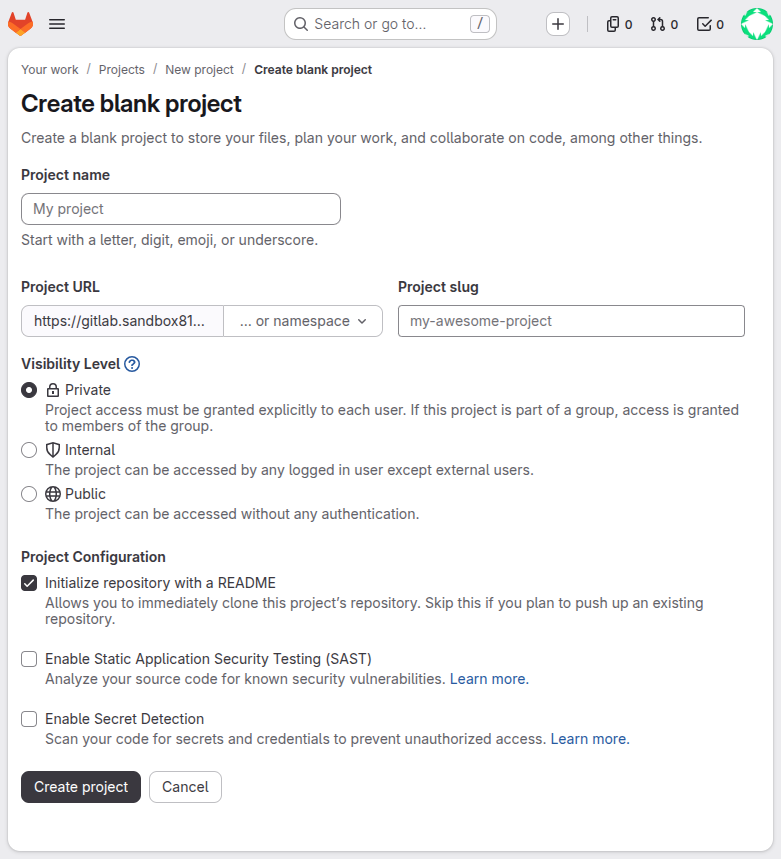
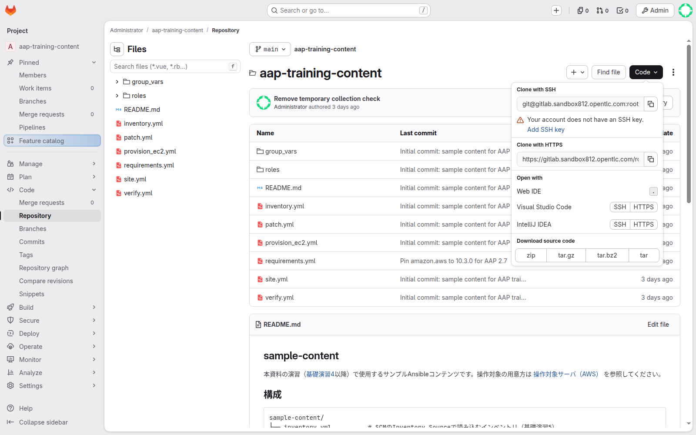
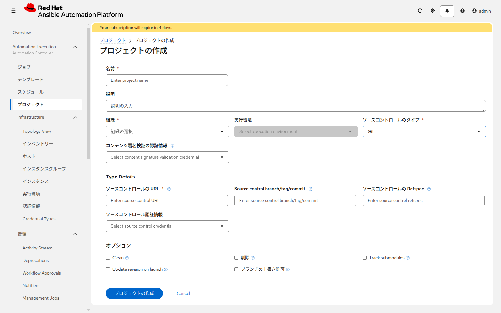
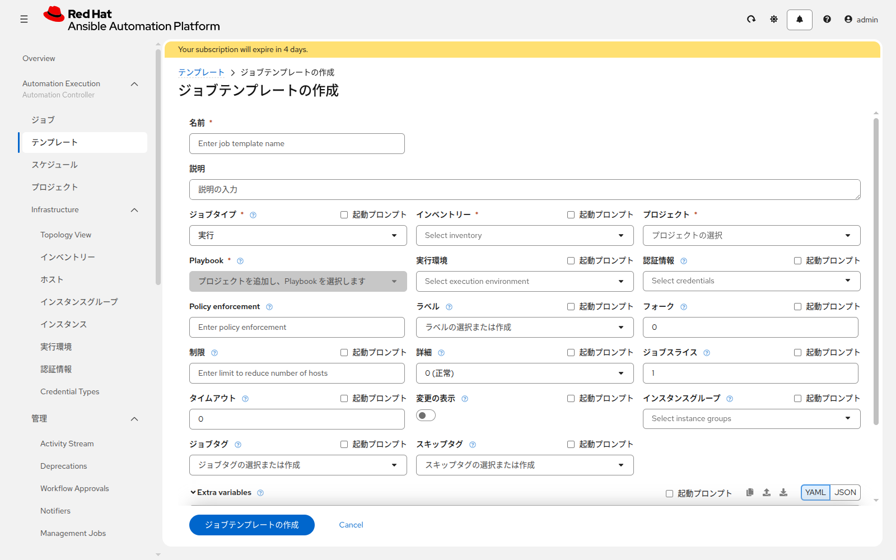

# 演習 4 - AWSでサーバを作る

[演習3](./ex3.md) | [ホスト登録へ戻る](./ex3.md#add-hosts)

対象の Linux と Windows がすでにある場合は、この演習を全部飛ばして [演習5](../basic-controller/ex5.md) へ進んでください。

この演習は、空の AWS アカウントに次を作ります。

* VPC、サブネット、インターネットゲートウェイ、ルートテーブル、セキュリティグループ
* Linux 1台（SSH、ユーザー `ansible`）
* Windows 1台（PSRP、NTLM、ユーザー `Administrator`）

名前には、自分専用の `resource_prefix` を付けます。同じアカウントを複数人で使うときに、リソースが混ざらないようにするためです。作ったサーバのアドレスはログに出るので控えます。

ジョブは15分ほどかかることがあります。Windows の PSRP の待ち受けが開くまで待つためです。

パスワードはジョブのログに出ます。研修用の英数字にして、本番で使っているパスワードは入れないでください。

開始前に、[演習3](./ex3.md) の Section 3 まで終わっていることを確認します。ジョブテンプレートのインベントリー欄では、そこで作った `aws-runner` を選びます。この演習でインベントリーは作りません。

## Section 1: PlaybookをGitLabに置く

ここでは、サーバ作成に必要なファイルだけ先に置きます。残りのファイルは [演習5](../basic-controller/ex5.md) で同じ画面に足します。

1. GitLab で **Create new…** > **New project/repository** > **Create blank project** を開く
2. Project name は `aap-training-content`、Visibility は `Private`。README の初期化は付けたままにする



3. 右上の **Code** を開き、**Web IDE** をクリックする。メニュー名が **Edit** の環境では、その中の **Web IDE** を選ぶ



4. 次の4ファイルを作り、[sample-content/](../sample-content/) の内容を貼り付ける
   * `create_aws_servers.yml`
   * `remove_aws_servers.yml`
   * `requirements.yml`
   * `group_vars/all.yml`
5. **Source Control** から **Commit to main** をクリックする

`requirements.yml` は、ジョブが使う `amazon.aws` の版を 10.3.0 に固定するファイルです。AWS で作る場合だけ置きます。置かないとジョブが失敗します。

<details>
<summary>git CLIで行う場合</summary>

```bash
git clone https://gitlab.example.local/<namespace>/aap-training-content.git
cd aap-training-content
# 上の4ファイルだけをコピーする
git add create_aws_servers.yml remove_aws_servers.yml requirements.yml group_vars/all.yml
git commit -m "Add AWS server creation playbooks"
git push
```

</details>

## Section 2: AAPにプロジェクトを登録する

**Automation Execution > プロジェクト** を開き、**プロジェクトの作成** をクリックします。



| 項目 | 入力値 |
|---|---|
| 名前 | `aap-training-content` |
| ソースコントロールタイプ | Git |
| ソースコントロールURL | Section 1 の HTTPS の URL |
| ソースコントロールブランチ | `main` |
| ソースコントロール認証情報 | `gitlab-scm` |
| 起動時のリビジョン更新 | 有効 |
| クリーン | 有効 |

保存したあと、同期を実行し、成功することを確認します。失敗したら URL、ユーザー名、パスワード、ブランチ名を見直してください。

## Section 3: ジョブテンプレートを作って実行する

**Automation Execution > テンプレート** を開き、**テンプレートの作成** > **ジョブテンプレートの作成** をクリックします。



| 項目 | 入力値 |
|---|---|
| 名前 | `create-aws-servers` |
| インベントリー | `aws-runner` |
| プロジェクト | `aap-training-content` |
| Playbook | `create_aws_servers.yml` |
| 実行環境 | 空欄（既定のまま） |
| 認証情報 | `aws-training` だけ。Machine は付けない |
| Extra variables | 下の YAML |

```yaml
resource_prefix: tanaka01
linux_login_password: TrainingLinux1
windows_login_password: TrainingWindows1
```

`tanaka01` は例です。小文字で始め、英小文字・数字・ハイフンだけにし、13文字以内、末尾はハイフンにしないでください。同じアカウントの他の人と重ならない値にします。パスワードは英数字の8文字以上32文字以内で、自分の値に変えます。

リージョンは `group_vars/all.yml` の `ap-northeast-1` のままにします。この演習では変えません。Extra variables に入れるのは、上の3行だけです。

**テンプレートの起動** をクリックします。成功すると、最後のタスクに次のような行が出ます。

```
Linuxの接続先: 203.0.113.10
Windowsの接続先: 203.0.113.11
Linuxのユーザー: ansible
Windowsのユーザー: Administrator
```

表示された2つのアドレス、ユーザー名、自分で決めた2つのパスワードを控えてください。

失敗したときは、失敗したタスクの `msg` を見ます。よくある原因は、`resource_prefix` の文字種、パスワードに記号が入っていること、AWS のキーに EC2 の作成権限が無いことです。

## Section 4: ログイン用の認証情報を作る

[演習2](./ex2.md) と同じ作成画面で、Machine 認証情報を2つ作ります。

| 名前 | ユーザー名 | パスワード |
|---|---|---|
| `linux-ssh` | `ansible` | `linux_login_password` に入れた値 |
| `windows-psrp` | `Administrator` | `windows_login_password` に入れた値 |

権限昇格は空欄です。

## Section 5: 不要になったら削除する

リソースを残すと課金が続きます。学習が終わったら、同じ要領でジョブテンプレート `remove-aws-servers` を作り、Playbook を `remove_aws_servers.yml` にして実行します。Extra variables の `resource_prefix` は作成時と同じ値にします。パスワードは不要です。認証情報は `aws-training`、インベントリー欄は `aws-runner` です。

## 次

[演習3の Section 4](./ex3.md#add-hosts) に戻り、控えたアドレスを `lin1` と `win1` として登録し、疎通まで確認します。そのあと [演習5](../basic-controller/ex5.md) です。
